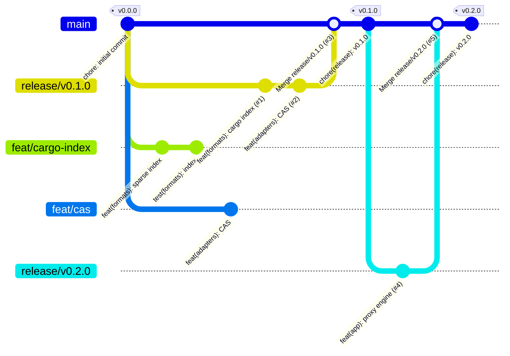

# Git flow проекта

Как устроены ветки, версии, теги и выпуск релизов. Краткая версия для агентов — раздел «Git flow» в [AGENTS.md](AGENTS.md); план версий — [ROADMAP.md](ROADMAP.md); автоматизация — раздел 16.7 документации.

## Принципы

- `main` — production. Прямые коммиты в `main` и `release/*` запрещены, всё идёт через PR.
- Релиз готовится в ветке `release/vX.Y.Z`; имя ветки определяет версию и тег.
- Версию выбирает человек при создании релизной ветки. Бамп версий, CHANGELOG и тег ставит автоматика после слияния в `main`.
- Один релиз — один набор Conventional Commits: из них собирается CHANGELOG.

## Схема

*Рис. G.1. Ветки и релизы. Squash-слияние feature-ветки показано одним коммитом в релизной ветке; feature-ветки после слияния удаляются.*

## Ветки

| Ветка | Создаётся от | Имя | Слияние | Время жизни |
| --- | --- | --- | --- | --- |
| `main` | — | `main` | PR из `release/*`, merge commit | постоянная, защищённая |
| `release/vX.Y.Z` | `main` | `release/v` + версия SemVer без суффиксов (проверяет CI, задача `branch-flow`) | PR в `main`, merge commit | до релиза, затем удаляется |
| feature | `main` | `<тип>/<кратко-через-дефис>`, тип из Conventional Commits: `feat/cargo-index`, `fix/stryker-plugin`, `docs/gitflow` | PR в `release/vX.Y.Z`, squash | до слияния, затем удаляется |

- Одновременно открыта одна релизная ветка. Новую создают от `main` после слияния предыдущей. Пока предыдущий релиз стабилизируется, работу над следующим ведут в feature-ветках на базе текущей релизной ветки и открывают PR в новую ветку, когда она создана.
- Feature-ветки можно и иногда нужно перебазировать на релизную (`git rebase origin/release/vX.Y.Z`, пуш только `--force-with-lease`, после ребейза повторить `task gate`). `main` и `release/*` не перебазируются и не форсятся. Релизные ветки в feature-ветки не мержатся.
- Каждая feature-ветка живёт в своём worktree; после слияния PR worktree и ветка удаляются (`task worktrees:prune`). Подробности — [AGENTS.md](AGENTS.md).

## Версионирование

Формат: [SemVer 2.0.0](https://semver.org/lang/ru/) `MAJOR.MINOR.PATCH`, без пререлизных суффиксов и build-метаданных. Тег — та же версия с префиксом `v`.

| Диапазон | Правило |
| --- | --- |
| `0.0.0` | Исходный коммит; единственный тег, поставленный вручную |
| `0.MINOR.0` | Каждая веха дорожной карты до релиза 1.0 (`v0.1.0` … `v0.6.0`). Несовместимые изменения допустимы и помечаются `!` в заголовке коммита или `BREAKING CHANGE:` в теле |
| `1.0.0` | Релиз объёма P0 + P1 ([ROADMAP.md](ROADMAP.md)) |
| `MAJOR+1.0.0` | Есть хотя бы один breaking change (API, схема данных, протокол, конфигурация, CLI) |
| `MAJOR.MINOR+1.0` | Есть `feat`, breaking changes нет |
| `MAJOR.MINOR.PATCH+1` | Только `fix`, `perf` и служебные изменения |

Версия хранится в четырёх местах и меняется только скриптом `tools/bump-version.ts` (вызывает workflow `release`; вручную — `task bump TAG=vX.Y.Z`): `[workspace.package]` в `Cargo.toml`, `package.json` в корне, `web/package.json`, `Chart.yaml` (когда появится `deploy/helm`). `Cargo.lock` обновляется командой `cargo update --workspace`.

## Теги

| Правило | Подробности |
| --- | --- |
| Формат | Ровно `vMAJOR.MINOR.PATCH` (`v0.1.0`, `v1.2.3`). Workflow `publish` срабатывает только на этот шаблон; пререлизные теги (`-rc.1`) не поддерживаются |
| Соответствие ветке | Тег равен имени релизной ветки без `release/`: `release/v0.2.0` → `v0.2.0`. Существующий тег останавливает workflow `release` с ошибкой |
| Кто ставит | Только workflow `release` от имени GitHub App `crane-release`. Вручную тег ставят лишь в исключительном случае (раздел «Если автоматика недоступна») |
| На какой коммит | На коммит `chore(release): vX.Y.Z` в `main`, созданный сразу после слияния релизной ветки |
| Тип | Аннотированный (`git tag -a`) |
| Неизменяемость | Опубликованный тег не переносится и не удаляется. Ошибку в релизе исправляют новым патч-релизом. Исключение: `v0.0.0` до первого релиза мог быть перевыпущен |
| Что запускает | Push тега запускает workflow `publish`: создаёт GitHub Release с заметками из CHANGELOG (`git-cliff --latest`). Образы в ghcr пока не собираются |

## Коммиты и CHANGELOG

Заголовок — [Conventional Commits](https://www.conventionalcommits.org/ru/v1.0.0/), до 100 символов, `scope` в kebab-case; хук `commit-msg` и CI проверяют это через commitlint. Подпись DCO (`git commit -s`) обязательна по `CONTRIBUTING.md`. Атрибуция ИИ-агентов в сообщениях запрещена и тоже проверяется.

| Тип | Раздел CHANGELOG | Влияние на версию |
| --- | --- | --- |
| `feat` | Возможности | MINOR |
| `fix` | Исправления | PATCH |
| `perf` | Производительность | PATCH |
| `refactor` | Рефакторинг | — |
| `docs` | Документация | — |
| `test`, `build`, `ci`, `style`, `chore`, `revert` | Служебное | — |
| любой тип с `!` или `BREAKING CHANGE:` | помечается `[BREAKING]` | MAJOR (в `0.x` — MINOR) |

- Окно сборки CHANGELOG — между тегами: от предыдущего тега `v*` до нового. `CHANGELOG.md` пересобирается целиком `git-cliff` в коммите релиза.
- Коммиты слияния и `chore(release)` в CHANGELOG не попадают. Для PR в релизную ветку сообщением коммита становится заголовок PR (squash): именно он попадёт в CHANGELOG.

## Pull request

| | Feature → release | Release → main |
| --- | --- | --- |
| База | `release/vX.Y.Z` | `main` |
| Источник | feature-ветка | `release/vX.Y.Z` |
| Слияние | squash | merge commit (история нужна для CHANGELOG) |
| Заголовок | Conventional Commit | `chore(release): vX.Y.Z` |
| В описании | таблица ручных мутантов (мутация → тест, который её поймал) | вывод `task gate` (`Gate: passed`, `Gate-SHA` — коммит из истории PR) |
| Проверки CI | `branch-flow`, `title`, `structure`, `rust`, `web` | `branch-flow`, `title`, `gate-mark`, `structure`, `rust`, `web` |
| Одобрение | сопровождающий; для доступа, токенов, криптографии, протоколов и аудита — двое, один из них отвечает за безопасность | владелец проекта |

PR в `release/*` проходит `task check`, тесты затронутой части (`task rust:test:pg`, `task e2e`) и ручные мутанты ревью. Полный мутационный гейт (`task gate`) запускается локально один раз на веху — перед PR `release/vX.Y.Z` → `main`, по всему дифу релиза относительно `main`; в CI не гоняется. Найденные им пробелы закрываются PR в ту же релизную ветку, затем гейт повторяется и `Gate-SHA` обновляется.

## Как выпускается версия

1. Владелец выбирает версию по таблице выше и создаёт `release/vX.Y.Z` от `main`.
2. Feature-ветки (от `main`, при необходимости перебазированные на релизную) сливаются в неё squash-ом через PR с зелёными проверками и таблицей ручных мутантов.
3. Когда объём вехи готов, на релизной ветке запускается полный `task gate`; когда он и CI зелёные, открывается PR `release/vX.Y.Z` → `main` с заголовком `chore(release): vX.Y.Z`. Владелец одобряет и сливает его merge commit.
4. Workflow `release` запускается на слиянии: проверяет, что тега ещё нет, запускает `tools/bump-version.ts`, `cargo update --workspace`, `git-cliff --tag vX.Y.Z`, делает коммит `chore(release): vX.Y.Z`, ставит аннотированный тег и пушит их в `main`.
5. Тег запускает workflow `publish`: GitHub Release с заметками из CHANGELOG.
6. Релизная и feature-ветки удаляются (GitHub удаляет ветку при слиянии), worktree очищаются.

### Hotfix

Исправление production делается как обычный релиз с увеличенным PATCH: `release/vX.Y.(Z+1)` от `main`, fix-ветка, PR в неё, затем в `main`. Откат версий тегами не делается.

### Если автоматика недоступна

Бамп, CHANGELOG и тег выполняют вручную теми же командами: `task bump TAG=vX.Y.Z`, `task changelog`, коммит `chore(release): vX.Y.Z`, `git tag -a vX.Y.Z`, push коммита и тега в `main` владельцем с правом записи. Затем `publish` сработает как обычно или GitHub Release создаётся вручную с заметками из `git cliff --latest`.

## Что пока не включено

Защита веток `main` и `release/**` (rulesets) включится после публикации репозитория (`DEBT.md`). До этого правила выше соблюдаются дисциплиной и проверками CI и хуков.
