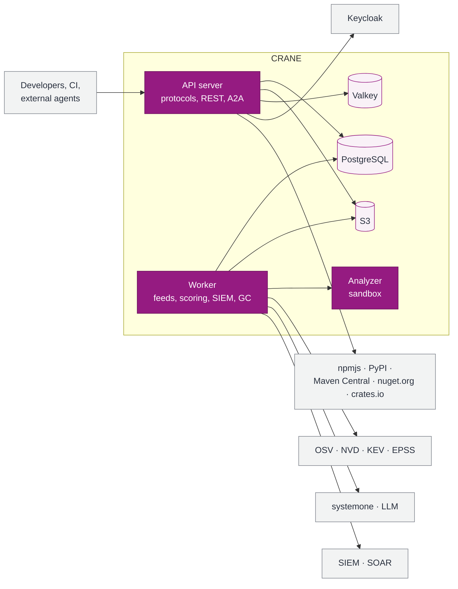

<div align="center">

<picture>
  <source media="(prefers-color-scheme: dark)" srcset="brand/crane-logo-dark.svg">
  
</picture>

### The package registry that knows what's inside, who uses it, and what to do when a CVE drops

**C**ontainer **R**egistry for **A**rtifacts, **N**odes & **E**nvironments

[](docs/product/README.md)
[](LICENSE)
[](CODE_OF_CONDUCT-EN.md)
[](docs/product/03-load-forecast-rust-vs-fastapi.md)
[](docs/product/09-data-structures.md)
[](docs/product/16-deployment.md)
[](docs/product/16-deployment.md)

[](#formats)
[](#formats)
[](#formats)
[](#formats)
[](#formats)

[Русский](README.md) · **English**

[Features](#features) · [Architecture](#architecture) · [Quick start](#quick-start) · [Documentation](#documentation) · [Roadmap](#roadmap) · [Contributing](#contributing)

</div>

---

> [!IMPORTANT]
> CRANE is in the **design** stage: this repository holds the solution architecture, the effort estimate and a printable guidebook. There is no code yet. Commands and configuration below describe the **target** interface.

## Why

A package registry sits in the path of every build. That makes it the best place to answer questions a typical artifact manager leaves open:

- **What is this and where did it come from?** Every version is tied to a commit, a pipeline and an SBOM. Provenance comes from the CI platform's signed token, not from whatever the client claims.
- **Who uses it?** A consumer graph from package to applications and teams, with honest confidence levels: *downloaded*, *in a lockfile*, *in a build SBOM*, *deployed*.
- **What do we do when a CVE drops?** New vulnerabilities land every day. CRANE matches an advisory against the inventory within minutes, assigns a priority, files tasks for owners and, if needed, blocks downloads.
- **Why was I denied?** Instead of a bare `403`, you get the rule that fired and the steps to fix it.

## Features

<table>
<tr>
<td width="50%" valign="top">

### 📦 Registry
- Hosted and proxy repositories for **Maven, npm, PyPI, NuGet, Cargo**
- Content-addressable storage keyed by SHA-256: releases are immutable, duplicates are stored once
- Atomic publishing, protection of internal names against dependency confusion
- Pull-through cache with singleflight and stale-while-revalidate
- Storage classes: `primary`, `proxy-cache`, `archive`, `restricted`

</td>
<td width="50%" valign="top">

### 🛡️ Supply chain security
- Feeds: **OSV, GHSA, NVD, CISA KEV, FIRST EPSS, CSAF**
- **P0–P4** priorities with SLAs, VEX, emergency blocking
- SPDX-based license policy aware of the usage context
- Promotion: quarantine → checks → approval → release, bytes never change
- Typosquatting and slopsquatting defenses

</td>
</tr>
<tr>
<td valign="top">

### 🔐 Access and audit
- **Keycloak / OIDC** for people, no stored secrets for CI (GitLab, Kubernetes)
- Short-lived tokens for npm, pip, Maven, Gradle, dotnet
- **Cedar** policies with an explanation for every decision
- Role model with separation of duties and a dedicated **SecOps** role
- Tamper-evident audit log with a hash chain and WORM anchors

</td>
<td valign="top">

### 🤖 AI and integrations
- Risk scores from **systemone** models: exploitability, blast radius, license virality
- **LLMs** for explanations and semantic search; everything still works by rules without models
- **A2A agent**: external agents read the catalog and change it only with human confirmation
- **SIEM** events in the **OCSF** schema, **Sigma** rules, **SOAR** response actions
- **OpenMetrics** metrics, **OTLP** traces, SLOs and alerts out of the box

</td>
</tr>
</table>

### Formats

| Format | Clients in the compatibility matrix | Hosted | Proxy | Notes |
| --- | --- | :---: | :---: | --- |
| Maven | Maven, Gradle | ✅ | ✅ | SNAPSHOT retention of the last N builds |
| npm | npm, pnpm, yarn | ✅ | ✅ | dist-tags, deprecate, policy-based unpublish |
| PyPI | pip, uv, poetry | ✅ | ✅ | Simple API, yank (PEP 592) |
| NuGet | dotnet, nuget.exe | ✅ | ✅ | V3 API, unlist, credential provider |
| Cargo | cargo | ✅ | ✅ | Sparse protocol only (RFC 2789): internal crates and a crates.io proxy, yank, credential provider |

## Architecture

A modular monolith in Rust: one binary runs as `serve`, `worker` and `analyze`. State lives only in PostgreSQL (source of truth), S3 (bytes) and Valkey (a cache you can lose).



| | |
| --- | --- |
| **Throughput** | Enterprise profile target of ~50,000 RPS; the download hot path never touches the database |
| **Smallest profile** | One VM, 2 vCPU / 4 GB, PostgreSQL and a local disk only |
| **Availability** | 99.99% for downloads across three zones; reads keep working when the primary database fails |
| **Vulnerability detection** | ≤ 15 minutes from advisory publication to an owner's task |
| **Dependency licenses** | Permissive OSS only: MIT, Apache-2.0, BSD, ISC; enforced by `cargo-deny` |

In depth: [context](docs/product/05-c4-l1-context.md), [containers](docs/product/06-c4-l2-containers.md), [components](docs/product/07-c4-l3-components.md), [code](docs/product/08-c4-l4-code.md).

## Quick start

> [!NOTE]
> Target interface. It will ship with the first release.

**Single node, Docker Compose:**

```bash
curl -fsSLO https://example.org/crane/compose.yaml   # URL will be published with the release
docker compose up -d
open https://localhost
```

**Kubernetes, Helm:**

```bash
helm install crane oci://example.org/charts/crane \
  --set oidc.issuer=https://keycloak.example.org/realms/main \
  --set storage.s3.endpoint=https://s3.example.org
```

**Developer:**

```bash
cctl login                                    # sign in via Keycloak (device flow, MFA)
cctl setup npm pip maven gradle nuget cargo         # tokens and package manager configuration
npm install @acme/ui                          # business as usual from here
cctl diag <request-id>                        # why it was denied and how to fix it
```

**GitLab CI, no stored secrets:**

```yaml
include: { project: platform/crane-ci, file: npm.yml }

publish:
  extends: .crane-npm-publish
  id_tokens:
    CRANE_ID_TOKEN: { aud: crane }
  rules: [{ if: $CI_COMMIT_TAG }]
```

## Documentation

| Section | Audience |
| --- | --- |
| [Solution architecture](docs/product/README.md): 20 sections, C4, algorithms, data | Architects, CTOs |
| [Executive summary](docs/product/01-executive-summary.md) and [delivery plan](docs/product/18-plan-team-budget.md) | Budget owners |
| [Security, vulnerabilities and SIEM](docs/product/14-security.md) | Security, SecOps, AppSec |
| [Integrations and API, Keycloak, A2A](docs/product/13-integrations-api.md) | Integrators |
| [Deployment and observability](docs/product/16-deployment.md) | DevOps, SRE |
| PDF guidebook: `out/CRANE-Architecture-v1.0.pdf`, built with `tools/build-guidebook.sh` | Everyone |

The documentation is currently in Russian; an English translation is planned.

## Roadmap

Effort is estimated in agent-hours, calibrated against a measured real project ([section 18](docs/product/18-plan-team-budget.md)); the baseline scenario is about 770 agent-hours.

- [x] Solution architecture and guidebook
- [x] Effort estimate and roadmap
- [ ] **P0 · core**: five formats, hosted and proxy, CAS, Keycloak, roles and Cedar, audit, observability, Compose and Helm
- [ ] **P1 · usability**: GitLab and other OIDC platforms, CI templates, provenance, denial diagnostics, storage classes, Nexus import
- [ ] **P2 · security**: SBOM, vulnerability feeds, P0–P4, VEX, systemone scoring, licenses, promotion, SIEM, SOAR, SecOps audit log
- [ ] **P3 · growth**: consumer graph, impact analysis, LLM-powered search and assistants, A2A agent

Open decisions: [section 19](docs/product/19-risks-open-decisions.md).

## Contributing

The project is in the design stage, so the most valuable contribution right now is an architecture review: open an issue that links to the relevant documentation section. Repository layout, documentation and code guidelines, DCO sign-off and the review process are in [CONTRIBUTING-EN.md](CONTRIBUTING-EN.md). By participating, you agree to the [Code of Conduct](CODE_OF_CONDUCT-EN.md).

**Security issues** in CRANE must not be reported in public issues: private reporting, timelines and scope are in [SECURITY-EN.md](SECURITY-EN.md).

## License

[Apache License 2.0](LICENSE): an explicit patent grant and compatibility with the whole stack. See also [NOTICE](NOTICE).

<div align="center">
<sub>Logo and artwork: <a href="brand/">brand/</a></sub>
</div>
