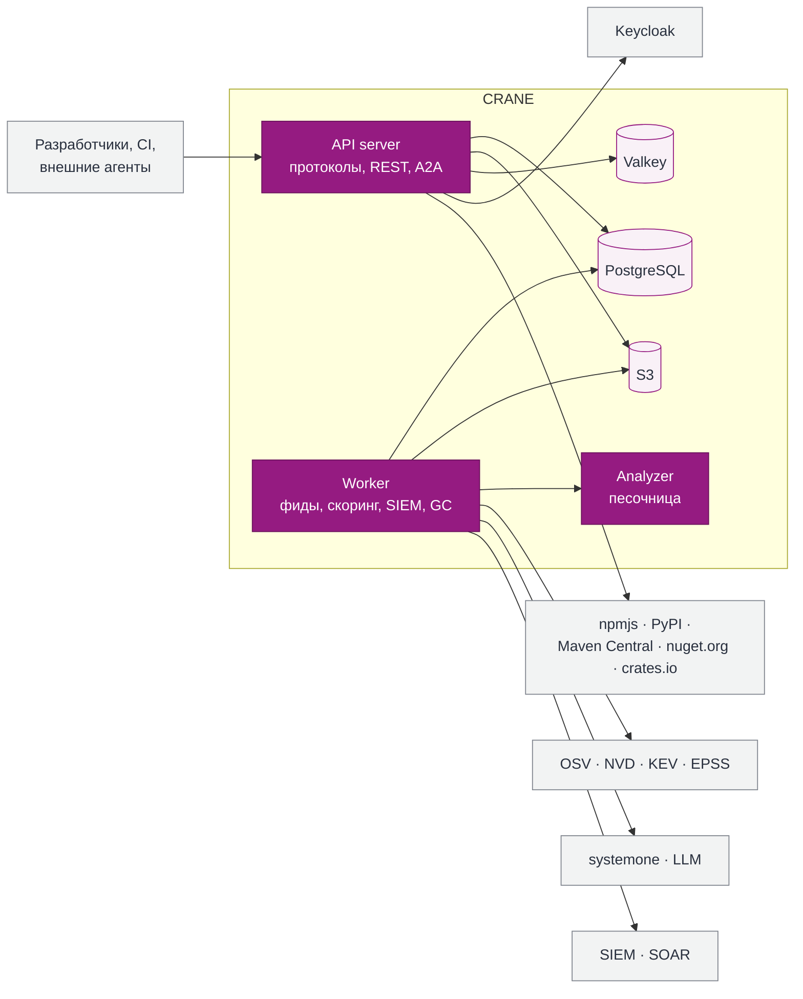

<div align="center">

<picture>
  <source media="(prefers-color-scheme: dark)" srcset="brand/crane-logo-dark.svg">
  
</picture>

### Реестр пакетов, который знает, что внутри, кто это использует и что делать, когда выходит CVE

**C**ontainer **R**egistry for **A**rtifacts, **N**odes & **E**nvironments · **К**аталог **Р**еестров **А**ртефактов и **Н**аследования

[](docs/product/README.md)
[](LICENSE)
[](CODE_OF_CONDUCT.md)
[](docs/product/03-load-forecast-rust-vs-fastapi.md)
[](docs/product/09-data-structures.md)
[](docs/product/16-deployment.md)
[](docs/product/16-deployment.md)

[](#форматы)
[](#форматы)
[](#форматы)
[](#форматы)
[](#форматы)

**Русский** · [English](README-EN.md)

[Возможности](#возможности) · [Архитектура](#архитектура) · [Быстрый старт](#быстрый-старт) · [Документация](#документация) · [Дорожная карта](#дорожная-карта) · [Участие](#участие)

</div>

---

> [!IMPORTANT]
> CRANE находится на стадии **проектирования**: в репозитории архитектура решения, оценка трудоёмкости и гайдбук. Кода пока нет. Команды и конфигурация ниже описывают **целевой** интерфейс.

## Зачем

Реестр пакетов стоит на пути каждой сборки. Поэтому именно в нём удобнее всего отвечать на вопросы, которые обычный менеджер артефактов оставляет без ответа:

- **Что внутри и откуда это?** Каждая версия связана с коммитом, pipeline и SBOM; провенанс берётся из подписанного токена CI, а не со слов клиента.
- **Кто это использует?** Граф потребителей от пакета до приложений и команд, с честными уровнями достоверности: «скачивали», «в lockfile», «в SBOM сборки», «развёрнуто».
- **Что делать, когда выходит CVE?** Новые уязвимости выходят каждый день. CRANE за минуты сопоставляет advisory с инвентарём, назначает приоритет, ставит задачи владельцам и при необходимости блокирует скачивание.
- **Почему мне отказали?** Вместо голого `403` — сработавшее правило и шаги исправления.

## Возможности

<table>
<tr>
<td width="50%" valign="top">

### 📦 Реестр
- Hosted- и proxy-репозитории для **Maven, npm, PyPI, NuGet, Cargo**
- Content-addressable хранилище по SHA-256: релизы неизменяемы, дубликаты хранятся один раз
- Атомарная публикация, защита внутренних имён от dependency confusion
- Pull-through кэш с singleflight и stale-while-revalidate
- Классы хранения: `primary`, `proxy-cache`, `archive`, `restricted`

</td>
<td width="50%" valign="top">

### 🛡️ Безопасность цепочки поставки
- Фиды **OSV, GHSA, NVD, CISA KEV, FIRST EPSS, CSAF**
- Приоритет **P0–P4** с SLA, VEX, экстренная блокировка
- Лицензионная политика по SPDX с учётом контекста использования
- Promotion: quarantine → проверки → approval → release, байты не меняются
- Защита от typosquatting и slopsquatting

</td>
</tr>
<tr>
<td valign="top">

### 🔐 Доступ и аудит
- **Keycloak / OIDC** для людей, без хранимых секретов для CI (GitLab, Kubernetes)
- Краткоживущие токены для npm, pip, Maven, Gradle, dotnet
- Политики **Cedar** с объяснением каждого решения
- Ролевая модель с разделением обязанностей и ролью **SecOps**
- Неизменяемый журнал действий с цепочкой хэшей и якорями WORM

</td>
<td valign="top">

### 🤖 ИИ и интеграции
- Оценки риска моделями **systemone**: эксплуатируемость, бласт, вирусность лицензии
- **LLM** для объяснений и семантического поиска; без моделей всё работает по правилам
- **A2A-агент**: внешние агенты читают каталог и меняют его только с подтверждением человека
- События в **SIEM** по схеме **OCSF**, правила **Sigma**, ответные действия **SOAR**
- Метрики **OpenMetrics**, трассы **OTLP**, SLO и алерты в поставке

</td>
</tr>
</table>

### Форматы

| Формат | Клиенты в матрице совместимости | Hosted | Proxy | Особенности |
| --- | --- | :---: | :---: | --- |
| Maven | Maven, Gradle | ✅ | ✅ | SNAPSHOT с хранением N последних сборок |
| npm | npm, pnpm, yarn | ✅ | ✅ | dist-tags, deprecate, unpublish по политике |
| PyPI | pip, uv, poetry | ✅ | ✅ | Simple API, yank (PEP 592) |
| NuGet | dotnet, nuget.exe | ✅ | ✅ | V3 API, unlist, credential provider |
| Cargo | cargo | ✅ | ✅ | Только sparse-протокол (RFC 2789): внутренние крейты и proxy crates.io, yank, credential provider |

## Архитектура

Модульный монолит на Rust: один бинарник запускается в ролях `serve`, `worker` и `analyze`. Состояние живёт только в PostgreSQL (источник истины), S3 (байты) и Valkey (кэш, который можно потерять).



| | |
| --- | --- |
| **Производительность** | Цель профиля «корпорация» — ~50 000 RPS; горячий путь скачивания не ходит в БД |
| **Минимальный профиль** | 1 ВМ, 2 vCPU / 4 ГБ, только PostgreSQL и локальный диск |
| **Доступность** | 99.99% скачивания в трёх зонах; чтение продолжается при отказе primary БД |
| **Обнаружение уязвимостей** | ≤ 15 минут от публикации advisory до задачи владельцу |
| **Лицензии зависимостей** | Только пермиссивный OSS: MIT, Apache-2.0, BSD, ISC; проверяется `cargo-deny` |

Подробно: [контекст](docs/product/05-c4-l1-context.md), [контейнеры](docs/product/06-c4-l2-containers.md), [компоненты](docs/product/07-c4-l3-components.md), [код](docs/product/08-c4-l4-code.md).

## Быстрый старт

> [!NOTE]
> Целевой интерфейс. Появится вместе с первым релизом.

**Один узел, Docker Compose:**

```bash
curl -fsSLO https://example.org/crane/compose.yaml   # адрес появится с релизом
docker compose up -d
open https://localhost
```

**Kubernetes, Helm:**

```bash
helm install crane oci://example.org/charts/crane \
  --set oidc.issuer=https://keycloak.example.org/realms/main \
  --set storage.s3.endpoint=https://s3.example.org
```

**Разработчик:**

```bash
cctl login                                    # вход через Keycloak (device flow, MFA)
cctl setup npm pip maven gradle nuget cargo         # токены и конфигурация пакетных менеджеров
npm install @acme/ui                          # дальше всё как обычно
cctl diag <request-id>                        # почему отказали и как исправить
```

**GitLab CI, без хранимых секретов:**

```yaml
include: { project: platform/crane-ci, file: npm.yml }

publish:
  extends: .crane-npm-publish
  id_tokens:
    CRANE_ID_TOKEN: { aud: crane }
  rules: [{ if: $CI_COMMIT_TAG }]
```

## Документация

| Раздел | Для кого |
| --- | --- |
| [Архитектура решения](docs/product/README.md) — 20 разделов, C4, алгоритмы, данные | Архитекторы, CTO |
| [Резюме для ЛПР](docs/product/01-executive-summary.md) и [план работ](docs/product/18-plan-team-budget.md) | Владельцы бюджета |
| [Безопасность, уязвимости и SIEM](docs/product/14-security.md) | ИБ, SecOps, AppSec |
| [Интеграции и API, Keycloak, A2A](docs/product/13-integrations-api.md) | Интеграторы |
| [Развёртывание и наблюдаемость](docs/product/16-deployment.md) | DevOps, SRE |
| Гайдбук в PDF: `out/CRANE-Architecture-v1.0.pdf`, сборка `tools/build-guidebook.sh` | Все |

Документация пока на русском.

## Дорожная карта

Трудоёмкость посчитана в агент-часах по замеру реального проекта ([раздел 18](docs/product/18-plan-team-budget.md)); базовый сценарий — около 770 агент-часов.

- [x] Архитектура решения и гайдбук
- [x] Оценка трудоёмкости и дорожная карта
- [ ] **P0 · ядро** — пять форматов hosted и proxy, CAS, Keycloak, роли и Cedar, аудит, наблюдаемость, Compose и Helm
- [ ] **P1 · удобство** — GitLab и OIDC-платформы, CI templates, провенанс, диагностика отказов, классы хранения, импорт из Nexus
- [ ] **P2 · безопасность** — SBOM, фиды уязвимостей, P0–P4, VEX, скоринг systemone, лицензии, promotion, SIEM, SOAR, журнал для SecOps
- [ ] **P3 · развитие** — граф потребителей, impact analysis, поиск и ассистенты на LLM, A2A-агент

Открытые решения: [раздел 19](docs/product/19-risks-open-decisions.md).

## Участие

Проект на стадии проектирования, поэтому самый ценный вклад сейчас — ревью архитектуры: issue со ссылкой на раздел документации. Как устроен репозиторий, правила для документации и кода, подпись DCO и порядок ревью — в [CONTRIBUTING.md](CONTRIBUTING.md). Участвуя, вы принимаете [Кодекс поведения](CODE_OF_CONDUCT.md).

**Уязвимости** в CRANE не публикуйте в открытых issue: порядок приватного сообщения, сроки и область действия — в [SECURITY.md](SECURITY.md).

## Лицензия

[Apache License 2.0](LICENSE): явный патентный грант и совместимость со всем стеком. Краткое изложение на русском — [LICENSE-RU.md](LICENSE-RU.md), уведомления — [NOTICE](NOTICE).

<div align="center">
<sub>Логотип и графика: <a href="brand/">brand/</a></sub>
</div>
