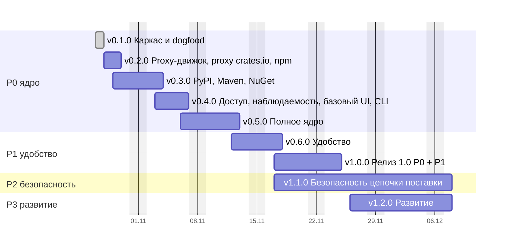

# Дорожная карта CRANE

Пошаговый план от каркаса до релиза 1.0 и дальнейшего развития. Каждая версия — ветка `release/vX.Y.Z`, в которую squash-ом сливаются feature-ветки; после одобрения релиз уходит в `main` и получает тег (раздел 16.7).

## Как посчитаны даты

```bash
python3 tools/estimate-agent-hours.py --start 2026-10-28 --gantt
```

Скрипт берёт трудоёмкость модулей из раздела 18, раскладывает её по версиям (`RELEASES`) и переводит в рабочие дни: 4 агента параллельно по 8 часов, рабочие дни пн–пт (нерабочие даты задаются `--holidays`). Этапы, которые агенты не ускоряют, идут по календарю: нагрузочный PoC на железе (3 дня, параллельно разработке), release candidate (5 дней, допущение) и security review с пентестом (7 дней). Старт — 28 октября 2026.

Карта описывает только техническую поставку; сроки раздела 18 длиннее, потому что включают организационные этапы.

Скорость после v0.1.0 замерена. v0.1.0 закрыта 27 октября (PR #8–#16, около 4 часов календарного времени, 2–4 лида параллельно): код продукта 5,1 тыс. непустых строк, в основном ядро (≈ 4,2 из 12 тыс.), CAS (≈ 0,17 из 6) и Cargo (≈ 0,7 из 24). Модель на этот объём даёт ≈ 21 агент-ч, замер 15–25 (время исполнителей не журналировалось). Отклонение середины замера ≈ −5% меньше порога 20% из «Риски графика», но замер грубый (агент-часы исполнителей не журналировались, разброс от модели −29%…+19% шире порога), поэтому норма не опровергнута и не меняется. Перекалибрована разбивка по релизам: план считал, что v0.1.0 строит ядро и CAS целиком, а остаток (≈ 80 агент-ч) сложен в v0.5.0 допущением; на дату конца P0 он не влияет, а даты v0.2.0–v0.4.0 из-за него оптимистичны, потому что часть остатка (namespace, журнал действий, owners) стоит в них. v0.1.0 ставится в скрипте фактической датой, календарь считается от 28 октября. Этапы календаря (нагрузочный PoC 3 дня, release candidate 5 дней, security review 7 дней) не ускоряются. Фактическая параллельность v0.1.0 ≈ 5 агентов (20 агент-ч за 4 ч), в скрипте оставлены 4. Это остаётся главным риском оценки: норма перенесена с эталона на Rust и другой домен.

## Диаграмма

Базовый сценарий (полосы — рабочие дни):



*Рис. R.1. Базовый сценарий: v0.1.0 закрыта 27 октября (замер), остальное считается от 28 октября 2026. Разработка v1.1.0 идёт параллельно release candidate 1.0, а security review завершает её.*

## Вехи

| Версия | Содержание | Базово | Оптимистично – пессимистично |
| --- | --- | --- | --- |
| v0.1.0 | Каркас и dogfood: Cargo hosted | 27 октября (готово) | — |
| v0.2.0 | Proxy-движок, proxy crates.io, npm | 29 октября | 29 – 30 октября |
| v0.3.0 | PyPI, Maven, NuGet | 3 ноября | 2 – 5 ноября |
| v0.4.0 | Доступ, наблюдаемость, базовый UI, CLI | 6 ноября | 4 – 11 ноября |
| **v0.5.0** | **Полное ядро (P0)**: матрица клиентов, нагрузка, поставка → репозиторий публичный | **12 ноября** | 10 – 20 ноября |
| v0.6.0 | Удобство (P1): GitLab, диагностика, классы хранения, импорт из других реестров | 17 ноября | 12 – 26 ноября |
| **v1.0.0** | **Релиз 1.0 (P0 + P1)** после release candidate | **24 ноября** | 19 ноября – 3 декабря |
| v1.1.0 | Безопасность цепочки поставки (P2) после security review | 7 декабря | 1 – 22 декабря |
| v1.2.0 | Развитие (P3): граф, поиск и LLM, A2A | 7 декабря | 1 – 22 декабря |

## Шаг 0. Подготовка (до старта v0.1.0)

- [x] Ветка `release/v0.1.0` создана от `main`.
- [x] Решение 12 (раздел 19): имя CLI и бинарника; от него зависят имена крейтов и `crane setup`.
- [x] Замер выполнен по времени веток; агент-часы исполнителей не журналировались, см. «Как посчитаны даты».

## v0.1.0 · Каркас и dogfood: Cargo hosted

**Готово 27 октября** · замер ≈ 15–25 агент-ч (план был ~100) · разделы 8, 9, 13 (Cargo).

Выполнено PR #8, #10, #12, #13, #15, #16 в `release/v0.1.0` (Compose single node, п. 10, — PR #5); полный гейт (`task gate`) запускается отдельно перед PR релиза в `main`.

Цель — CRANE хранит и раздаёт собственные крейты настоящему `cargo`. Это первое доказательство работоспособности продукта.

1. [x] `feat(core)`: workspace по разделу 8. Все группы и крейты-заглушки (`core`, `formats`, `adapters`, `entry`), `task structure` проверяет правило четырёх и направление слоёв.
2. [x] `feat(domain)`: типы без IO: `Format`, `PackageName` с нормализацией Cargo (регистр, `-` ≡ `_`), `Version` (SemVer), `Sha256`, state machine версии (раздел 9.2), ошибки.
3. [x] `feat(ports)`: трейты `BlobStore`, каталог (репозитории, пакеты, версии), `Clock`, `IdGen`; in-memory реализации для тестов `app`.
4. [x] `feat(adapters)`: PostgreSQL на sqlx, миграции expand / migrate / contract, минимальный срез таблиц раздела 9 (repositories, packages, versions, blobs).
5. [x] `feat(adapters)`: CAS на `object_store`: staging → проверка SHA-256 → commit, идемпотентно; локальная ФС и S3 одним адаптером.
6. [x] `feat(app)`: use cases publish, fetch, yank / unyank: атомарная публикация, неизменяемость версии, tombstone.
7. [x] `feat(formats)`: Cargo sparse: `config.json`, пути индекса, NDJSON, `ETag`, download, publish в бинарном формате cargo, yank / unyank, owners только на чтение (статическая личность).
8. [x] `feat(entry)`: axum, problem+json, health; бинарник с ролями `serve` и `migrate`; конфигурация.
9. [x] Временная аутентификация статическим токеном из конфигурации (до v0.4.0); фиксируется в `DEBT.md`.
10. [x] `build(deploy)`: Compose single node: CRANE + PostgreSQL + локальный диск.
11. [x] **Dogfood (hosted)**: `task dogfood` поднимает временный стенд и прогоняет полный цикл настоящего `cargo` на временных пакетах (`cargo new` во временном каталоге, зависимости между ними); стенд удаляется вместе с данными.
12. [x] `test`: e2e с настоящим `cargo` (две последние стабильные версии) в `task gate`.

**Готово, когда:** реальный `cargo` публикует, находит, скачивает и yank-ает крейт; мутационный порог держится на `domain`, `app`, `formats/cargo`; норма скорости пересчитана.

## v0.2.0 · Proxy-движок, proxy crates.io, npm

**28 – 29 октября** · ~55 агент-ч · разделы 10, 11.

1. `feat(app)`: proxy-движок: TTL и negative TTL (11.1), stale-while-revalidate, refresh-ahead, singleflight, SSRF guard для upstream.
2. `feat(adapters)`: Valkey как L2-кэш metadata и координатор singleflight; кэш в процессе (moka).
3. `feat(formats)`: proxy crates.io: `index.crates.io` и `static.crates.io`, собственный `dl` в `config.json`.
4. **Dogfood (полный)**: сборка CRANE целиком идёт через собственный реестр: внутренние крейты из hosted (`registry = "crane"`), внешние зависимости через proxy crates.io. Проверка перенесена из v0.1.0: без proxy сборка CRANE на собственном реестре невозможна.
5. `feat(formats)`: npm hosted и proxy: packument, tarball, dist-tags, deprecate, unpublish по политике.
6. `feat(app)`: namespaces и защита от dependency confusion: hosted всегда приоритетнее proxy. Таблица `namespace` добавляется expand-миграцией (как в комментарии `crates/adapters/persistence/pg/migrations/0001_catalog.sql:75`).

**Готово, когда:** сборка CRANE проходит на собственном реестре (hosted + proxy crates.io); `npm install` и `cargo build` проходят через proxy при недоступном upstream (stale-if-error); повторные запросы к upstream схлопываются.

## v0.3.0 · PyPI, Maven, NuGet

**29 октября – 3 ноября** · ~85 агент-ч · разделы 9, 13.

1. `feat(formats)`: PyPI: Simple API (PEP 503 и 691), загрузка, yank (PEP 592), нормализация имён.
2. `feat(formats)`: Maven: layout репозитория, `maven-metadata.xml`, контрольные суммы, SNAPSHOT с хранением N последних сборок.
3. `feat(formats)`: NuGet V3: service index, registration, flat container, push, unlist.
4. `test`: e2e с pip, uv, poetry, Maven, Gradle, dotnet.

**Готово, когда:** все пять форматов работают hosted и proxy на реальных клиентах.

## v0.4.0 · Доступ, наблюдаемость, базовый UI, CLI

**3 – 6 ноября** · ~85 агент-ч · разделы 13, 14, 15, 16.6.

1. `feat(access)`: Keycloak OIDC, токены `crp_`, `crr_`, `crci_`, обмен по RFC 8693, эпохи авторизации; статический токен v0.1.0 удаляется.
2. `feat(access)`: Cedar с объяснением решений, роли и разделение обязанностей.
3. `feat(app)`: журнал действий с цепочкой хэшей.
4. `feat(entry)`: OpenMetrics, OTLP, health и readiness, алерты в поставке.
5. `feat(web)`: каркас SPA по FSD: каталог, карточка пакета, администрирование, командная палитра и центр уведомлений (`docs/ui/`, `docs/api/admin.openapi.yaml`); Storybook и Playwright подключаются здесь (`DEBT.md`, п. 3).
6. `feat(cli)`: `login` (device flow), `setup` шести клиентов, credential providers для NuGet и Cargo.
7. `feat(formats)`: `cargo owners add / remove` на реальных принципалах и Cedar (`DEBT.md`, п. 7).

**Готово, когда:** каждый запрос проходит Cedar и объясняет отказ; пакетные менеджеры работают на краткоживущих токенах.

## v0.5.0 · Полное ядро (P0)

**6 – 12 ноября** · ~150 агент-ч (из них ~80 — остаток модулей v0.1.0) + нагрузочный PoC на железе (3 дня, параллельно).

1. `test`: матрица реальных клиентов в CI: npm, pnpm, yarn, pip, uv, poetry, Maven, Gradle, dotnet, nuget.exe, cargo.
2. `test`: нагрузочный стенд (oha, Gatling) и оптимизация горячего пути; PoC на целевом железе по профилю L.
3. `build(deploy)`: Compose и Helm, профили S / M / L (раздел 16.3), проверяемые backup и restore.
4. **Репозиторий становится публичным**: включаются защита веток и автовыпуск версий (`DEBT.md`).
5. Остаток модулей P0, не построенный в v0.1.0: ядро (очередь задач, остальные контексты), CAS (GC, retention, проверка целостности), доводка протоколов.

**Готово, когда:** выполнен объём P0 из раздела 18; нагрузка и восстановление подтверждены замером.

## v0.6.0 · Удобство (P1)

**12 – 17 ноября** · ~89 агент-ч.

1. GitLab workload identity, trust policy; provenance из claims пишется в evidence (минимальная таблица по модели раздела 9), карточка читает её; другие OIDC-платформы.
2. Диагностика отказов (`cctl diag`), CI templates.
3. Классы хранения, размещение, онлайн-перенос.
4. Импорт из других реестров; CLI `warm`, `readiness`, `export`.
5. Рабочие столы ролей в SPA.
6. Интеграция с реальными Keycloak, GitLab, Trivy и S3 на стенде.

**Готово, когда:** сценарии P1 проходят на стенде без ручных шагов.

## v1.0.0 · Релиз 1.0

**17 – 24 ноября** · release candidate, 5 рабочих дней (допущение).

- Стабилизация P0 + P1, внешняя обратная связь по release candidate, исправления в патч-версиях `v0.6.x`.
- Критерии: SLO раздела 4 выполняются на стенде, нет открытых дефектов P0 и P1, процедура обновления версий и миграций проверена.

## v1.1.0 · Безопасность цепочки поставки (P2)

Разработка с **17 ноября** параллельно release candidate, релиз **7 декабря** после security review · ~232 агент-ч.

1. Новые виды evidence: SBOM, сканы Trivy; песочница анализа.
2. Проверка upstream attestations в proxy: npm provenance, PyPI (PEP 740), Maven Central (PGP, Sigstore); карточка «собрано в … из …»; правило регрессии.
3. Приём attestations из своего CI (in-toto/SLSA) как evidence, gate provenance требует валидную attestation (настройка по репозиторию и стадии); цель SLSA Build L2.
4. Фиды уязвимостей, сопоставление по PURL, приоритеты P0–P4, VEX, экстренный режим.
5. Лицензии: SPDX, политика, вирусность; скоринг systemone.
6. Promotion, approvals, исключения.
7. События OCSF в SIEM, Sigma, SOAR; журнал действий для SecOps.
8. Security review и пентест (7 рабочих дней), исправление замечаний.

## v1.2.0 · Развитие (P3)

**26 ноября – 7 декабря** · ~55 агент-ч.

1. Граф потребителей и impact analysis.
2. Поиск и ассистенты на LLM: FTS, pgvector, RAG, rerank.
3. A2A-агент.

## Вне графика (опционально)

**Подпись продвинутых версий самим CRANE.** Нужен частный Sigstore (Fulcio и Rekor со своим корнем TUF) в закрытых сетях. Выгода низкая: клиенты пакетных менеджеров почти не умеют проверять подпись по чужому trust root. Цена: эксплуатация Fulcio и Rekor (HA, бэкап журнала, ротация корня) и интеграция с promotion. Пункт стоит после P3, в даты и в оценку раздела 18 не входит; решается, когда появится потребитель, который проверяет такую подпись.

## Риски графика

- **Скорость на Rust.** Замер v0.1.0 не опроверг норму (замер грубый), а v0.1.0 — самая предсказуемая веха; главный риск — протоколы на реальных клиентах (v0.2.0–v0.5.0). Пересчёт после v0.3.0 различит отклонение в 20% только при журнале агент-часов исполнителей (начало и конец, число параллельных); без журнала замер снова будет грубым. Решение о журнале за тим-лидом, ROADMAP его не вводит. При отклонении больше 20% даты сдвигаются по новой норме.
- **Остаток v0.1.0 в v0.5.0.** Остаток модулей сложен туда допущением: даты v0.2.0–v0.4.0 оптимистичны, потому что часть остатка (namespace, журнал действий, owners) стоит в этих версиях.
- **Запас по протоколам.** Объём Cargo (0,7 тыс.) намного меньше 1/5 модуля протоколов (4,8 тыс.), но объёмы модулей не уменьшены до данных по npm, PyPI, Maven и NuGet: возможный запас.
- **Внешние этапы.** Security review и обратная связь по release candidate не ускоряются агентами.
- **Допущения.** Длительность release candidate (5 дней) выбрана без замера и уточняется по ходу.
