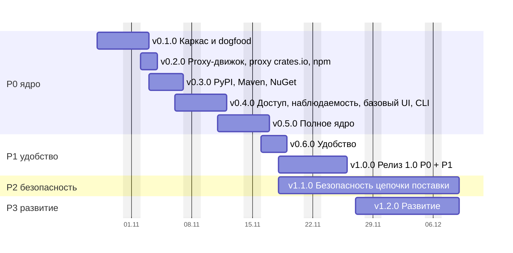

# Дорожная карта CRANE

Пошаговый план от каркаса до релиза 1.0 и дальнейшего развития. Каждая версия — ветка `release/vX.Y.Z`, в которую squash-ом сливаются feature-ветки; после одобрения релиз уходит в `main` и получает тег (раздел 16.7).

## Как посчитаны даты

```bash
python3 tools/estimate-agent-hours.py --start 2026-10-28 --gantt
```

Скрипт берёт трудоёмкость модулей из раздела 18, раскладывает её по версиям (`RELEASES`) и переводит в рабочие дни: 4 агента параллельно по 8 часов, рабочие дни пн–пт (нерабочие даты задаются `--holidays`). Этапы, которые агенты не ускоряют, идут по календарю: нагрузочный PoC на железе (3 дня, параллельно разработке), release candidate (5 дней, допущение) и security review с пентестом (7 дней). Старт — 28 октября 2026.

Карта описывает только техническую поставку; сроки раздела 18 длиннее, потому что включают организационные этапы. После v0.1.0 скорость замеряется по факту, коэффициенты в скрипте пересчитываются, даты ниже обновляются. Это главный риск оценки: норма перенесена с эталона на Rust и другой домен.

## Диаграмма

Базовый сценарий (полосы — рабочие дни):



*Рис. R.1. Базовый сценарий от 28 октября 2026. Разработка v1.1.0 идёт параллельно release candidate 1.0, а security review завершает её.*

## Вехи

| Версия | Содержание | Базово | Оптимистично – пессимистично |
| --- | --- | --- | --- |
| v0.1.0 | Каркас и dogfood: Cargo hosted | 2 ноября | 30 октября – 3 ноября |
| v0.2.0 | Proxy-движок, proxy crates.io, npm | 3 ноября | 2 – 6 ноября |
| v0.3.0 | PyPI, Maven, NuGet | 6 ноября | 4 – 12 ноября |
| v0.4.0 | Доступ, наблюдаемость, базовый UI, CLI | 11 ноября | 6 – 18 ноября |
| **v0.5.0** | **Полное ядро (P0)**: матрица клиентов, нагрузка, поставка → репозиторий публичный | **16 ноября** | 11 – 23 ноября |
| v0.6.0 | Удобство (P1): GitLab, диагностика, классы хранения, импорт из других реестров | 18 ноября | 13 – 27 ноября |
| **v1.0.0** | **Релиз 1.0 (P0 + P1)** после release candidate | **25 ноября** | 20 ноября – 4 декабря |
| v1.1.0 | Безопасность цепочки поставки (P2) после security review | 8 декабря | 2 – 22 декабря |
| v1.2.0 | Развитие (P3): граф, поиск и LLM, A2A | 8 декабря | 2 – 22 декабря |

## Шаг 0. Подготовка (до старта v0.1.0)

- [ ] Ветка `release/v0.1.0` создана от `main`.
- [x] Решение 12 (раздел 19): имя CLI и бинарника; от него зависят имена крейтов и `crane setup`.
- [ ] Замер скорости: время начала и конца каждой feature-ветки v0.1.0 фиксируется, чтобы пересчитать норму.

## v0.1.0 · Каркас и dogfood: Cargo hosted

**28 октября – 2 ноября** · ~100 агент-ч · разделы 8, 9, 13 (Cargo).

Цель — CRANE хранит и раздаёт собственные крейты настоящему `cargo`. Это первое доказательство работоспособности продукта.

1. `feat(core)`: workspace по разделу 8. Все группы и крейты-заглушки (`core`, `formats`, `adapters`, `entry`), `task structure` проверяет правило четырёх и направление слоёв.
2. `feat(domain)`: типы без IO: `Format`, `PackageName` с нормализацией Cargo (регистр, `-` ≡ `_`), `Version` (SemVer), `Sha256`, state machine версии (раздел 9.2), ошибки.
3. `feat(ports)`: трейты `BlobStore`, каталог (репозитории, пакеты, версии), `Clock`, `IdGen`; in-memory реализации для тестов `app`.
4. `feat(adapters)`: PostgreSQL на sqlx, миграции expand / migrate / contract, минимальный срез таблиц раздела 9 (repositories, namespaces, packages, versions, blobs).
5. `feat(adapters)`: CAS на `object_store`: staging → проверка SHA-256 → commit, идемпотентно; локальная ФС и S3 одним адаптером.
6. `feat(app)`: use cases publish, fetch, yank / unyank: атомарная публикация, неизменяемость версии, tombstone.
7. `feat(formats)`: Cargo sparse: `config.json`, пути индекса, NDJSON, `ETag`, download, publish в бинарном формате cargo, yank / unyank, owners.
8. `feat(entry)`: axum, problem+json, health; бинарник с ролями `serve` и `migrate`; конфигурация.
9. Временная аутентификация статическим токеном из конфигурации (до v0.4.0); фиксируется в `DEBT.md`.
10. `build(deploy)`: Compose single node: CRANE + PostgreSQL + локальный диск.
11. **Dogfood**: CRANE поднят на стенде, `cargo publish --registry crane` публикует внутренние крейты, сборка CRANE берёт их из CRANE через `registry = "crane"`.
12. `test`: e2e с настоящим `cargo` (две последние стабильные версии) в `task gate`.

**Готово, когда:** реальный `cargo` публикует, находит, скачивает и yank-ает крейт; сборка CRANE проходит на собственном реестре; мутационный порог держится на `domain`, `app`, `formats/cargo`; норма скорости пересчитана.

## v0.2.0 · Proxy-движок, proxy crates.io, npm

**2 – 3 ноября** · ~55 агент-ч · разделы 10, 11.

1. `feat(app)`: proxy-движок: TTL и negative TTL (11.1), stale-while-revalidate, refresh-ahead, singleflight, SSRF guard для upstream.
2. `feat(adapters)`: Valkey как L2-кэш metadata и координатор singleflight; кэш в процессе (moka).
3. `feat(formats)`: proxy crates.io: `index.crates.io` и `static.crates.io`, собственный `dl` в `config.json`.
4. **Dogfood**: внешние зависимости CRANE идут через собственный proxy crates.io.
5. `feat(formats)`: npm hosted и proxy: packument, tarball, dist-tags, deprecate, unpublish по политике.
6. `feat(app)`: namespaces и защита от dependency confusion: hosted всегда приоритетнее proxy.

**Готово, когда:** `npm install` и `cargo build` проходят через proxy при недоступном upstream (stale-if-error); повторные запросы к upstream схлопываются.

## v0.3.0 · PyPI, Maven, NuGet

**3 – 6 ноября** · ~85 агент-ч · разделы 9, 13.

1. `feat(formats)`: PyPI: Simple API (PEP 503 и 691), загрузка, yank (PEP 592), нормализация имён.
2. `feat(formats)`: Maven: layout репозитория, `maven-metadata.xml`, контрольные суммы, SNAPSHOT с хранением N последних сборок.
3. `feat(formats)`: NuGet V3: service index, registration, flat container, push, unlist.
4. `test`: e2e с pip, uv, poetry, Maven, Gradle, dotnet.

**Готово, когда:** все пять форматов работают hosted и proxy на реальных клиентах.

## v0.4.0 · Доступ, наблюдаемость, базовый UI, CLI

**6 – 11 ноября** · ~85 агент-ч · разделы 13, 14, 15, 16.6.

1. `feat(access)`: Keycloak OIDC, токены `crp_`, `crr_`, `crci_`, обмен по RFC 8693, эпохи авторизации; статический токен v0.1.0 удаляется.
2. `feat(access)`: Cedar с объяснением решений, роли и разделение обязанностей.
3. `feat(app)`: журнал действий с цепочкой хэшей.
4. `feat(entry)`: OpenMetrics, OTLP, health и readiness, алерты в поставке.
5. `feat(web)`: каркас SPA по FSD: каталог, карточка пакета, администрирование; Storybook и Playwright подключаются здесь (`DEBT.md`, п. 3).
6. `feat(cli)`: `login` (device flow), `setup` шести клиентов, credential providers для NuGet и Cargo.

**Готово, когда:** каждый запрос проходит Cedar и объясняет отказ; пакетные менеджеры работают на краткоживущих токенах.

## v0.5.0 · Полное ядро (P0)

**11 – 16 ноября** · ~70 агент-ч + нагрузочный PoC на железе (3 дня, параллельно).

1. `test`: матрица реальных клиентов в CI: npm, pnpm, yarn, pip, uv, poetry, Maven, Gradle, dotnet, nuget.exe, cargo.
2. `test`: нагрузочный стенд (oha, Gatling) и оптимизация горячего пути; PoC на целевом железе по профилю L.
3. `build(deploy)`: Compose и Helm, профили S / M / L (раздел 16.3), проверяемые backup и restore.
4. **Репозиторий становится публичным**: включаются защита веток и автовыпуск версий (`DEBT.md`).

**Готово, когда:** выполнен объём P0 из раздела 18; нагрузка и восстановление подтверждены замером.

## v0.6.0 · Удобство (P1)

**16 – 18 ноября** · ~87 агент-ч.

1. GitLab workload identity, trust policy, provenance; другие OIDC-платформы.
2. Диагностика отказов (`cctl diag`), CI templates.
3. Классы хранения, размещение, онлайн-перенос.
4. Импорт из других реестров; CLI `warm`, `readiness`, `export`.
5. Рабочие столы ролей в SPA.
6. Интеграция с реальными Keycloak, GitLab, Trivy и S3 на стенде.

**Готово, когда:** сценарии P1 проходят на стенде без ручных шагов.

## v1.0.0 · Релиз 1.0

**18 – 25 ноября** · release candidate, 5 рабочих дней (допущение).

- Стабилизация P0 + P1, внешняя обратная связь по release candidate, исправления в патч-версиях `v0.6.x`.
- Критерии: SLO раздела 4 выполняются на стенде, нет открытых дефектов P0 и P1, процедура обновления версий и миграций проверена.

## v1.1.0 · Безопасность цепочки поставки (P2)

Разработка с **18 ноября** параллельно release candidate, релиз **8 декабря** после security review · ~220 агент-ч.

1. Evidence, SBOM, Trivy, песочница анализа.
2. Фиды уязвимостей, сопоставление по PURL, приоритеты P0–P4, VEX, экстренный режим.
3. Лицензии: SPDX, политика, вирусность; скоринг systemone.
4. Promotion, approvals, исключения.
5. События OCSF в SIEM, Sigma, SOAR; журнал действий для SecOps.
6. Security review и пентест (7 рабочих дней), исправление замечаний.

## v1.2.0 · Развитие (P3)

**27 ноября – 8 декабря** · ~55 агент-ч.

1. Граф потребителей и impact analysis.
2. Поиск и ассистенты на LLM: FTS, pgvector, RAG, rerank.
3. A2A-агент.

## Риски графика

- **Скорость на Rust.** Пересчёт после v0.1.0; при отклонении больше 20% даты сдвигаются по новой норме.
- **Внешние этапы.** Security review и обратная связь по release candidate не ускоряются агентами.
- **Допущения.** Длительность release candidate (5 дней) выбрана без замера и уточняется по ходу.
