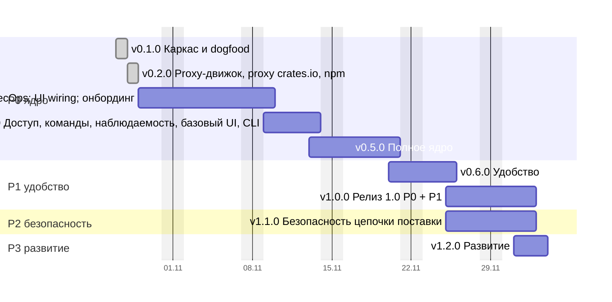

# Дорожная карта CRANE

Пошаговый план от каркаса до релиза 1.0 и дальнейшего развития. Каждая версия — ветка `release/vX.Y.Z`, в которую squash-ом сливаются feature-ветки; после одобрения релиз уходит в `main` и получает тег (раздел 16.7).

## Как посчитаны даты

```bash
python3 tools/estimate-agent-hours.py --start 2026-10-29 --gantt
```

Скрипт берёт трудоёмкость модулей из раздела 18, раскладывает её по версиям (`RELEASES`) и переводит в рабочие дни: по умолчанию 4 параллельных потока по 8 часов в день, рабочие дни пн–пт (нерабочие даты задаются `--holidays`). Ёмкость меняют флаги `--parallel`, `--hours` и `--every-day` (календарь без выходных); с `--start` скрипт дополнительно печатает календарь base по наблюдению 27.10 (5 × 12, 7 дней в неделю) независимо от флагов. Этап, который агенты не ускоряют, идёт по календарю: release candidate (5 дней, допущение). Замер ёмкости под нагрузкой и пентест вынесены на этап «После v1» (см. одноимённый раздел). Их часы (~55 агент-ч, 10 рабочих дней календаря) считаются в итоге раздела 18, но в даты не входят. Локальная проверка регрессии производительности остаётся в v0.5.0. Старт — 29 октября 2026: v0.1.0 закрыта 27 октября, v0.2.0 — 28 октября.

Карта описывает только техническую поставку; сроки раздела 18 длиннее, потому что включают организационные этапы.

Скорость после v0.1.0 замерена. v0.1.0 закрыта 27 октября (PR #8–#16, около 4 часов календарного времени, 2–4 лида параллельно): код продукта 5,1 тыс. непустых строк, в основном ядро (≈ 4,2 из 12 тыс.), CAS (≈ 0,17 из 6) и Cargo (≈ 0,7 из 24). Модель на этот объём даёт ≈ 21 агент-ч, замер 15–25 (время исполнителей не журналировалось). Отклонение середины замера ≈ −5% меньше порога 20% из «Риски графика», но замер грубый (агент-часы исполнителей не журналировались, разброс от модели −29%…+19% шире порога), поэтому норма не опровергнута и не меняется. Перекалибрована разбивка по релизам: план считал, что v0.1.0 строит ядро и CAS целиком, а остаток (≈ 80 агент-ч) сложен в v0.5.0 допущением; на дату конца P0 он не влияет, а даты v0.2.0–v0.4.0 из-за него оптимистичны, потому что часть остатка (namespace, журнал действий, owners) стоит в них. v0.1.0 и v0.2.0 ставятся в скрипте фактической датой, календарь считается от 29 октября. Этап календаря (release candidate, 5 дней) не ускоряется. База плана — 4 × 8. По наблюдению 27 октября — 5 × 12 параллельных веток, 7 дней в неделю; ветки — единица нормы (эталон измерил 3,8 активной ветки): одновременно шло ≈ 4–6 веток, v0.1.0 дала ≈ 5 (20 агент-ч за 4 ч); оценка владельца: не меньше 12 часов активной работы агентов в день, без выходных. Лиды и ревьюеры входят в ветку и отдельно не считаются. Release candidate ждёт обратной связи, а не работы, поэтому его 5 дней в этом сценарии — календарные. Это один день замера, пересчёт по журналу после v0.2.0. Три параллельных потока в `release/v0.3.0` (см. ниже) эту норму не меняют: они добавляют объём, а не ёмкость. Это остаётся главным риском оценки: норма перенесена с эталона на Rust и другой домен.

## Диаграмма

Базовый сценарий (полосы — рабочие дни):



*Рис. R.1. Базовый сценарий: v0.1.0 закрыта 27 октября, v0.2.0 — 28 октября (замер), остальное считается от 29 октября 2026. Разработка v1.1.0 идёт параллельно release candidate 1.0.*

## Вехи

| Версия | Содержание | Базово (4 × 8) | Оптимистично – пессимистично (4 × 8) | По наблюдению 27.10 (5 × 12, 7 дней) |
| --- | --- | --- | --- | --- |
| v0.1.0 | Каркас и dogfood: Cargo hosted | 27 октября (готово) | — | 27 октября (готово) |
| v0.2.0 | Proxy-движок, proxy crates.io, npm | 28 октября (готово) | — | 28 октября (готово) |
| v0.3.0 | PyPI, Maven, NuGet; Trivy и SecOps; UI wiring; онбординг первого запуска | 9 ноября | 5 – 12 ноября | 1 ноября |
| v0.4.0 | Доступ, команды, наблюдаемость, базовый UI, CLI | 13 ноября | 11 – 23 ноября | 4 ноября |
| **v0.5.0** | **Полное ядро (P0)**: матрица клиентов, поставка → репозиторий публичный | **20 ноября** | 16 ноября – 1 декабря | 6 ноября |
| v0.6.0 | Удобство (P1): GitLab, диагностика, классы хранения, импорт из других реестров, след команды, владение и межкомандный доступ, SCIM | 25 ноября | 19 ноября – 8 декабря | 8 ноября |
| **v1.0.0** | **Релиз 1.0 (P0 + P1)** после release candidate | **2 декабря** | 26 ноября – 15 декабря | 13 ноября |
| v1.1.0 | Безопасность цепочки поставки (P2) | 2 декабря | 26 ноября – 17 декабря | 13 ноября |
| v1.2.0 | Развитие (P3): граф, поиск и LLM, A2A | 3 декабря | 26 ноября – 21 декабря | 13 ноября |

При 5 × 12 v1.1.0 и v1.2.0 упираются в release candidate, поэтому совпадают с v1.0.0.

## Шаг 0. Подготовка (до старта v0.1.0)

- [x] Ветка `release/v0.1.0` создана от `main`.
- [x] Решение 12 (раздел 19): имя CLI и бинарника; от него зависят имена крейтов и `crane setup`.
- [x] Замер выполнен по времени веток; агент-часы исполнителей не журналировались, см. «Как посчитаны даты».

## v0.1.0 · Каркас и dogfood: Cargo hosted

**Готово 27 октября** · замер ≈ 15–25 агент-ч (план был ~100) · разделы 8, 9, 13 (Cargo).

Выполнено PR #8, #10, #12, #13, #15, #16 в `release/v0.1.0` (Compose single node, п. 10, — PR #5); полный гейт (`task gate`) запускается отдельно перед PR релиза в `main`.

Цель — CRANE хранит и раздаёт собственные крейты настоящему `cargo`. Это первое доказательство работоспособности продукта.

1. [x] `feat(core)`: workspace по разделу 8. Все группы и крейты-заглушки (`core`, `formats`, `adapters`, `entry`), `task structure` проверяет правило четырёх и направление слоёв.
2. [x] `feat(domain)`: типы без IO: `Format`, `PackageName` с нормализацией Cargo (регистр, `-` ≡ `_`), `Version` (SemVer), `Sha256`, state machine версии (раздел 9.2), ошибки.
3. [x] `feat(ports)`: трейты `BlobStore`, каталог (репозитории, пакеты, версии), `Clock`, `IdGen`; in-memory реализации для тестов `app`.
4. [x] `feat(adapters)`: PostgreSQL на sqlx, миграции expand / migrate / contract, минимальный срез таблиц раздела 9 (repositories, packages, versions, blobs).
5. [x] `feat(adapters)`: CAS на `object_store`: staging → проверка SHA-256 → commit, идемпотентно; локальная ФС и S3 одним адаптером.
6. [x] `feat(app)`: use cases publish, fetch, yank / unyank: атомарная публикация, неизменяемость версии, tombstone.
7. [x] `feat(formats)`: Cargo sparse: `config.json`, пути индекса, NDJSON, `ETag`, download, publish в бинарном формате cargo, yank / unyank, owners только на чтение (статическая личность).
8. [x] `feat(entry)`: axum, problem+json, health; бинарник с ролями `serve` и `migrate`; конфигурация.
9. [x] Временная аутентификация статическим токеном из конфигурации (до v0.4.0); фиксируется в `DEBT.md`.
10. [x] `build(deploy)`: Compose single node: CRANE + PostgreSQL + локальный диск.
11. [x] **Dogfood (hosted)**: `task dogfood` поднимает временный стенд и прогоняет полный цикл настоящего `cargo` на временных пакетах (`cargo new` во временном каталоге, зависимости между ними); стенд удаляется вместе с данными.
12. [x] `test`: e2e с настоящим `cargo` (две последние стабильные версии) в `task gate`.

**Готово, когда:** реальный `cargo` публикует, находит, скачивает и yank-ает крейт; мутационный порог держится на `domain`, `app`, `formats/cargo`; норма скорости пересчитана.

## v0.2.0 · Proxy-движок, proxy crates.io, npm

**Готово 28 октября** · ~54 агент-ч (план) · разделы 10, 11. Релиз `v0.2.0`, полный гейт пройден (мутации инкрементально, Stryker 72,66%).

1. `feat(app)`: proxy-движок: TTL и negative TTL (11.1), stale-while-revalidate, refresh-ahead, singleflight, SSRF guard для upstream.
2. `feat(adapters)`: Valkey как L2-кэш metadata и координатор singleflight; кэш в процессе (moka).
3. `feat(formats)`: proxy crates.io: `index.crates.io` и `static.crates.io`, собственный `dl` в `config.json`.
4. **Dogfood (полный)**: сборка CRANE целиком идёт через собственный реестр: внутренние крейты из hosted (`registry = "crane"`), внешние зависимости через proxy crates.io. Проверка перенесена из v0.1.0: без proxy сборка CRANE на собственном реестре невозможна.
5. `feat(formats)`: npm hosted и proxy: packument, tarball, dist-tags, deprecate, unpublish по политике.
6. `feat(app)`: namespaces и защита от dependency confusion: hosted всегда приоритетнее proxy. Таблица `namespace` добавляется expand-миграцией (как в комментарии `crates/adapters/persistence/pg/migrations/0001_catalog.sql:75`).
7. `build(deploy)`: точные версии и digest образов вместо плавающих тегов (PostgreSQL 17.x, pgvector ≥ 0.8) в `.env.dist`, на dogfood-стенде и в Helm; `crane migrate` требует расширения `vector` и `pg_trgm` (`DEBT.md`, п. 15).

**Готово, когда:** сборка CRANE проходит на собственном реестре (hosted + proxy crates.io); `npm install` и `cargo build` проходят через proxy при недоступном upstream (stale-if-error); повторные запросы к upstream схлопываются.

## v0.3.0 · PyPI, Maven, NuGet; Trivy и SecOps; UI wiring; онбординг

**29 октября – 9 ноября** · ~224 агент-ч (из них ~85 — исходный объём вехи) · разделы 9, 13, 14, 15.

Решение владельца 28 октября 2026: в `release/v0.3.0` идут три параллельных потока и одна сквозная фича. Все PR идут в одну релизную ветку; объём потоков 2 и 3 вычтен из исходных вех (отмечено ниже), порядок и критерии остальных вех не меняются.

**Поток 1 · форматы (исходный объём вехи).**

1. `feat(formats)`: PyPI: Simple API (PEP 503 и 691), загрузка, yank (PEP 592), нормализация имён.
2. `feat(formats)`: Maven: layout репозитория, `maven-metadata.xml`, контрольные суммы, SNAPSHOT с хранением N последних сборок.
3. `feat(formats)`: NuGet V3: service index, registration, flat container, push, unlist.
4. `test`: e2e с pip, uv, poetry, Maven, Gradle, dotnet.

**Поток 2 · Trivy и SecOps (вытянуто из v1.1.0, выборочно).**

5. `feat(app)`: evidence и SBOM, интеграция Trivy и песочница анализа (v1.1.0, п. 1, целиком). Проверка на реальном Trivy на стенде остаётся в v0.6.0, п. 7.
6. `feat(app)`: фиды уязвимостей, сопоставление по PURL, приоритеты P0–P4 (v1.1.0, п. 4, половина объёма); VEX, экстренный режим и правила deny остаются в v1.1.0.
7. `feat(app)`: видимость proxy-версий `served()` (10.2): правила deny, окно карантина upstream, фильтр документов (v1.1.0, п. 4, целиком), чтобы результат скана влиял на выдачу.
8. `feat(app)`: лицензии: SPDX и политика (v1.1.0, п. 5, половина объёма); вирусность остаётся в v1.1.0.

**Поток 3 · UI wiring (вытянуто из v0.4.0, v0.6.0 и v1.1.0, выборочно).**

9. `feat(web)`: экраны SPA подключаются к API по контракту `docs/api`: каталог, карточка пакета и администрирование (60% п. 5 v0.4.0), команды и участники (70% п. 13 v0.4.0), рабочие столы ролей (40% п. 5 v0.6.0), след команды (40% п. 8 v0.6.0), рабочие столы AppSec и SecOps (50% SPA-части v1.1.0). Где API ещё нет, заглушка живёт только на границе (`web/src/shared/api/`), помечена комментарием `FIXME(vX.Y.Z)` с версией, в которой появится реальный API, и не протекает в экраны.
10. `chore(tools)`: реестр заглушек: `task fixme:report` перечисляет все `FIXME(vX.Y.Z)`; формат комментария проверяет линтер. Версия, в которой заглушка заменяется, обязана быть в плане: `FIXME` без версии не проходит проверку.

**Онбординг первого запуска (сквозная фича; в спецификации её нет, раздел в `docs/product` добавляется отдельным PR до старта).**

11. `feat(app)`, `feat(entry)`: настройки двух видов: **effective** (в БД) и **inherited** (из ENV); ENV перекрывает БД, источник значения виден в API и UI, поле из ENV в UI только для чтения. Порт `SettingsStore`, разрешение значения, журнал ИБ на каждое изменение, секреты в типе без `Debug`/`Display`.
12. `feat(entry)`: одноразовый bootstrap-токен: печатается в лог на первом старте, мастер без него закрыт; после завершения мастер закрывается навсегда. Совместимо со статическим токеном v0.1.0.
13. `feat(web)`: мастер первого запуска для devops / developer: первый storage, upstream, namespace, оргструктура (если она есть), недостающие настройки, не заданные в ENV (провайдер OIDC и др.). Шаги, зависящие от v0.4.0 (оргструктура workspace, проверка OIDC), работают на заглушках `FIXME(v0.4.0)`.
14. `build(dev)`: изоляция стендов по worktree: свои compose-проект и порты, мутации с `--test-package`, чтобы параллельные потоки не делили Valkey (`FLUSHDB`) и PostgreSQL.

**Готово, когда:** все пять форматов работают hosted и proxy на реальных клиентах; Trivy-скан на стенде создаёт evidence и влияет на выдачу proxy-версии; мастер проходит на чистом стенде за один сеанс и закрывается; экраны потоков 3 открываются на реальном API или на заглушках, и `task fixme:report` перечисляет каждую заглушку с версией её замены.

## v0.4.0 · Доступ, команды, наблюдаемость, базовый UI, CLI

**9 – 13 ноября** · ~141 агент-ч (было ~157; 60% п. 5 и 70% п. 13 вытянуты в v0.3.0 на заглушках) · разделы 13, 14, 15, 16.6.

1. `feat(access)`: generic OIDC (`IdentityVerifier`, нормализатор claims, `group_mapping`), профиль Keycloak; токены `crp_`, `crr_`, `crci_`, обмен по RFC 8693, эпохи авторизации; статический токен v0.1.0 удаляется.
2. `feat(access)`: Cedar с объяснением решений, роли и разделение обязанностей.
3. `feat(app)`: журнал действий с цепочкой хэшей.
4. `feat(entry)`: OpenMetrics, OTLP, health и readiness, алерты в поставке.
5. `feat(web)`: каркас SPA по FSD (60% подключено в v0.3.0 на заглушках): каталог, карточка пакета, администрирование, командная палитра и центр уведомлений (`docs/ui/`, `docs/api/admin.openapi.yaml`); Storybook и Playwright подключаются здесь (`DEBT.md`, п. 3).
6. `feat(cli)`: `login` (device flow), `setup` шести клиентов, credential providers для NuGet и Cargo.
7. `feat(formats)`: `cargo owners add / remove` на реальных принципалах и Cedar (`DEBT.md`, п. 7).
8. `feat(app)`: аудит скачиваний на 100% — поток `download_event` (разделы 9, 14.13): колонки `workspace_id`, `bytes`, `source`, `dropped_known` в дайджесте, `GET /audit/downloads`, метрики по workspace.
9. `feat(access)`: правила выпуска токенов (только интерактивная сессия IdP, step-up, только сужение), защитные настройки репозитория отдельной операцией со step-up, step-up по списку 14.12, идемпотентность без хранения секретов (13, 14.12).
10. `feat(entry)`: отдача недоверенного содержимого — origin пакетов `CRANE_PACKAGES_URL`, `nosniff`, CSP `sandbox`, `attachment`; строгая CSP консоли; README без сырого HTML и внешних картинок (14.3, 15, 16.1).
11. `feat(entry)`: rate limiting GCRA по principal и по IP для неаутентифицированных и неуспешных запросов (10.12).
12. `feat(access)`: команды = workspace: таблицы `workspace`, `principal` (`iss` + `sub`, workload на CI-проект), `role_binding` во времени, `group_mapping`, локальное членство; API команд и участников; владение (`namespace.workspace_id`, `package.owner_workspace_id` с CHECK); атрибуция `credential.workspace_id`, `cctl login --team` (14.15).
13. `feat(web)`: экраны команд: список, участники и история, маппинги групп (`docs/ui`); 70% подключено в v0.3.0 на заглушках.
14. `feat(web)`: замена заглушек `FIXME(v0.4.0)` на реальный API: каталог, карточка, администрирование, команды, шаги мастера онбординга (оргструктура, проверка OIDC).

**Готово, когда:** каждый запрос проходит Cedar и объясняет отказ; пакетные менеджеры работают на краткоживущих токенах.

## v0.5.0 · Полное ядро (P0)

**13 – 20 ноября** · ~150 агент-ч (из них ~80 — остаток модулей v0.1.0).

1. `test`: матрица реальных клиентов в CI: npm, pnpm, yarn, pip, uv, poetry, Maven, Gradle, dotnet, nuget.exe, cargo.
2. `test`: локальная проверка регрессии производительности (регрессия, не ёмкость; чисел ёмкости из неё не выводим): микробенчмарки criterion горячего пути (поиск и отрисовка индекса cargo, разбор кадра publish, хэширование CAS) и смоук с малым RPS через oha против compose-стенда; задержки и пропускная способность пишутся по релизам, чтобы ловить регрессии. Запуск — отдельная `task perf` (необязательна в `task gate`).
3. `build(deploy)`: эталонные развёртывания Compose single node и Helm; размеры S / M / L (16.3) — ориентиры; готовых настроек бэкапа и шифрования нет (16.5, 16.8).
4. `feat(app)`: `crane restore verify` — проверка целостности CAS (каждый asset имеет blob с верным SHA-256) против восстановленной БД; процедура восстановления (16.5).
5. **Репозиторий становится публичным**: включаются защита веток и автовыпуск версий (`DEBT.md`).
6. Остаток модулей P0, не построенный в v0.1.0: ядро (очередь задач, остальные контексты), CAS (GC, retention, проверка целостности), доводка протоколов.
7. `feat(entry)`: проверка конфигурации при старте `CRANE_REQUIRE_SECURE_CONFIG` и параметры шифрования S3 и TLS PostgreSQL в документации (16.8).
8. `build(release)`: безопасность релизов CRANE best effort — SLSA provenance, cosign, SBOM, CSAF/VEX по возможности (`SECURITY.md`).
9. `feat(app)`: строки proxy-версий — `package_version`, `asset`, `blob` при первой выдаче артефакта (хвост publish 10.1); GC и `crane restore verify` видят кэш proxy (09, 10.2, 10.9).

**Готово, когда:** выполнен объём P0 из раздела 18; восстановление из backup подтверждено замером (`crane restore verify`); базовая линия регрессии производительности записана.

## v0.6.0 · Удобство (P1)

**20 – 25 ноября** · ~113 агент-ч (было ~119; 40% п. 5 и п. 8 вытянуты в v0.3.0 на заглушках).

1. GitLab workload identity, trust policy; provenance из claims пишется в evidence (минимальная таблица по модели раздела 9), карточка читает её; другие OIDC-платформы; запись только с `ref_protected` и списком имён пакетов, пайплайны MR и форков — только чтение (10.5).
2. Диагностика отказов (`cctl diag`), CI templates с раздельными фазами установки и публикации (13).
3. Классы хранения, размещение, онлайн-перенос.
4. Импорт из других реестров; CLI `warm`, `readiness`, `export`.
5. Рабочие столы ролей в SPA (40% подключено в v0.3.0 на заглушках).
   Замена заглушек `FIXME(v0.6.0)` на реальный API входит в п. 5 и п. 8.
6. Отчёт о пересмотре доступа (14.14).
7. Интеграция с реальными Keycloak, GitLab, Trivy и S3 на стенде; второй IdP (Authentik) в compose, e2e входа и SCIM.
8. `feat(app)`: след команды: `download_daily`, `GET /usage/downloads`, экспорт `stream: downloads | usage`, экраны следа.
9. `feat(access)`: передача владения, межкомандный доступ (`access_grant`, шаблоны Cedar), опрос каталога Keycloak, приём admin events, SCIM 2.0 (Users.active, Groups.members).

**Готово, когда:** сценарии P1 проходят на стенде без ручных шагов.

## v1.0.0 · Релиз 1.0

**25 ноября – 2 декабря** · release candidate, 5 рабочих дней (допущение).

- Стабилизация P0 + P1, внешняя обратная связь по release candidate, исправления в патч-версиях `v0.6.x`.
- Критерии: SLO раздела 4 остаются целями: на стенде проверяются функционально, под реальной нагрузкой подтверждаются после v1; нет открытых дефектов P0 и P1, процедура обновления версий и миграций проверена.

## v1.1.0 · Безопасность цепочки поставки (P2)

Разработка с **25 ноября** параллельно release candidate, релиз **2 декабря** · ~133 агент-ч (было ~211; п. 1, половина п. 4, половина п. 5 и `served()` вытянуты в v0.3.0, п. 5–8; SPA AppSec и SecOps подключена там на заглушках на 50%).

1. Новые виды evidence: SBOM, сканы Trivy; песочница анализа.
2. Проверка upstream attestations в proxy: npm provenance, PyPI (PEP 740), Maven Central (PGP, Sigstore); карточка «собрано в … из …»; правило регрессии.
3. Приём attestations из своего CI (in-toto/SLSA) как evidence, gate provenance требует валидную attestation (настройка по репозиторию и стадии); цель SLSA Build L2.
4. Фиды уязвимостей, сопоставление по PURL, приоритеты P0–P4, VEX, экстренный режим; VEX не снимает блокировки, VEX для malware запрещён (14.7, 14.8); видимость proxy-версий `served()`: правила deny, окно карантина upstream по возрасту, фильтр документов, проверка на пути артефакта, stale без заблокированных версий (10.2).
5. Лицензии: SPDX, политика, вирусность; скоринг systemone.
6. Promotion, approvals, исключения.
7. События OCSF в SIEM, Sigma, SOAR; журнал действий для SecOps; робот `soar` только через OIDC или mTLS, пороги массовых действий (14.10).
8. Выгрузка пакета для аудитора и матрица ответственности OSCAL (14.14).
9. Маскированный доступ `auditor` к следу скачиваний и агрегатам; правила Sigma по следу (холодные загрузки сверх базовой линии команды, скачивания «не распределено» роботами); пакет для аудитора включает агрегаты.

## v1.2.0 · Развитие (P3)

**1 – 3 декабря** · ~55 агент-ч.

1. Граф потребителей и impact analysis.
2. Поиск и ассистенты на LLM: FTS, pgvector, RAG, rerank; эмбеддинги в `package_embedding` (halfvec, HNSW, итеративные сканы), 10.10.
3. A2A-агент; подтверждение плана только в UI (13).

## После v1: проверка сообществом и на реальной нагрузке

**Без дат** · ~55 агент-ч + 10 раб. дн. календаря (нагрузочный PoC 3, пентест 7).

Нагрузочное тестирование, оптимизация горячего пути и пентест требуют опубликованного проекта: сообщество находит его, проверяет, даёт обратную связь (issue, отчёты о производительности и совместимости). Поэтому владелец 27 октября 2026 перенёс их на этап после всей плановой дорожной карты (после v1.2.0). Этап в календарь и Гант не входит; часы (25 + 30) и календарные этапы учтены в разделе 18 как «после v1».

1. `test`: ёмкость и нагрузка по профилю L с реальными виртуальными пользователями на целевом железе (oha, Gatling) по сценариям раздела 3 («packument кэш-хит», «tarball 1 МБ», «publish 10 МБ»), оптимизация горячего пути, подтверждение SLO раздела 4. Локальная проверка регрессии идёт раньше, с v0.5.0.
2. Пентест владельцем на реальном корпоративном реестре с помощью [Strix](https://github.com/usestrix/strix) (open-source AI-агент для пентеста, Apache-2.0): 7 рабочих дней.
3. Исправление замечаний в патч-версиях, advisory по `SECURITY.md`.

**Готово, когда:** цифры разделов 3 и 4 подтверждены замером или исправлены, замечания пентеста критичности high и выше закрыты.

## Вне графика (опционально)

**Подпись продвинутых версий самим CRANE.** Нужен частный Sigstore (Fulcio и Rekor со своим корнем TUF) в закрытых сетях. Выгода низкая: клиенты пакетных менеджеров почти не умеют проверять подпись по чужому trust root. Цена: эксплуатация Fulcio и Rekor (HA, бэкап журнала, ротация корня) и интеграция с promotion. Пункт стоит после P3, в даты и в оценку раздела 18 не входит; решается, когда появится потребитель, который проверяет такую подпись.

## Риски графика

- **Скорость на Rust.** Замер v0.1.0 не опроверг норму (замер грубый), а v0.1.0 — самая предсказуемая веха; главный риск — протоколы на реальных клиентах (v0.2.0–v0.5.0). Пересчёт после v0.3.0 различит отклонение в 20% только при журнале агент-часов исполнителей (начало и конец, число параллельных); без журнала замер снова будет грубым. Решение о журнале за тим-лидом, ROADMAP его не вводит. При отклонении больше 20% даты сдвигаются по новой норме.
- **Остаток v0.1.0 в v0.5.0.** Остаток модулей сложен туда допущением: даты v0.2.0–v0.4.0 оптимистичны, потому что часть остатка (namespace, журнал действий, owners) стоит в этих версиях.
- **Запас по протоколам.** Объём на протокол, вероятно, завышен: hosted-часть Cargo заняла ≈ 0,7 тыс. строк (formats/cargo 333 + entry/http/cargo 382) против ≈ 4,8 тыс. на протокол в модели. Это одна точка, самый простой протокол и только hosted, поэтому норма и объёмы не меняются. Перекалибровка после v0.2.0: npm и proxy crates.io дадут вторую и третью точки. Чувствительность, не прогноз: при 50% объёма протоколов итог ≈ 836 агент-ч вместо 907 (base).
- **Ёмкость.** 4 × 8 (пн–пт) — консервативная база, 5 × 12 без выходных — по наблюдению одного дня; пересчёт по журналу после v0.2.0 (см. «Как посчитаны даты»).
- **Внешние этапы.** Обратная связь по release candidate (5 дней) не ускоряется агентами и не масштабируется числом веток: при 5 × 12 без выходных разработка заканчивается раньше, и этап календаря становится большей долей срока до v1.0.0.
- **Проверки после v1.** Нагрузка и пентест вне датированного плана: даты их не включают, а итог раздела 18 включает.
- **Допущения.** Длительность release candidate (5 дней) выбрана без замера и уточняется по ходу.
- **Три потока в одной ветке (с 28 октября).** `release/v0.3.0` растёт с ~85 до ~224 агент-ч, поэтому её гейт переходит на инкрементальный (мутации в PR на дифе, релизный гейт считает только дельту), иначе повторится день, потерянный на гейте v0.2.0. Потоки делят крейты `domain` и `ports`, миграции, `.cargo/mutants.toml`, Valkey и PostgreSQL: нужна изоляция стендов по worktree (п. 14 v0.3.0), нумерация миграций по очереди и ребейз перед PR.
- **Заглушки UI.** Экраны на заглушках `FIXME(vX.Y.Z)` экономят время UI-части исходных вех, но не работу с реальным API: замена оценена в ~25% часов вытянутых экранов (допущение). Реальное сокращение будущих UI-вех получается около 30–50% и только при зафиксированном контракте `docs/api`; заявленные 60–80% не подтверждаются расчётом. Без `task fixme:report` заглушки превращаются в скрытый долг.
- **Онбординг и безопасность.** Мастер первого запуска без аутентификации даёт захват инстанса первым пришедшим. Защита — одноразовый bootstrap-токен и необратимое закрытие мастера (п. 12 v0.3.0); это нужно проверить отдельным тестом на обход.
- **Допущения пересчёта (28 октября).** Вытянутые доли выбраны выборочно (п. 5–9 v0.3.0), а не по числу экранов; часы нового кода (онбординг 18, реестр FIXME 4, изоляция стендов 6) оценены по норме агент-ч/KLOC без замера. Итог раздела 18 вырос с 907 до 947 агент-ч (+40: новая работа 28 и замена заглушек 11), сроки v1.0.0 сдвинулись с 27 ноября на 2 декабря.
