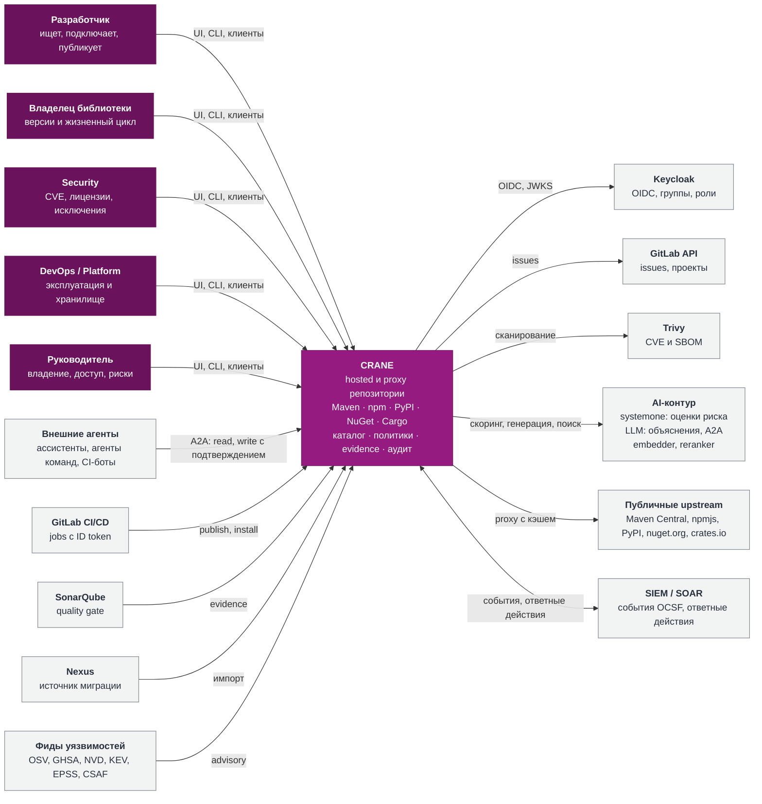

# 5. C4 · Уровень 1: системный контекст

CRANE стоит между командами, их CI и внешними источниками пакетов. Идентичность приходит из Keycloak, контекст сборок из GitLab, результаты анализа из Trivy и SonarQube, сведения об уязвимостях из открытых фидов. AI-контур даёт два разных вида функций: оценки риска (модели systemone) и тексты (LLM). События безопасности уходят в SIEM и SOAR, внешние агенты работают с CRANE через его A2A-агента.

*Рис. 5.1. System Context. Фиолетовым показана проектируемая система, серым внешние системы.*

| Внешняя система | Направление | Что передаётся |
| --- | --- | --- |
| Keycloak | CRANE ↔ KC | OIDC: Authorization Code + PKCE для UI, Device Grant для CLI, Client Credentials для автоматизации; проверка JWT, группы и client roles; back-channel logout и сверка пользователей. Пакетным менеджерам CRANE выдаёт собственные токены, привязанные к личности из Keycloak (раздел 13). Keycloak отвечает за «кто», CRANE за «что можно». |
| GitLab | двусторонне | CI job предъявляет ID token (JWT), получает краткоживущий credential. CRANE создаёт issues, читает метаданные проектов, принимает SBOM и provenance. |
| Trivy | CRANE → Trivy | Trivy в режиме server; CRANE отправляет SBOM или распакованный в песочнице артефакт, получает отчёт с версией сканера и базы. |
| SonarQube | SQ → CRANE | Webhook quality gate или pull через API, привязка к commit SHA. |
| AI-контур | CRANE → AI | **systemone:** структурированные признаки уязвимостей, графа потребителей и лицензий → оценки `exploit_relevance`, `blast_radius`, `license_virality`. **LLM:** заземлённые промпты → объяснения, сводки, разбор намерения A2A. **embedder, reranker:** тексты → векторы и порядок. Контекст проходит ACL и очистку от секретов до отправки. |
| Внешние агенты | Агент → CRANE | A2A (JSON-RPC over HTTPS): read-навыки поиска и объяснений, write-навыки управления метаданными с явным подтверждением. Права вызывающего principal не расширяются. |
| Upstream | CRANE → upstream | Только разрешённые хосты, контроль redirects, размеров, таймаутов. |
| Фиды уязвимостей | Фиды → CRANE | Инкрементальная синхронизация OSV, GHSA, NVD, KEV, EPSS, CSAF; сопоставление с инвентарём по PURL (раздел 14.4). |
| SIEM / SOAR | двусторонне | События по схеме OCSF (syslog RFC 5424 поверх TLS, HTTP JSON, OTLP logs) с hash chain; от SOAR приходят ответные действия через REST (разделы 14.9, 14.10). |
