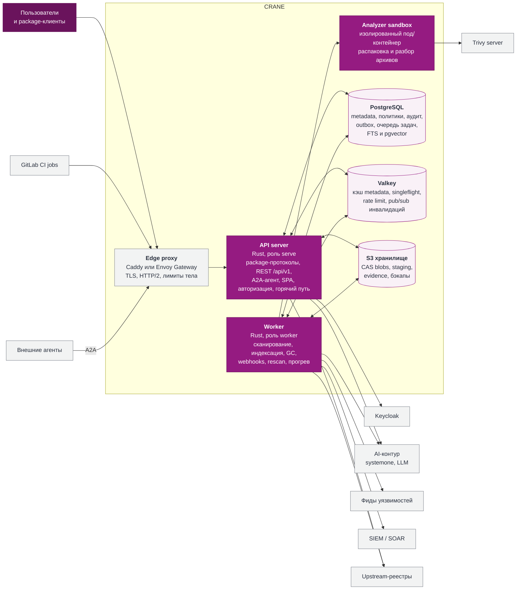

# 6. C4 · Уровень 2: контейнеры

Один исполняемый образ `crane` запускается в разных ролях. Состояние живёт только в PostgreSQL (истина), S3 (байты) и Valkey (эфемерный кэш и координация).

*Рис. 6.1. Containers. API server и Worker собираются из одного бинарника.*

| Контейнер | Технология | Ответственность | Масштабирование |
| --- | --- | --- | --- |
| Edge proxy | Caddy (single node), Envoy Gateway / любой Gateway API (k8s) | TLS, HTTP/2, ограничение размера тела, ранний отказ, доступ-логи. | Горизонтально |
| API server | Rust: tokio, axum, hyper, rustls | Протоколы пяти форматов, REST API, A2A-агент (`/a2a`, Agent Card), вызовы LLM для интерактивных ответов, раздача SPA, аутентификация и авторизация, кэш, proxy fetch, приём публикаций. | Stateless, HPA по RPS и CPU |
| Worker | тот же бинарник | Фоновые задачи из очереди в PostgreSQL: синхронизация фидов уязвимостей, сопоставление и скоринг systemone, экспорт в SIEM, сканы, индекс, эмбеддинги, GC, retention, webhooks, rescan, прогрев кэша, импорт из Nexus. | Горизонтально, по длине очереди |
| Analyzer sandbox | тот же бинарник в роли `analyze`, distroless, seccomp, read-only FS, без сети кроме Trivy | Распаковка недоверенных архивов с лимитами, извлечение metadata и license-файлов, генерация SBOM. | Пул подов, по очереди |
| PostgreSQL | PostgreSQL 17+, pgvector, pg\_trgm | Единственный источник истины. | Primary + синхронные реплики, PgBouncer |
| Valkey | Valkey 8+ | Кэш, распределённые блокировки singleflight, GCRA rate limit, pub/sub. | Sentinel или Cluster |
| S3 | SeaweedFS / RustFS / Ceph RGW / облачный S3, либо локальная ФС | Неизменяемые blobs по SHA-256, staging загрузок, evidence, бэкапы. По умолчанию одно хранилище; классы `primary`, `proxy-cache`, `archive`, `restricted` могут указывать на разные (раздел 9). | По возможностям хранилища |

> **Почему не микросервисы.** Домен реестра компактный, а горячий путь (авторизация → кэш → blob) выигрывает от отсутствия сетевых переходов. Роли процесса дают то же независимое масштабирование, что и сервисы, без распределённых транзакций и десятка деплойментов.
