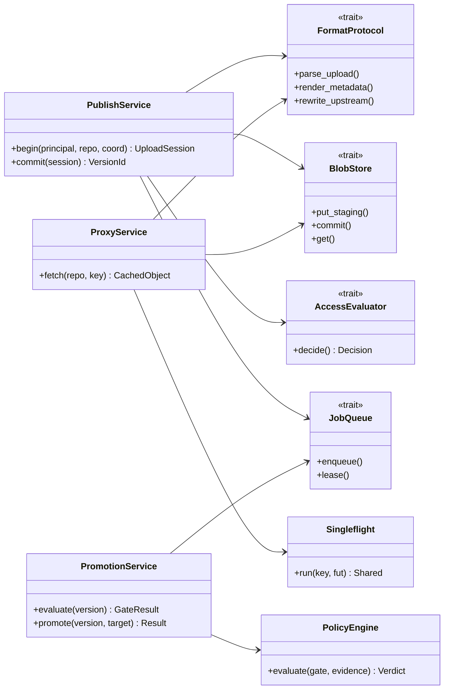

# 8. C4 · Уровень 4: код и абстракции

Расширяемость обеспечивается небольшим числом устойчивых трейтов. Новый формат, хранилище или сканер означает новую реализацию трейта и строку в фабрике конфигурации. Ядро при этом не меняется.

## Структура workspace

Архитектура кода: **DDD + hexagonal (ports & adapters) + clean architecture**. Крейты — это слои, bounded context — модули внутри слоёв `domain`, `ports` и `app`. Раскладка подчиняется «правилу четырёх» (ниже): групповые каталоги содержат только подкаталоги, пакеты лежат на последнем уровне.

```
crane/
├─ crates/
│  ├─ core/                   ядро (гексагон), зависимости только внутрь
│  │  ├─ domain/              сущности, value objects, state machines, ошибки (без IO)
│  │  ├─ ports/               трейты: BlobStore, Cache, JobQueue, Scanner, RiskScorer, AiProvider ...
│  │  ├─ app/                 use cases: publish, fetch, promote, evaluate, search
│  │  └─ access/              политики Cedar, кэш решений, trace
│  ├─ formats/                реализации FormatProtocol
│  │  └─ maven/  npm/  pypi/  nuget/  cargo/
│  ├─ adapters/               driven-адаптеры, реализуют порты
│  │  ├─ persistence/         pg/  valkey/  objstore/
│  │  ├─ identity/            keycloak/  gitlab/
│  │  ├─ external/            upstream/  trivy/  feeds/  siem/
│  │  └─ intelligence/        systemone/  llm/
│  └─ entry/                  driving-слой и composition root
│     ├─ http/                axum routers, middleware, problem+json
│     ├─ worker/              планировщик и обработчики задач
│     ├─ analyzer/            песочница разбора архивов
│     └─ server/              main: роли serve | worker | analyze | all | migrate
├─ web/                       React SPA на собственном UI kit (FSD)
├─ cli/                       CLI cctl (Rust, clap)
└─ deploy/                    compose/, helm/
```

*Рис. 8.0. Раскладка репозитория (CLI называется `cctl`: раздел 19, решение 12).*

## Слои и направление зависимостей

Зависимости направлены внутрь, к предметной области: `entry → adapters | formats | access | app → ports → domain`.

| Слой | Может зависеть от | Правило |
| --- | --- | --- |
| `domain` | ничего из проекта | Без IO, async и фреймворков. Типы, инварианты, state machines. |
| `ports` | `domain` | Только трейты и типы их сигнатур. |
| `app` | `domain`, `ports` | Use cases оркестрируют порты. Тесты идут на in-memory адаптерах. |
| `access` | `domain`, `ports` | Решения доступа и их объяснения. |
| `formats` | `domain`, `ports` | Трансляция протокола клиента в команды ядра. |
| `adapters` | `domain`, `ports` | Реализуют порты; друг друга и `app` не знают. |
| `entry` | все слои | Единственное место, где адаптеры собираются в приложение. |

Матрица лежит в `tools/lint-structure/rules.json` и проверяется на выводе `cargo metadata` в pre-commit и CI: нарушение направления ломает сборку. Bounded context (реестр, цепочка поставки, доступ, аудит и инсайты) — модуль с одним именем в `domain`, `ports` и `app`; контексты общаются через порты и доменные события, а не через типы друг друга.

## Правило четырёх

Правило файловой структуры, одинаковое для Rust (`crates/`, `cli/`) и React (`web/src/`); оно стыкуется с Feature-Sliced Design (раздел 15).

1. Не больше **4 файлов** в папке.
2. Не больше **8 подпапок** в папке.
3. **Смешанные папки запрещены**: в папке либо файлы, либо подпапки.

Не считаются манифесты и конфиги (`Cargo.toml`, `package.json`, `tsconfig*.json`), файлы тестов (`*.test.*`, `*.spec.*`), каталоги `tests/`, `migrations/`, `generated/` и dotfiles. Файлы-входы (`lib.rs`, `main.rs`, `mod.rs`, `index.ts`) не делают папку смешанной, но входят в лимит файлов; поэтому модуль Rust с подмодулями записывается как `foo/mod.rs` и `foo/…`, а не `foo.rs` рядом с `foo/`. Правило проверяет `tools/lint-structure` (pre-commit и CI).

## Ключевые трейты

```rust
/// Протокол формата: трансляция HTTP-запроса в команду ядра и обратно.
pub trait FormatProtocol: Send + Sync + 'static {
    const FORMAT: Format;                              // Maven | Npm | PyPi | NuGet | Cargo
    fn routes(&self) -> Router<AppState>;              // пути протокола
    fn normalize_name(&self, raw: &str) -> Result<PackageName>;   // PEP 503, npm scope, NuGet lower, Cargo: -/_ и регистр
    fn parse_version(&self, raw: &str) -> Result<VersionKey>;     // сортируемый ключ
    fn version_policy(&self) -> MutabilityRules;       // SNAPSHOT, yank, unlist, deprecate
    async fn parse_upload(&self, req: UploadRequest) -> Result<UploadPlan>;
    fn render_metadata(&self, pkg: &PackageView, base: &BaseUrl) -> Result<Rendered>;
    fn rewrite_upstream(&self, body: Bytes, base: &BaseUrl) -> Result<Bytes>; // ссылки → CRANE
    fn render_error(&self, e: &Diagnosed) -> Response;  // ошибка в форме, понятной клиенту
}

/// Неизменяемое content-addressable хранилище.
pub trait BlobStore: Send + Sync {
    async fn put_staging(&self, id: UploadId, body: ByteStream) -> Result<Digests>;
    async fn commit(&self, id: UploadId, sha256: &Sha256) -> Result<BlobRef>; // идемпотентно
    async fn get(&self, sha256: &Sha256, range: Option<Range>) -> Result<ByteStream>;
    async fn presign(&self, sha256: &Sha256, ttl: Duration) -> Result<Option<Url>>;
    async fn delete(&self, sha256: &Sha256) -> Result<()>;
}

/// Решение доступа всегда возвращается вместе с объяснением.
pub trait AccessEvaluator: Send + Sync {
    fn decide(&self, who: &Principal, act: Action, what: &Resource, ctx: &Ctx) -> Decision;
}
pub struct Decision { pub allow: bool, pub rules: Vec<PolicyId>, pub reason: ReasonCode,
                      pub remediation: Vec<Remedy> }

pub trait JobQueue: Send + Sync {
    async fn enqueue(&self, tx: &mut Tx, job: NewJob) -> Result<JobId>; // в той же транзакции
    async fn lease(&self, kinds: &[JobKind], n: usize, ttl: Duration) -> Result<Vec<Job>>;
    async fn complete(&self, id: JobId, outcome: Outcome) -> Result<()>;
}

pub trait Scanner: Send + Sync {
    fn id(&self) -> ScannerId;
    async fn scan_sbom(&self, sbom: &Sbom) -> Result<ScanReport>;     // version + db_version внутри
    async fn db_version(&self) -> Result<DbVersion>;
}

pub trait AiProvider: Send + Sync {
    async fn embed(&self, texts: &[SanitizedText]) -> Result<Vec<Embedding>>;
    async fn rerank(&self, q: &str, docs: &[DocRef]) -> Result<Vec<f32>>;
    async fn complete(&self, p: GroundedPrompt) -> Result<GroundedAnswer>; // с цитатами
}
// Реализации: OpenAiCompatProvider (генерация и embeddings), RerankProvider.
// Каждая роль = упорядоченный список провайдеров с circuit breaker.

/// Скоринг риска моделями systemone: числа для политик, а не тексты.
pub trait RiskScorer: Send + Sync {
    fn model(&self) -> ModelRef;                                   // id и версия пишутся в evidence
    async fn score(&self, kind: ScoreKind, f: &Features) -> Result<Score>;
}
pub enum ScoreKind { ExploitRelevance, BlastRadius, LicenseVirality }
pub struct Score { pub value: f32, pub confidence: f32,          // 0..1
                   pub factors: Vec<Factor>, pub model: ModelRef } // главные факторы для объяснения

/// Источник advisory: инкрементальная выгрузка с курсора.
pub trait AdvisoryFeed: Send + Sync {
    fn id(&self) -> FeedId;                                        // osv | nvd | kev | epss | csaf | internal
    async fn changes_since(&self, cursor: &FeedCursor) -> Result<(Vec<RawAdvisory>, FeedCursor)>;
}

/// Приёмник событий безопасности (SIEM): пакетная доставка, дедупликация по event_id на стороне приёмника.
pub trait SiemSink: Send + Sync {
    async fn deliver(&self, batch: &[OcsfEvent]) -> Result<Delivered>;
}
```

## Диаграмма классов ядра



*Рис. 8.1. Use case сервисы зависят только от трейтов.*

## Паттерны

| Паттерн | Где применяется |
| --- | --- |
| Hexagonal (ports & adapters) | Вся граница ядра. Тесты ядра идут на in-memory адаптерах. |
| Typestate | Жизненный цикл загрузки: `Upload<Staged>` → `Upload<Verified>` → `Version<Committed>`. Пропустить проверку digest невозможно на уровне компилятора. |
| State machine | Версия пакета, exception, promotion request. |
| Transactional outbox | События и задачи пишутся в той же транзакции, что и изменение данных. |
| Singleflight | Proxy fetch и рендер metadata при промахе кэша. |
| Strategy | Политики TTL proxy, правила retention, стратегии выдачи blob (stream или presigned redirect). |
| Specification | Условия политик promotion и retention как композиция предикатов. |
| Circuit breaker, bulkhead | Upstream, Trivy, AI-контур: отдельные пулы соединений и лимиты. |
| CQRS-lite | Отдельные read-модели для каталога и графа потребителей, обновляются из событий. |
