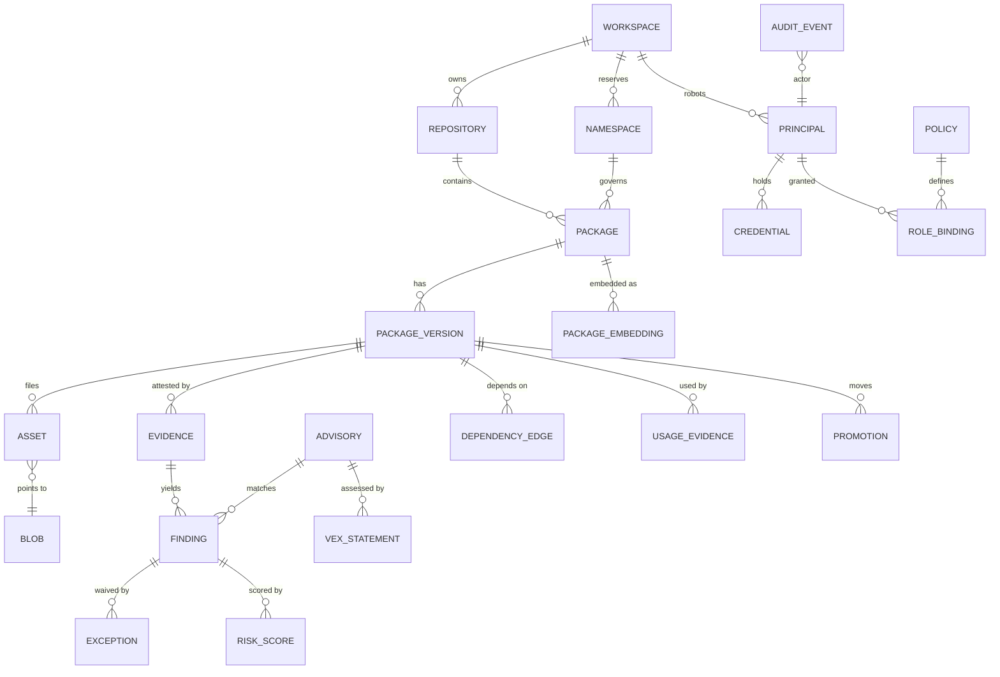
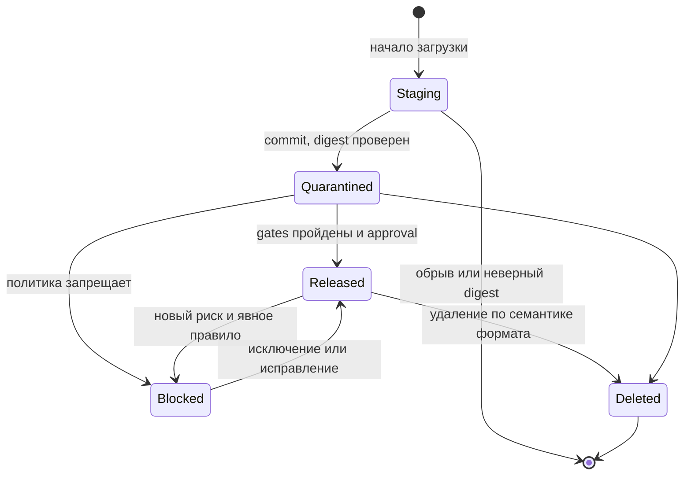

# 9. Структуры данных

Модель следует исходным требованиям: физическое хранение (blob) отделено от логической версии (package version) и от её видимости (state + политики). Идентификаторы версий и репозиториев UUIDv7, монотонные по времени, что хорошо для индексов; `package.id` — `bigint identity` (внутренний ключ, 8-байтовый горячий FK).

## Логическая модель



*Рис. 9.1. Основные сущности и связи.*

## Ключевые таблицы PostgreSQL

```sql
CREATE TYPE pkg_format AS ENUM ('maven','npm','pypi','nuget','cargo');
CREATE TYPE repo_kind  AS ENUM ('hosted','proxy');
CREATE TYPE ver_state  AS ENUM ('quarantined','released','blocked','deleted');

CREATE TABLE repository (
  id uuid PRIMARY KEY, workspace_id uuid NOT NULL REFERENCES workspace,
  format pkg_format NOT NULL, kind repo_kind NOT NULL, name text NOT NULL,
  upstream_url text,                 -- только proxy; задаётся при создании из allowlist; смена — через /protection
  config jsonb NOT NULL DEFAULT '{}', -- эксплуатационные: TTL, лимиты, delivery, класс хранения; защитные (mutable, dev_skip_quarantine) — только через /protection
  UNIQUE (format, name));

CREATE TABLE namespace (
  id uuid PRIMARY KEY, workspace_id uuid NOT NULL, format pkg_format NOT NULL,
  pattern text NOT NULL,             -- '@acme/*', 'com.acme.*', 'acme-*'
  pattern_kind text NOT NULL,        -- exact | prefix | scope
  reserved boolean NOT NULL DEFAULT true,  -- запрет fallback в upstream
  UNIQUE (format, pattern));

CREATE TABLE package (
  id bigint GENERATED ALWAYS AS IDENTITY PRIMARY KEY,  -- внутренний ключ, наружу не выдаётся
  repository_id uuid NOT NULL, namespace_id uuid,
  name_norm text NOT NULL, name_display text NOT NULL,
  owner_workspace_id uuid, gitlab_project_id bigint,
  lifecycle text NOT NULL DEFAULT 'active', -- active | deprecated | eol
  replacement_id bigint, description text,
  search_tsv tsvector GENERATED ALWAYS AS (...) STORED,
  UNIQUE (repository_id, name_norm));

CREATE TABLE package_embedding (
  package_id bigint NOT NULL REFERENCES package ON DELETE CASCADE,
  model text NOT NULL,               -- идентификатор модели и версии из конфигурации
  dim smallint NOT NULL,             -- размерность модели
  embedding halfvec NOT NULL,        -- halfvec(N) по модели; без typmod, у каждой модели своя N
  updated_at timestamptz NOT NULL,
  PRIMARY KEY (package_id, model),
  CHECK (vector_dims(embedding) = dim));
ALTER TABLE package_embedding ALTER COLUMN embedding SET STORAGE PLAIN;  -- вектор inline, без TOAST

CREATE TABLE package_version (
  id uuid PRIMARY KEY, package_id bigint NOT NULL REFERENCES package,
  version text NOT NULL,             -- каноническая форма (Cargo: SemVer без build metadata), ключ уникальности
  version_display text NOT NULL,     -- написание клиента, как name_display у пакета
  purl text NOT NULL,                -- pkg:npm/%40acme/ui@1.2.3, ключ графа
  state ver_state NOT NULL, mutable boolean NOT NULL DEFAULT false,
  yanked boolean NOT NULL DEFAULT false, deprecated_msg text,
  published_by uuid NOT NULL, published_at timestamptz NOT NULL,
  metadata json NOT NULL,            -- metadata формата как есть; json, не jsonb (см. ниже)
  UNIQUE (package_id, version));

CREATE TABLE blob_store (
  id text PRIMARY KEY,               -- 'main' | 'cache' | 'cold' | 'restricted-eu' ...
  class text NOT NULL,               -- primary | proxy-cache | archive | restricted
  backend jsonb NOT NULL,            -- s3: endpoint, bucket, prefix, kms key | file: path
  writable boolean NOT NULL DEFAULT true);  -- false: только чтение, идёт вывод из эксплуатации

CREATE TABLE blob (
  store_id text NOT NULL REFERENCES blob_store,
  sha256 bytea NOT NULL, size bigint NOT NULL,
  sha512 bytea, sha1 bytea, md5 bytea,               -- для протоколов клиентов
  created_at timestamptz NOT NULL, verified_at timestamptz,
  gc_mark timestamptz,               -- момент, когда blob стал кандидатом
  PRIMARY KEY (store_id, sha256));   -- дедупликация в пределах хранилища

CREATE TABLE asset (
  version_id uuid NOT NULL REFERENCES package_version,
  path text NOT NULL, store_id text NOT NULL, blob_sha256 bytea NOT NULL,
  FOREIGN KEY (store_id, blob_sha256) REFERENCES blob,
  media_type text, PRIMARY KEY (version_id, path));

CREATE TABLE credential (
  id uuid PRIMARY KEY, principal_id uuid NOT NULL,
  kind text NOT NULL,                -- personal | robot | workload
  prefix text UNIQUE NOT NULL,       -- 'crp_' | 'crr_' | 'crci_' + 8 символов, ищется по нему
  secret_hmac bytea NOT NULL,        -- HMAC-SHA256(pepper, secret)
  scopes jsonb NOT NULL, expires_at timestamptz NOT NULL,
  last_used_at timestamptz, revoked_at timestamptz);

CREATE TABLE audit_event (
  id bigint GENERATED ALWAYS AS IDENTITY, ts timestamptz NOT NULL,
  actor uuid, action text, resource text, decision text, reason jsonb,
  request_id text, prev_hash bytea NOT NULL, hash bytea NOT NULL
) PARTITION BY RANGE (ts);           -- помесячные партиции, append-only роль

CREATE TABLE advisory (
  id text PRIMARY KEY,               -- канонический id: CVE-…, GHSA-…, MAL-…, internal-…
  aliases text[] NOT NULL,           -- граф псевдонимов CVE ↔ GHSA ↔ OSV
  ecosystem pkg_format NOT NULL, name_norm text NOT NULL,
  ranges jsonb NOT NULL,             -- диапазоны в семантике формата, исправленные версии
  severity jsonb, epss real, in_kev boolean NOT NULL DEFAULT false,
  is_malware boolean NOT NULL DEFAULT false, withdrawn_at timestamptz,
  sources jsonb NOT NULL, modified_at timestamptz NOT NULL);
CREATE INDEX advisory_by_name ON advisory (ecosystem, name_norm);  -- сопоставление по имени

CREATE TABLE risk_score (
  subject_id uuid NOT NULL,          -- finding или license_decision
  kind text NOT NULL,                -- exploit_relevance | blast_radius | license_virality
  value real NOT NULL, confidence real NOT NULL, factors jsonb NOT NULL,
  model text NOT NULL, model_version text NOT NULL, features_hash bytea NOT NULL,
  shadow boolean NOT NULL DEFAULT false,   -- теневой режим новой версии модели
  created_at timestamptz NOT NULL,
  PRIMARY KEY (subject_id, kind, model_version));

CREATE TABLE evidence (
  id uuid PRIMARY KEY,               -- UUIDv7
  version_id uuid NOT NULL REFERENCES package_version,
  subject_sha256 bytea NOT NULL,     -- digest файла версии, о котором утверждение; при приёме сверяется с blob
  kind text NOT NULL,                -- dsse | sigstore | pgp | jwt | none: чем проверять; gate не читает
  predicate_type text NOT NULL,      -- URI типа содержимого; вид доказательства для gates и UI
  trust text NOT NULL,               -- upstream | publisher | integration | crane: откуда пришло
  signer_issuer text, signer_subject text, signer_san text,  -- кто подписал; NULL у неподписанного report
  facts jsonb NOT NULL DEFAULT '{}', -- извлечённое для gates и карточки: builder, repo, commit, run; для скана — версия сканера и базы
  verify_result text NOT NULL,       -- valid | invalid | unverifiable | unsigned
  verify_detail jsonb,               -- причина отказа, версия trust root
  verified_at timestamptz,
  tlog jsonb,                        -- запись Rekor: log id, index, integrated time; NULL без журнала
  object_key text NOT NULL,          -- исходный документ в S3 как есть (bundle, SBOM, отчёт); ключ по sha256 самого документа
  media_type text NOT NULL,
  created_at timestamptz NOT NULL,
  CHECK ((kind = 'none') = (verify_result = 'unsigned')));
CREATE INDEX evidence_by_type ON evidence (version_id, predicate_type, created_at DESC);  -- evidence.latest(version, types)
```

Evidence расширяется строками, а не колонками. Новый вид доказательства означает новую строку с новым URI в `predicate_type`; ни колонка, ни enum не добавляются. Gates и UI читают evidence только по `predicate_type`. Подписанность выражена в `verify_result`, а `kind` (формат конверта) нужен лишь верификатору: отчёт Trivy и SLSA provenance из npm одинаково доходят до gate, а политика решает по `trust` и `verify_result`, чему доверять. Голая подпись файла (PGP, Sigstore без предиката) тоже получает свой URI, поэтому `predicate_type` всегда заполнен и NULL в ключе индекса нет.

Известные predicate type:

| Вид содержимого | `predicate_type` | Конверт (`kind`) | Кто производит |
| --- | --- | --- | --- |
| SLSA Provenance | `https://slsa.dev/provenance/v1` | sigstore, dsse; jwt | npm provenance, PyPI, свой CI; CRANE из claims ID token (`trust = crane`, с v0.6.0) |
| PyPI Publish | `https://docs.pypi.org/attestations/publish/v1` | sigstore, dsse | PyPI (Trusted Publishing) |
| SBOM CycloneDX | `https://cyclonedx.org/bom` | sigstore, dsse, none | свой CI, upstream |
| SBOM SPDX 2.x и 3 | `https://spdx.dev/Document`, `https://spdx.dev/Document/v3` | sigstore, dsse, none | свой CI, upstream |
| Скан уязвимостей | `https://in-toto.io/attestation/vulns/v0.2` | none | Trivy в CRANE |
| VEX | `https://openvex.dev/ns/v0.2.0` | sigstore, dsse, none | издатель пакета, security |
| Quality gate SonarQube | `urn:crane:quality-gate:v1` (внутренний URI CRANE) | none | SonarQube через интеграцию |
| Подпись файла (Maven `.asc`; `.sigstore.json` с messageSignature) | `urn:crane:file-signature:v1` (внутренний URI CRANE) | pgp, sigstore | издатель Maven, upstream |

Требование действует с P0: таблица появляется в v0.6.0 (см. «Отложено») сразу в этой форме, с одним видом — provenance из claims. Provenance хранится в одном месте, карточка версии читает её из evidence с самого начала, а v1.1.0 добавляет виды без миграции. Менять тип колонок после накопления evidence дороже, чем зафиксировать форму сейчас.

Порядок версий в схеме не хранится: `sort_key` убран из таблицы. Порядко-сохраняющее кодирование для Maven и PEP 440 — отдельная задача на появление потребителя; индекс Cargo упорядочен по публикации `(published_at, id)`.

`metadata` имеет тип `json`, а не `jsonb`: `jsonb` переписывает текст (порядок ключей, пробелы), а metadata формата — непрозрачные байты для индекса Cargo и ETag, они должны вернуться побайтно.

Строки proxy-репозиториев. Строки `package`, `package_version`, `asset` и `blob` создаются при первой выдаче артефакта proxy, в той же транзакции, что commit в CAS (хвост `publish` из 10.1 с системным принципалом `upstream`; `published_by` — он). `published_at` — время публикации upstream, если оно известно, иначе время commit; `served()` эту колонку не читает. Документы (packument с тысячами версий) строк не создают. Отдельной колонки происхождения нет: строка proxy-репозитория — это `repository.kind = 'proxy'`. `state` строки хранит только решения о версии (hold по регрессии attestation, ручная блокировка, удаление); состояние версии в API — вердикт `served()`. Новая строка рождается `released`: у CRANE нет возражений. Карантин по возрасту и блокировки по диапазонам в строки не пишутся, их применяет `served()` при каждой выдаче (10.2). Поэтому они действуют и на версии без строки, а снятие блокировки ничего не восстанавливает. Досрочный выпуск из окна карантина — строка `promotion`, как у hosted. Флаги `yanked` и `deprecated_msg` у proxy-строк — снимок upstream на момент материализации; при выдаче они не читаются, документ рендерится из `px:`.

Групповых репозиториев нет (19 #28). Строка `package` hosted-репозитория создаётся с первой версией и не удаляется: это и есть резервирование имени (10.3).

`config` — эксплуатационные настройки; защитные (`mutable`, `dev_skip_quarantine` у hosted, `upstream_url` у proxy) меняются отдельной операцией, права — 14.12.

### Эмбеддинги пакетов

Одна строка на пару (пакет, модель). Смена модели или размерности идёт «рядом»: заполнить строки новой модели, построить её индекс, переключить читаемую модель в конфигурации, затем удалить строки старой модели и её индекс. Горячая таблица `package` при этом не переписывается. У колонки нет typmod, потому что размерности у моделей разные; HNSW требует фиксированной размерности, поэтому у каждой модели свой индекс по выражению с частичным предикатом (pgvector README, «Indexing vectors with different dimensions»):

```sql
CREATE INDEX CONCURRENTLY package_embedding_hnsw_<model> ON package_embedding
  USING hnsw ((embedding::halfvec(1024)) halfvec_cosine_ops) WITH (m = 32, ef_construction = 256)
  WHERE model = '<model>';
```

Индекс строит задача воркера, а не статическая миграция: он зависит от модели, которую выбрал оператор. `SET STORAGE PLAIN` нужен потому, что, по README pgvector, планировщик не учитывает внешнее (out-of-line) хранение, а `halfvec(1024)` ≈ 2 КБ лежит на пороге TOAST. Эмбеддинг строится на пакет, а не на версию: текст составляют имя, описание, ключевые слова и README последней выпущенной версии; при изменении текста вектор пересчитывается. Алгоритм поиска и обоснование параметров: 10.10.

## Реализовано в v0.1.0

В `crane-pg` реализован минимальный срез; остальные колонки и таблицы из схемы выше добавляются позже nullable-расширением (expand).

```sql
-- migrations/0001_catalog.sql (crane-pg); типы pkg_format, repo_kind, ver_state как выше
CREATE TABLE repository (
  id uuid PRIMARY KEY, format pkg_format NOT NULL, kind repo_kind NOT NULL, name text NOT NULL,
  CONSTRAINT repository_format_name_key UNIQUE (format, name));

CREATE TABLE package (
  id bigint GENERATED ALWAYS AS IDENTITY PRIMARY KEY,
  repository_id uuid NOT NULL,
  name_norm text NOT NULL, name_display text NOT NULL,
  CONSTRAINT package_repository_id_fkey FOREIGN KEY (repository_id) REFERENCES repository (id),
  CONSTRAINT package_repository_id_name_norm_key UNIQUE (repository_id, name_norm));

CREATE TABLE package_version (
  id uuid PRIMARY KEY, package_id bigint NOT NULL REFERENCES package (id),
  version text NOT NULL, version_display text NOT NULL,
  state ver_state NOT NULL, yanked boolean NOT NULL DEFAULT false,
  deprecated text,                   -- миграция 0002: сообщение deprecate (npm), NULL - не устарела
  published_at timestamptz NOT NULL, metadata json NOT NULL,
  CONSTRAINT package_version_package_id_version_key UNIQUE (package_id, version)
) WITH (fillfactor = 90);

-- Миграция 0002: dist-теги npm. Пакет тега совпадает с пакетом версии (set_tag выводит его из версии).
CREATE TABLE dist_tag (
  package_id bigint NOT NULL REFERENCES package (id), tag text NOT NULL,
  version_id uuid NOT NULL REFERENCES package_version (id),
  PRIMARY KEY (package_id, tag));

CREATE TABLE blob (
  store_id text NOT NULL, sha256 bytea NOT NULL CHECK (octet_length(sha256) = 32),
  size bigint NOT NULL CHECK (size >= 0), created_at timestamptz NOT NULL DEFAULT now(),
  PRIMARY KEY (store_id, sha256));

CREATE TABLE asset (
  version_id uuid NOT NULL REFERENCES package_version (id), path text NOT NULL,
  store_id text NOT NULL, blob_sha256 bytea NOT NULL,
  PRIMARY KEY (version_id, path),
  FOREIGN KEY (store_id, blob_sha256) REFERENCES blob (store_id, sha256));
```

*Рис. 9.3. Срез схемы v0.1.0 плюс миграция 0002 (`deprecated`, `dist_tag`).* Адаптер читает имена ограничений `package_repository_id_fkey` (нарушение значит «нет репозитория») и `package_version_package_id_version_key` (версия занята). `store_id` адаптер задаёт явно (константа `'main'`), значения по умолчанию в колонке нет. Файлы версии читаются в байтовом порядке `path` (`COLLATE "C"`), чтобы результат не зависел от локали БД.

| Отложено | Когда добавляется |
| --- | --- |
| `namespace`, `package.namespace_id`, `workspace_id` | Защита от dependency confusion и workspaces (v0.2.0 и позже) |
| `purl`, `sort_key`, `mutable`, `published_by` | Появление потребителя (граф, сортировка, аудит публикаций) |
| `sha512`, `sha1`, `md5`, `media_type` | Форматы, которым нужны эти дайджесты и типы |
| таблица `blob_store` | Второе физическое хранилище; пока `store_id` — текст без FK |
| `package_embedding` | Векторный поиск, P3 / v1.2.0 |
| `download_event` | v0.4.0, вместе с журналом аудита |
| таблица `evidence` | v0.6.0 (P1): таблица целиком, первый вид — provenance из claims; v1.1.0 добавляет виды без миграции |

## Масштаб L: каталог

Профиль L (раздел 3): 1–5 млн пакетов (hosted и proxy), десятки миллионов версий и файлов.

**Замер на синтетике, PG 17, 2026-10-27**, после `VACUUM ANALYZE`. Набор: 1 млн пакетов, по 10 версий (10 млн версий), по одному asset и одному blob на версию, `metadata` ≈ 96 Б (малый JSON вроде cargo).

| Таблица | Строк | Heap | Индексы | На строку (heap / индексы) |
| --- | --- | --- | --- | --- |
| `package` | 1 млн | 73 МБ | 105 МБ (PK и UNIQUE `(repository_id, name_norm)`) | ~73 Б / ~105 Б |
| `package_version` | 10 млн | 1953 МБ | 809 МБ (PK uuid и UNIQUE `(package_id, version)`) | ~195 Б с учётом fillfactor 90 (средний tuple 176 Б, из них `metadata` 96 Б) / ~81 Б |
| `asset` | 10 млн | 965 МБ | 611 МБ (PK) | ~96 Б / ~61 Б |
| `blob` | 10 млн | 805 МБ | 731 МБ (PK) | ~80 Б / ~73 Б |

Итого ≈ 6 ГБ на 10 млн версий.

**Экстраполяция на L:** 10–100 млн версий, то есть ×1–×10 к замеру, ≈ 6–60 ГБ, а пакетов 1–5 млн (×1–×5 для `package`). Сверху добавится рост `metadata`: реальная metadata cargo крупнее 96 Б, а значения больше ~2 КБ уходят в TOAST (сжатие, отдельная relation, в строке остаётся указатель). Число asset на версию в других форматах больше одного (Maven), тогда `asset` растёт пропорционально. Blob после дедупликации не больше числа asset.

Индекс правил deny (10.2) живёт в памяти реплики и ключуется по (format, name_norm). Индекс строится по строкам `emergency_block`: приём `MAL-*` создаёт их сотни тысяч, но по одной на имя, поэтому порядок объёма — десятки МБ (оценка, не замер).

**Планы запросов** (`EXPLAIN (ANALYZE, BUFFERS)`, тот же набор):

| Запрос | План |
| --- | --- |
| `find_version` | Index scan по UNIQUE `package`, затем index scan по UNIQUE `(package_id, version)`; 9 buffers, 0,04 мс при тёплом кэше |
| `versions()` | UNIQUE `package`, range scan по префиксу `package_id` в UNIQUE `package_version`, quicksort строк одного пакета в памяти; asset каждой версии читается через PK `asset` плюс проба по PK `blob` |
| `set_yanked`, `transition` | Index scan по `package_version_pkey` |

Однострочная таблица `repository` читается seq scan: для крошечной таблицы это нормально.

| Индекс | Какой запрос обслуживает |
| --- | --- |
| `package`: UNIQUE `(repository_id, name_norm)` | Поиск пакета по имени в репозитории |
| `package_version`: UNIQUE `(package_id, version)` | `find_version`; уникальность при публикации; `versions()` — range scan по префиксу `package_id`, сортировка строк одного пакета в памяти, отдельный индекс не нужен |
| `package_version`: PK `id` | `transition`, `set_yanked`, `set_deprecated`, `set_tag` |
| `dist_tag`: PK `(package_id, tag)` | `tags` (range scan по префиксу `package_id`, порядок `COLLATE "C"`), upsert при `set_tag` и публикации с тегами, `remove_tag` |
| `asset`: PK `(version_id, path)` | Файлы версии |
| `blob`: PK `(store_id, sha256)` | Дедупликация при публикации; цель FK из `asset` |

Правила и заметки:

-   **fillfactor 90 у `package_version`.** `state` и `yanked` не проиндексированы, поэтому их UPDATE идут как HOT (без записи в индексы); запас на странице даёт fillfactor. Inline-`metadata` ≤ ~2 КБ копируется целиком при каждом UPDATE строки; большая уходит в TOAST и копируется только указатель.
-   **Нет индекса `asset(store_id, blob_sha256)`** до появления GC; тогда он добавляется `CREATE INDEX CONCURRENTLY`.
-   **Нет OFFSET-пагинации и `count(*)` на горячих путях**: курсорная выборка по ключу.
-   **UUIDv7 для `version.id`.** Вставки в PK-индекс остаются почти append-only; v4 даёт случайные расщепления страниц. `IdGen` обязан выдавать v7.
-   **Миграции безопасны онлайн.** `CREATE INDEX CONCURRENTLY` в отдельной миграции без транзакции; без перезаписи таблиц; `NOT NULL` через `NOT VALID` + `VALIDATE CONSTRAINT`; значения enum только добавляются.

## Масштаб L: эмбеддинги

**Оценка, не замер** (в отличие от таблицы каталога выше): синтетического замера для векторов ещё не было. Исходные данные: 1–5 млн пакетов, одна строка на пакет и модель.

| Величина | Оценка |
| --- | --- |
| Значение `halfvec(1024)` | ≈ 2 КБ |
| Heap `package_embedding` | ≈ 2–10 ГБ |
| Индекс HNSW (m = 32) | ≈ 2,5–3 КБ на элемент: ≈ 3 ГБ на 1 млн, ≈ 13–15 ГБ на 5 млн пакетов |
| То же на `vector(1024)` | примерно в 2–3 раза больше |

Профиль L: PostgreSQL с 64 ГБ RAM (16.3), `shared_buffers` ≈ 16 ГБ. На 5 млн пакетов один индекс подходит к размеру `shared_buffers`. Главный урок источника [2] из 10.10: индекс должен помещаться в память (в [2] индекс `vector` в 14 ГБ не влез в 12 ГБ `shared_buffers`, а `halfvec` сократил его до 7,2 ГБ). Отсюда правила:

-   `halfvec` обязателен, размерность не выше 1024; размер индекса сравнивается с `shared_buffers` в мониторинге.
-   Во время смены модели два индекса сосуществуют и занимают память вдвое: смену планируют заранее.
-   **Сборка.** `maintenance_work_mem` соразмерен графу (в [2]: 14 ГБ для 925 тыс. векторов размерности 2000, 7 параллельных воркеров, ≈ 15 мин; бюджет в контейнере 40 ГБ: 16 ГБ `shared_buffers` + 14 ГБ сборка + ≈ 4 ГБ соединения). Для параллельной сборки HNSW `/dev/shm` (Docker `--shm-size`, k8s `emptyDir` с `medium: Memory`) не меньше `maintenance_work_mem` (pgvector README); также настраивается `max_parallel_maintenance_workers`.
-   После подмены индекса его прогревают `pg_prewarm` (contrib).

Перед v1.2.0 рекомендуется синтетический замер, как для каталога: размер heap и индекса, время сборки, задержка и recall при ACL-фильтре.

## Поток скачиваний

Решение владельца: фиксируются **100%** успешных скачиваний файлов (вместо выборки 10%). Поток идёт в отдельную партиционированную таблицу доступа с большим объёмом записи, а не в `audit_event` с хэш-цепочкой.

```sql
CREATE TABLE download_event (
  ts timestamptz NOT NULL,
  repository_id uuid NOT NULL,       -- hosted или proxy: откуда отдано
  purl text NOT NULL,                -- pkg:npm/event-stream@3.3.6; переживает удаление версии и архив
  blob_sha256 bytea NOT NULL,        -- какой файл отдан; совпадает с индикатором компрометации
  actor uuid,                        -- принципал
  credential_id uuid,                -- каким токеном; ни секрета, ни его хэша
  client_ip inet,
  request_id uuid NOT NULL
) PARTITION BY RANGE (ts);           -- суточные партиции, роль только INSERT
-- на каждой партиции:
CREATE INDEX ON download_event_YYYYMMDD (purl text_pattern_ops, ts);  -- «кто скачал версию X между T1 и T2»; префикс 'pkg:npm/event-stream@' — любую версию
CREATE INDEX ON download_event_YYYYMMDD (actor, ts);                  -- «что скачивал робот R»
CREATE INDEX ON download_event_YYYYMMDD USING brin (ts);              -- почасовой дайджест читает час, а не сутки
```

-   Ключ — `purl`, а не `version_id`: скачивание из proxy создаёт строку `package_version` только при первой выдаче артефакта (10.2), а `purl` переживает удаление версии и архивирование.
-   Запрос «кто скачал версию X между T1 и T2» — отсечение партиций по `ts` и префиксный скан по `(purl, ts)`; префикс без версии (`pkg:npm/event-stream@`) даёт любую версию пакета.
-   Поиск по `blob_sha256` (совпадение с индикатором компрометации) — скан окна хранения: индекса нет намеренно, запрос редкий, а индекс удорожил бы каждую вставку.
-   Нет FK и нет хэш-цепочки на каждую строку: это дорого на таком потоке. Целостность обеспечивает почасовое событие `audit.download_digest` в цепочке журнала (подробности в 14.13). Его пишет та же почасовая задача, что и `audit.anchor` (10.13): в h+15 мин она записывает дайджест часа h, затем якорь, так что дайджест сразу попадает в WORM. Реплики отбрасывают строки старше 10 мин (запас 5 мин на расхождение часов до дайджеста в 15 мин); такие строки считаются потерянными.
-   Запись пакетная, `COPY` из каждой реплики API: раз в 1 с или по 5 000 строк.
-   Партиции создаёт заранее задача воркера, удаляются они через `DROP` (без `DELETE`: нет мёртвых строк и нагрузки на vacuum).
-   User agent и путь не хранятся: они есть в access-логе stdout.

**Объём для L (оценка, не замер).** L = 50–200 тыс. CI-задач в сутки, ≈ 1 500 запросов на задачу (раздел 3), примерно половина из них скачивания файлов: ≈ 35–150 млн строк в сутки. Строка ≈ 250 Б (heap, два btree и BRIN): ≈ 9–37 ГБ в сутки, за 90 суток ≈ 0,8–3,3 ТБ. Поэтому онлайн-окно по умолчанию: 90 суток в L и 12 месяцев в S и M. Старые партиции архивируются в сжатом виде в WORM-хранилище объектов. В L поток может жить в отдельном tablespace или в отдельном экземпляре PostgreSQL, чтобы не раздувать бэкапы и реплики каталога.

## Очередь задач

Таблица `job` рассчитана на профиль L и устроена как очередь с visibility timeout (по образцу SQS): взятая задача не удаляется, а становится невидимой до `run_at`.

```sql
CREATE TABLE job (
  id bigint GENERATED ALWAYS AS IDENTITY PRIMARY KEY,
  kind text NOT NULL, payload json NOT NULL,
  attempts int NOT NULL DEFAULT 0,
  run_at timestamptz NOT NULL DEFAULT now(),  -- «невидима до»: срок lease или время повтора; новая задача видна сразу, если производитель не задал позже
  claimed_at timestamptz,            -- без индекса, для наблюдаемости
  last_error text);
CREATE INDEX job_run_at ON job (run_at);   -- единственный индекс, кроме PK
```

```sql
-- claim
UPDATE job SET run_at = now() + $lease, attempts = attempts + 1, claimed_at = now()
WHERE id IN (SELECT id FROM job WHERE kind = ANY($1) AND run_at <= now()
             ORDER BY run_at LIMIT $n FOR UPDATE SKIP LOCKED)
RETURNING id, kind, payload, attempts;
```

| Событие | Операция |
| --- | --- |
| Успех | `complete(Claimed)`: `DELETE FROM job WHERE id = $1 AND attempts = $2` (id и attempts берутся из `Claimed`); завершённые задачи удаляются, а не помечаются |
| Ошибка | `fail(Claimed, error)`: `UPDATE job SET run_at = now() + backoff, last_error = $3 WHERE id = $1 AND attempts = $2` |
| Исчерпаны попытки | Строка переезжает в append-only `job_dead` (партиции по `died_at`, если таблица растёт) |
| Просрочен lease | Задача снова видна по `run_at <= now()` и берётся другим воркером |

-   **`attempts` — токен владения.** Воркер с истёкшим lease не перезапишет задачу, которую уже взял другой: его `complete` и `fail` не совпадут по `attempts` из `Claimed`. Поэтому обработчики идемпотентны.
-   **Горячая таблица маленькая**: только невыполненные и выполняемые задачи.
-   **autovacuum агрессивный** из-за churn от DELETE и UPDATE: например, `autovacuum_vacuum_scale_factor = 0.01` и малая задержка cost. fillfactor не настраивается: claim меняет индексированный `run_at`, HOT невозможен.
-   **Пробуждение воркеров:** `NOTIFY` в той же транзакции, что и вставка, плюс периодический опрос как запасной путь. `LISTEN` требует отдельного прямого соединения и не работает через PgBouncer в transaction mode.
-   **Отклонено: удерживать row lock всё время выполнения задачи.** Это занимает соединение пула, а долгие транзакции держат `xmin` и тормозят vacuum.
-   **Outbox с relay** нужен только для внешней доставки (webhooks, SIEM): P2 / v1.1.0. Внутренние задачи идут через `job`. Инвалидация кэша metadata в v0.2.0 — прямая после commit, TTL как страховка; очередь не нужна.

## Полный перечень таблиц

| Группа | Таблицы |
| --- | --- |
| Каталог | `workspace`, `repository`, `namespace`, `namespace_owner_history`, `package`, `package_version`, `asset`, `blob`, `blob_store`, `dist_tag` (npm), `upload_session` |
| Поиск | `package_embedding` |
| Доступ | `principal`, `group_mapping` (Keycloak → роли), `role_binding`, `policy` (Cedar), `credential`, `trust_policy` (издатель OIDC и claims → права) |
| Безопасность | `evidence`, `finding` (приоритет, SLA, источник), `exception`, `license_decision`, `license_policy`, `promotion`, `approval` |
| Уязвимости и скоринг | `advisory`, `feed_cursor`, `risk_score`, `vex_statement`, `emergency_block`, `break_glass_grant` |
| Граф | `dependency_edge`, `usage_evidence`, `consumer` (проект, сборка, деплой) |
| Эксплуатация | `job`, `job_dead`, `outbox`, `webhook_subscription`, `webhook_delivery`, `idempotency_key`, `retention_rule`, `retention_hold`, `quota_usage`, `audit_event`, `download_event`, `siem_sink`, `siem_cursor` |

## Жизненный цикл версии



*Рис. 9.2. State machine версии. Staging не виден клиентам, Deleted оставляет tombstone, повторно занять номер релиза нельзя.*

Ортогонально состоянию живут флаги формата: `yanked` (PyPI PEP 592, Cargo), `unlisted` (NuGet), `deprecated` (npm, NuGet), `dist-tags` (npm). Для dev-репозиториев политика может пропускать quarantine.

### Семантика удаления, скрытия и перезаписи по форматам

| Формат | Перезапись release | Скрытие | Удаление | Mutable |
| --- | --- | --- | --- | --- |
| Maven | Запрещена | Нет в протоколе; `blocked` с диагностикой | Tombstone, номер не переиспользуется | SNAPSHOT: timestamp-версии, хранится N последних |
| npm | Запрещена (как в npmjs) | `deprecate`, перенос dist-tag | `unpublish` по политике (окно 72 ч), tombstone | Нет; pre-release через dist-tags |
| PyPI | Запрещена, имя файла уникально навсегда | `yank` (PEP 592) | Tombstone, имя файла не переиспользуется | Нет; dev-релизы `.devN` |
| NuGet | Запрещена | `unlist` | Tombstone | Нет; pre-release суффиксы |
| Cargo | Запрещена, пара «крейт + версия» неизменяема | `yank` и обратный `unyank` (версия остаётся доступной по lockfile) | Tombstone, версия не переиспользуется (как на crates.io) | Нет; pre-release по SemVer (`1.0.0-rc.1`) |

## Valkey: пространство ключей

| Ключ | Значение и TTL |
| --- | --- |
| `md:<repo>:<name>` | Отрендеренная metadata (сжатая zstd) + ETag; TTL по эвристике 11.1; инвалидация по событию. Для proxy — документ после фильтра `served()`; сырой документ upstream — в `px:`. |
| `px:<repo>:<path>` | Запись proxy-кэша: факты (время получения; тело, ETag и max-age документа; дайджесты артефакта или счётчик 404), ручной бинарный формат с байтом версии (кодек v2: blob несёт sha256, sha512, sha1 и размер; записи v1 читаются как промах). TTL = `keep_for` из политики; у артефактов TTL нет. |
| `sf:<repo>:<path>` | Lease singleflight: `SET NX PX` с токеном-фенсингом, снимается Lua-скриптом только своим токеном. |
| `rl:<principal>:<bucket>` | Теоретическое время прибытия GCRA; Lua-скрипт атомарно. |
| `ep:<principal>` | Эпоха авторизации; инкремент при отзыве, блокировке, смене групп. |
| `dl:<version>` | Счётчик скачиваний; сбрасывается в PostgreSQL пакетно раз в минуту. |
| канал `inv` | Pub/sub инвалидаций: metadata, эпохи, политики. Для proxy payload — имя изменившегося ключа (`px:…`); его публикуют запись в кэш и снятие lease, подписчик сбрасывает L1 и будит ждущих. |

Угловые скобки в именах ключей — нотация; литеральные `{…}` в ключах не используются, потому что в Valkey Cluster это hash tag.

## Раскладка объектного хранилища

```
blobs/sha256/9f/86/9f86d081884c7d659a2feaa0c55ad015a3bf4f1b2b0b822cd15d6c15b0f00a08
staging/0192c1a4-7d2e-7c3b-9a51-6f0d3e4b8a11                (lifecycle: удалить через 24 ч)
evidence/5c1e....json.zst                                   (sha256 документа; вид — в строке БД, не в пути)
backup/pg/...  backup/manifests/...
```

Staging-объекты лежат плоско под `staging/<uuid>`: S3 lifecycle работает по префиксу и возрасту объекта, папки с датами не нужны. Ключ blob вычисляется из SHA-256, поэтому одинаковые файлы в разных репозиториях одного хранилища хранятся один раз, а проверка целостности сводится к пересчёту хэша.

## Хранилища blob: один CAS по умолчанию, классы хранения по необходимости

В Nexus blob stores заводят десятками, потому что через них решают задачи квот, изоляции и ёмкости. В CRANE эти задачи решаются иначе, поэтому по умолчанию хранилище одно: один content-addressable store на весь экземпляр. Несколько физических хранилищ появляются только там, где у байтов действительно разные требования к сохранности, цене или размещению.

### Почему по умолчанию одно

| Зачем в Nexus несколько blob stores | Как это решено в CRANE |
| --- | --- |
| Квоты по командам: soft quota на blob store | Квоты логические: объём workspace и репозитория считается по ссылкам `asset → blob` (`quota_usage`), с предупреждением и жёстким пределом. Физически делить байты для этого не нужно |
| Изоляция команд друг от друга | Изоляция по ACL: каждый запрос проходит Cedar, байты отдаются только после авторизации (presigned-ссылка живёт 60 секунд). Отдельный bucket не добавляет защиты, если доступ к нему всё равно у CRANE |
| Разные носители: файловая система и S3 | Абстракция `object_store`: смена носителя не требует смены модели данных |
| Расширение ёмкости группой blob stores | S3-хранилище масштабируется само (SeaweedFS, Ceph, облачный S3); переполнение одного store в CRANE не возникает |
| Перенос репозитория на другой store | Не требуется в обычной эксплуатации; при необходимости есть онлайн-перенос (ниже) |

Что даёт единый CAS:

-   **Дедупликация между репозиториями.** Один и тот же файл в proxy-кэше, в hosted-репозитории и в десятке dev-репозиториев хранится один раз. Типичный случай: популярный пакет закэширован proxy и затем продвинут во внутренний релиз.
-   **Одна проверка целостности и один GC.** Счётчик ссылок и двухфазная сборка мусора (10.9) работают в одном домене; не бывает blob, на который ссылается репозиторий в другом store.
-   **Простой бэкап.** Один bucket с версионированием и репликацией (16.5).

### Когда хранилищ несколько: классы хранения

Репозиторий получает класс хранения, класс указывает на физическое хранилище (`blob_store`). В профиле S все классы указывают на одно хранилище с разными префиксами; в профиле L это разные bucket и кластеры.

| Класс | Что хранит | Требования | Пример носителя |
| --- | --- | --- | --- |
| `primary` | Hosted-релизы, evidence, SBOM | Репликация, бэкап, опционально Object Lock | S3 с erasure coding |
| `proxy-cache` | Кэш публичных upstream | Можно потерять: без бэкапа, дешёвый носитель, восстанавливается прогревом | Отдельный bucket без репликации или локальный NVMe |
| `archive` | Старые версии по правилу retention «архивировать вместо удаления» | Дёшево, чтение с задержкой допустимо | Холодный класс S3 |
| `restricted` | Данные с требованием отдельного размещения: резидентность, отдельный ключ шифрования, изолированный контур | Свой bucket и свой ключ KMS (задаются параметрами хранилища этого класса); без дедупликации с другими классами | Отдельный кластер в нужной юрисдикции |

Правила:

-   **Дедупликация в пределах хранилища.** Один SHA-256 может лежать в двух хранилищах, если этого требуют классы. Когда пакет из proxy продвигают во внутренний hosted-репозиторий, blob копируется из `proxy-cache` в `primary`: гарантии сохранности релиза не должны зависеть от кэша, который разрешено потерять.
-   **Restricted не смешивается.** Blob из restricted-репозитория никогда не дедуплицируется с другими классами и не попадает в общий бэкап.
-   **Онлайн-перенос.** Задача `storage.move` копирует blob в новое хранилище, сверяет SHA-256, в одной транзакции переключает ссылки `asset` и оставляет старый объект GC после grace period. Так работают архивирование по retention, вывод хранилища из эксплуатации (`writable = false`) и смена класса репозитория.
-   **Метрики по хранилищу.** Объём, число объектов, ошибки и задержки видны по каждому `blob_store` (16.6).

