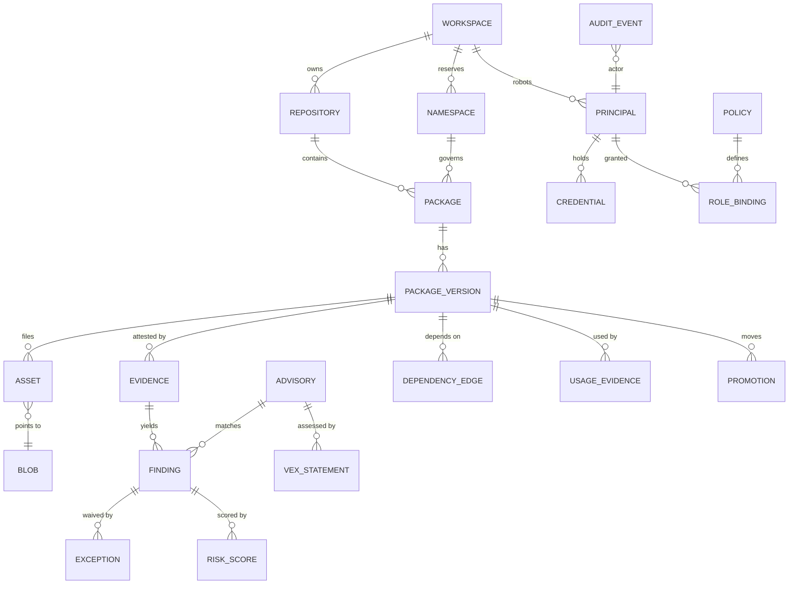
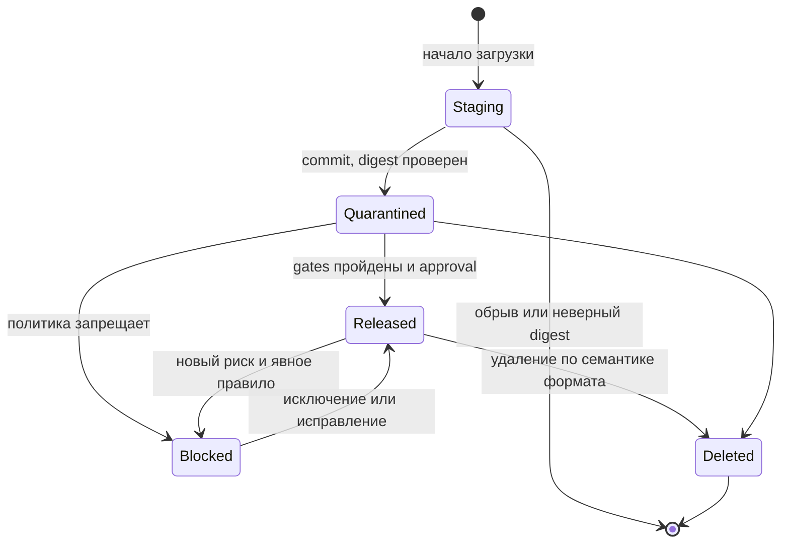

# 9. Структуры данных

Модель следует исходным требованиям: физическое хранение (blob) отделено от логической версии (package version) и от её видимости (state + политики). Идентификаторы UUIDv7, монотонные по времени, что хорошо для индексов.

## Логическая модель



*Рис. 9.1. Основные сущности и связи.*

## Ключевые таблицы PostgreSQL

```sql
CREATE TYPE pkg_format AS ENUM ('maven','npm','pypi','nuget','cargo');
CREATE TYPE repo_kind  AS ENUM ('hosted','proxy');
CREATE TYPE ver_state  AS ENUM ('quarantined','released','blocked','deleted');

CREATE TABLE repository (
  id uuid PRIMARY KEY, workspace_id uuid NOT NULL REFERENCES workspace,
  format pkg_format NOT NULL, kind repo_kind NOT NULL, name text NOT NULL,
  upstream_url text,                 -- только proxy, проверяется allowlist
  config jsonb NOT NULL DEFAULT '{}', -- TTL, лимиты, mutability, delivery, класс хранения
  UNIQUE (format, name));

CREATE TABLE namespace (
  id uuid PRIMARY KEY, workspace_id uuid NOT NULL, format pkg_format NOT NULL,
  pattern text NOT NULL,             -- '@acme/*', 'com.acme.*', 'acme-*'
  pattern_kind text NOT NULL,        -- exact | prefix | scope
  reserved boolean NOT NULL DEFAULT true,  -- запрет fallback в upstream
  UNIQUE (format, pattern));

CREATE TABLE package (
  id uuid PRIMARY KEY, repository_id uuid NOT NULL, namespace_id uuid,
  name_norm text NOT NULL, name_display text NOT NULL,
  owner_workspace_id uuid, gitlab_project_id bigint,
  lifecycle text NOT NULL DEFAULT 'active', -- active | deprecated | eol
  replacement_id uuid, description text,
  search_tsv tsvector GENERATED ALWAYS AS (...) STORED,
  embedding vector(1024),            -- pgvector, размерность embedder'а
  UNIQUE (repository_id, name_norm));

CREATE TABLE package_version (
  id uuid PRIMARY KEY, package_id uuid NOT NULL REFERENCES package,
  version text NOT NULL, sort_key bytea NOT NULL,    -- формат-специфичный порядок
  purl text NOT NULL,                -- pkg:npm/%40acme/ui@1.2.3, ключ графа
  state ver_state NOT NULL, mutable boolean NOT NULL DEFAULT false,
  yanked boolean NOT NULL DEFAULT false, deprecated_msg text,
  published_by uuid NOT NULL, published_at timestamptz NOT NULL,
  source jsonb,                      -- project, commit, pipeline, job, ref
  metadata jsonb NOT NULL,           -- нормализованная metadata формата
  UNIQUE (package_id, version));

CREATE TABLE blob_store (
  id text PRIMARY KEY,               -- 'main' | 'cache' | 'cold' | 'restricted-eu' ...
  class text NOT NULL,               -- primary | proxy-cache | archive | restricted
  backend jsonb NOT NULL,            -- s3: endpoint, bucket, prefix, kms key | file: path
  writable boolean NOT NULL DEFAULT true);  -- false: только чтение, идёт вывод из эксплуатации

CREATE TABLE blob (
  store_id text NOT NULL REFERENCES blob_store,
  sha256 bytea NOT NULL, size bigint NOT NULL,
  sha512 bytea, sha1 bytea, md5 bytea,               -- для протоколов клиентов
  created_at timestamptz NOT NULL, verified_at timestamptz,
  gc_mark timestamptz,               -- момент, когда blob стал кандидатом
  PRIMARY KEY (store_id, sha256));   -- дедупликация в пределах хранилища

CREATE TABLE asset (
  version_id uuid NOT NULL REFERENCES package_version,
  path text NOT NULL, store_id text NOT NULL, blob_sha256 bytea NOT NULL,
  FOREIGN KEY (store_id, blob_sha256) REFERENCES blob,
  media_type text, PRIMARY KEY (version_id, path));

CREATE TABLE credential (
  id uuid PRIMARY KEY, principal_id uuid NOT NULL,
  kind text NOT NULL,                -- personal | robot | workload
  prefix text UNIQUE NOT NULL,       -- 'crp_' | 'crr_' | 'crci_' + 8 символов, ищется по нему
  secret_hmac bytea NOT NULL,        -- HMAC-SHA256(pepper, secret)
  scopes jsonb NOT NULL, expires_at timestamptz NOT NULL,
  last_used_at timestamptz, revoked_at timestamptz);

CREATE TABLE audit_event (
  id bigint GENERATED ALWAYS AS IDENTITY, ts timestamptz NOT NULL,
  actor uuid, action text, resource text, decision text, reason jsonb,
  request_id text, prev_hash bytea NOT NULL, hash bytea NOT NULL
) PARTITION BY RANGE (ts);           -- помесячные партиции, append-only роль

CREATE TABLE advisory (
  id text PRIMARY KEY,               -- канонический id: CVE-…, GHSA-…, MAL-…, internal-…
  aliases text[] NOT NULL,           -- граф псевдонимов CVE ↔ GHSA ↔ OSV
  ecosystem pkg_format NOT NULL, name_norm text NOT NULL,
  ranges jsonb NOT NULL,             -- диапазоны в семантике формата, исправленные версии
  severity jsonb, epss real, in_kev boolean NOT NULL DEFAULT false,
  is_malware boolean NOT NULL DEFAULT false, withdrawn_at timestamptz,
  sources jsonb NOT NULL, modified_at timestamptz NOT NULL);
CREATE INDEX advisory_by_name ON advisory (ecosystem, name_norm);  -- сопоставление по имени

CREATE TABLE risk_score (
  subject_id uuid NOT NULL,          -- finding или license_decision
  kind text NOT NULL,                -- exploit_relevance | blast_radius | license_virality
  value real NOT NULL, confidence real NOT NULL, factors jsonb NOT NULL,
  model text NOT NULL, model_version text NOT NULL, features_hash bytea NOT NULL,
  shadow boolean NOT NULL DEFAULT false,   -- теневой режим новой версии модели
  created_at timestamptz NOT NULL,
  PRIMARY KEY (subject_id, kind, model_version));
```

## Полный перечень таблиц

| Группа | Таблицы |
| --- | --- |
| Каталог | `workspace`, `repository`, `namespace`, `namespace_owner_history`, `package`, `package_version`, `asset`, `blob`, `blob_store`, `dist_tag` (npm), `upload_session` |
| Доступ | `principal`, `group_mapping` (Keycloak → роли), `role_binding`, `policy` (Cedar), `credential`, `trust_policy` (издатель OIDC и claims → права) |
| Безопасность | `evidence`, `finding` (приоритет, SLA, источник), `exception`, `license_decision`, `license_policy`, `promotion`, `approval` |
| Уязвимости и скоринг | `advisory`, `feed_cursor`, `risk_score`, `vex_statement`, `emergency_block`, `break_glass_grant` |
| Граф | `dependency_edge`, `usage_evidence`, `consumer` (проект, сборка, деплой) |
| Proxy | `proxy_entry` (ключ upstream, etag, fetched\_at, expires\_at, negative, blob) |
| Эксплуатация | `job`, `outbox`, `webhook_subscription`, `webhook_delivery`, `idempotency_key`, `retention_rule`, `retention_hold`, `quota_usage`, `audit_event`, `siem_sink`, `siem_cursor` |

## Жизненный цикл версии



*Рис. 9.2. State machine версии. Staging не виден клиентам, Deleted оставляет tombstone, повторно занять номер релиза нельзя.*

Ортогонально состоянию живут флаги формата: `yanked` (PyPI PEP 592, Cargo), `unlisted` (NuGet), `deprecated` (npm, NuGet), `dist-tags` (npm). Для dev-репозиториев политика может пропускать quarantine.

### Семантика удаления, скрытия и перезаписи по форматам

| Формат | Перезапись release | Скрытие | Удаление | Mutable |
| --- | --- | --- | --- | --- |
| Maven | Запрещена | Нет в протоколе; `blocked` с диагностикой | Tombstone, номер не переиспользуется | SNAPSHOT: timestamp-версии, хранится N последних |
| npm | Запрещена (как в npmjs) | `deprecate`, перенос dist-tag | `unpublish` по политике (окно 72 ч), tombstone | Нет; pre-release через dist-tags |
| PyPI | Запрещена, имя файла уникально навсегда | `yank` (PEP 592) | Tombstone, имя файла не переиспользуется | Нет; dev-релизы `.devN` |
| NuGet | Запрещена | `unlist` | Tombstone | Нет; pre-release суффиксы |
| Cargo | Запрещена, пара «крейт + версия» неизменяема | `yank` и обратный `unyank` (версия остаётся доступной по lockfile) | Tombstone, версия не переиспользуется (как на crates.io) | Нет; pre-release по SemVer (`1.0.0-rc.1`) |

## Valkey: пространство ключей

| Ключ | Значение и TTL |
| --- | --- |
| `md:{repo}:{name}` | Отрендеренная metadata (сжатая zstd) + ETag; TTL по эвристике 11.1; инвалидация по событию. |
| `sf:{repo}:{key}` | Блокировка singleflight: `SET NX PX 30000` с токеном-фенсингом. |
| `rl:{principal}:{bucket}` | Теоретическое время прибытия GCRA; Lua-скрипт атомарно. |
| `ep:{principal}` | Эпоха авторизации; инкремент при отзыве, блокировке, смене групп. |
| `dl:{version}` | Счётчик скачиваний; сбрасывается в PostgreSQL пакетно раз в минуту. |
| канал `inv` | Pub/sub инвалидаций: metadata, эпохи, политики. |

## Раскладка объектного хранилища

```
blobs/sha256/9f/86/9f86d081884c7d659a2feaa0c55ad015a3bf4f1b2b0b822cd15d6c15b0f00a08
staging/2026/10/25/0192c1a4-7d2e-7c3b-9a51-6f0d3e4b8a11      (lifecycle: удалить через 24 ч)
evidence/sbom/9f86.../0192c1b0-....cdx.json.zst
evidence/scan/9f86.../trivy-0.6x-db-2026102512.json.zst
backup/pg/...  backup/manifests/...
```

Ключ blob вычисляется из SHA-256, поэтому одинаковые файлы в разных репозиториях одного хранилища хранятся один раз, а проверка целостности сводится к пересчёту хэша.

## Хранилища blob: один CAS по умолчанию, классы хранения по необходимости

В Nexus blob stores заводят десятками, потому что через них решают задачи квот, изоляции и ёмкости. В CRANE эти задачи решаются иначе, поэтому по умолчанию хранилище одно: один content-addressable store на весь экземпляр. Несколько физических хранилищ появляются только там, где у байтов действительно разные требования к сохранности, цене или размещению.

### Почему по умолчанию одно

| Зачем в Nexus несколько blob stores | Как это решено в CRANE |
| --- | --- |
| Квоты по командам: soft quota на blob store | Квоты логические: объём workspace и репозитория считается по ссылкам `asset → blob` (`quota_usage`), с предупреждением и жёстким пределом. Физически делить байты для этого не нужно |
| Изоляция команд друг от друга | Изоляция по ACL: каждый запрос проходит Cedar, байты отдаются только после авторизации (presigned-ссылка живёт 60 секунд). Отдельный bucket не добавляет защиты, если доступ к нему всё равно у CRANE |
| Разные носители: файловая система и S3 | Абстракция `object_store`: смена носителя не требует смены модели данных |
| Расширение ёмкости группой blob stores | S3-хранилище масштабируется само (SeaweedFS, Ceph, облачный S3); переполнение одного store в CRANE не возникает |
| Перенос репозитория на другой store | Не требуется в обычной эксплуатации; при необходимости есть онлайн-перенос (ниже) |

Что даёт единый CAS:

-   **Дедупликация между репозиториями.** Один и тот же файл в proxy-кэше, в hosted-репозитории и в десятке dev-репозиториев хранится один раз. Типичный случай: популярный пакет закэширован proxy и затем продвинут во внутренний релиз.
-   **Одна проверка целостности и один GC.** Счётчик ссылок и двухфазная сборка мусора (10.9) работают в одном домене; не бывает blob, на который ссылается репозиторий в другом store.
-   **Простой бэкап.** Один bucket с версионированием и репликацией (16.5).

### Когда хранилищ несколько: классы хранения

Репозиторий получает класс хранения, класс указывает на физическое хранилище (`blob_store`). В профиле S все классы указывают на одно хранилище с разными префиксами; в профиле L это разные bucket и кластеры.

| Класс | Что хранит | Требования | Пример носителя |
| --- | --- | --- | --- |
| `primary` | Hosted-релизы, evidence, SBOM | Репликация, бэкап, опционально Object Lock | S3 с erasure coding |
| `proxy-cache` | Кэш публичных upstream | Можно потерять: без бэкапа, дешёвый носитель, восстанавливается прогревом | Отдельный bucket без репликации или локальный NVMe |
| `archive` | Старые версии по правилу retention «архивировать вместо удаления» | Дёшево, чтение с задержкой допустимо | Холодный класс S3 |
| `restricted` | Данные с требованием отдельного размещения: резидентность, отдельный ключ шифрования, изолированный контур | Свой bucket и свой ключ KMS; без дедупликации с другими классами | Отдельный кластер в нужной юрисдикции |

Правила:

-   **Дедупликация в пределах хранилища.** Один SHA-256 может лежать в двух хранилищах, если этого требуют классы. Когда пакет из proxy продвигают во внутренний hosted-репозиторий, blob копируется из `proxy-cache` в `primary`: гарантии сохранности релиза не должны зависеть от кэша, который разрешено потерять.
-   **Restricted не смешивается.** Blob из restricted-репозитория никогда не дедуплицируется с другими классами и не попадает в общий бэкап.
-   **Онлайн-перенос.** Задача `storage.move` копирует blob в новое хранилище, сверяет SHA-256, в одной транзакции переключает ссылки `asset` и оставляет старый объект GC после grace period. Так работают архивирование по retention, вывод хранилища из эксплуатации (`writable = false`) и смена класса репозитория.
-   **Метрики по хранилищу.** Объём, число объектов, ошибки и задержки видны по каждому `blob_store` (16.6).

