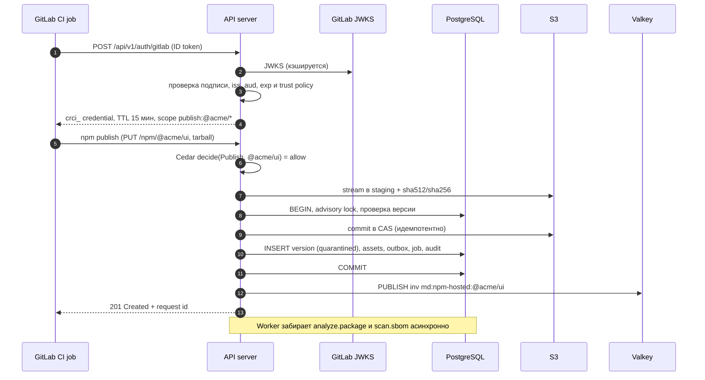
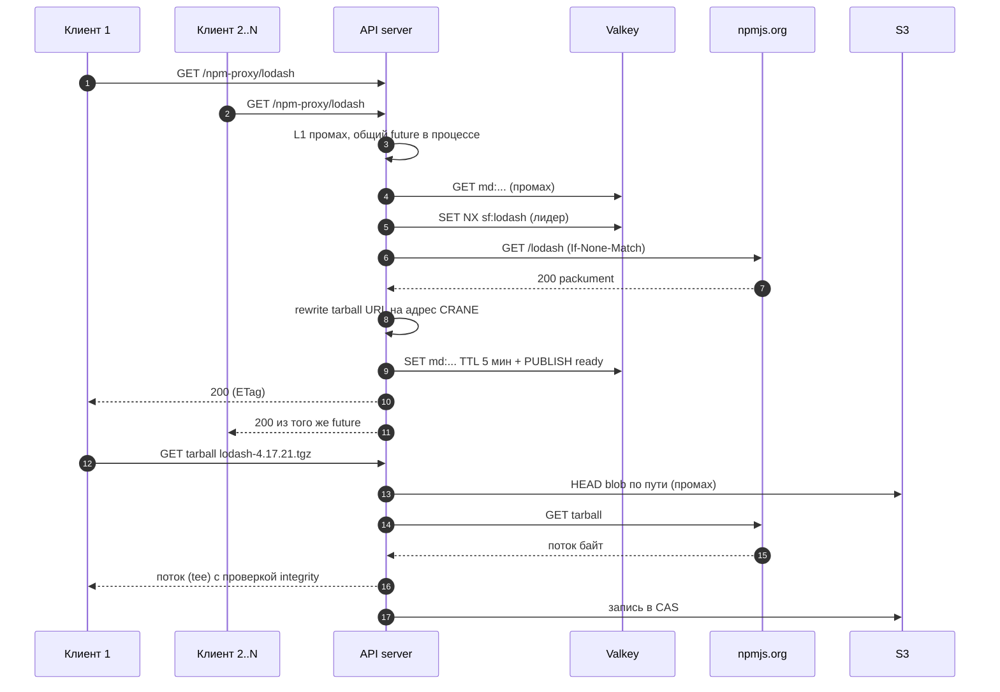
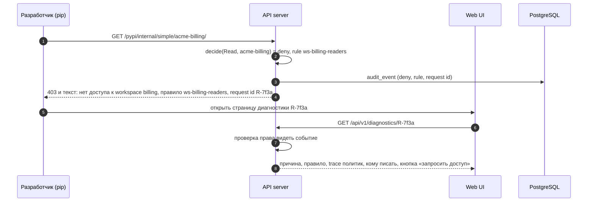
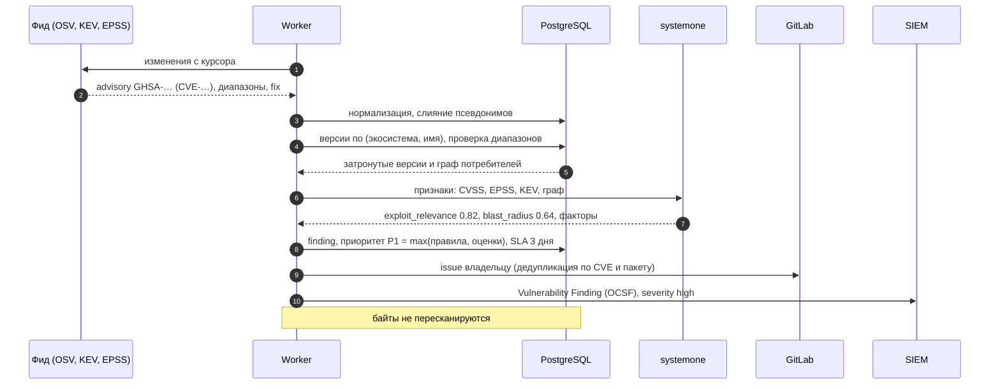
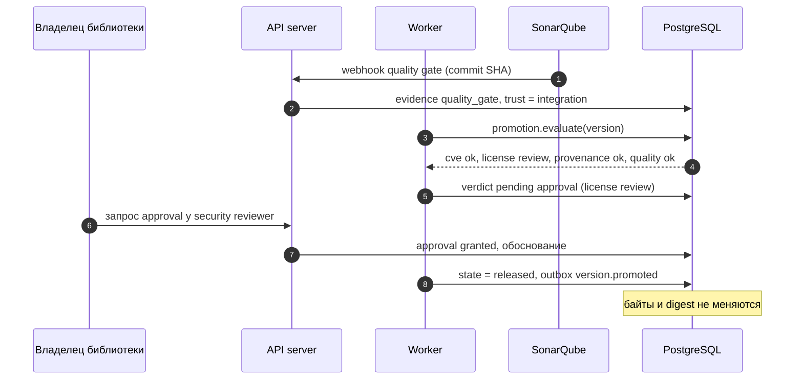
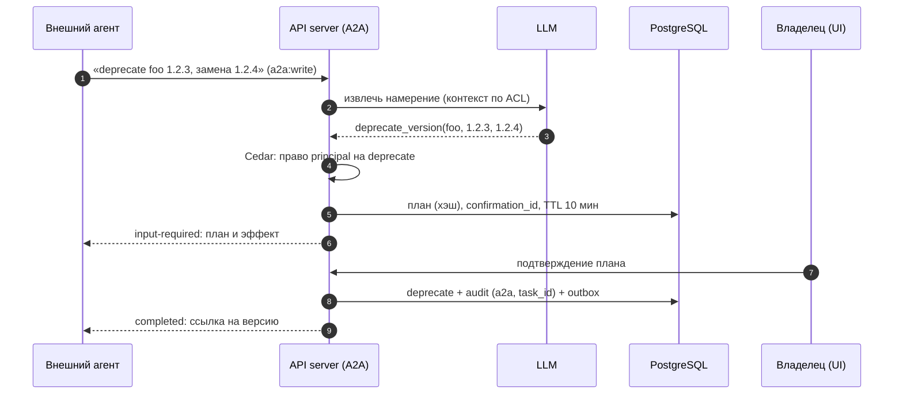
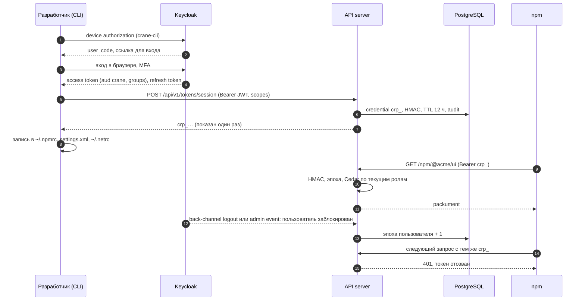

# 12. Sequence-диаграммы ключевых сценариев

## 12.1 Публикация npm-пакета из GitLab CI

*Рис. 12.1. Публикация с provenance из claims ID token.*

## 12.2 Скачивание через proxy при промахе кэша (конкурентные запросы)

*Рис. 12.2. Один запрос в upstream независимо от числа клиентов.*

## 12.3 Отказ в доступе с диагностикой

*Рис. 12.3. Отказ, который можно исправить без обращения в поддержку.*

## 12.4 Новая CVE: от фида до задач командам и SIEM

*Рис. 12.4. Advisory сопоставляется с инвентарём по PURL; оценки systemone могут только повысить приоритет.*

## 12.5 Promotion релиза

*Рис. 12.5. Publish, quarantine, checks, approval, release.*

## 12.6 Запись через A2A-агента с подтверждением

*Рис. 12.6. Агент предлагает, principal подтверждает, use case исполняет. До подтверждения состояние не меняется.*

## 12.7 Разработчик получает токен для пакетных менеджеров

*Рис. 12.7. Права не зашиты в токен: блокировка в Keycloak отзывает все токены пользователя за секунды.*
