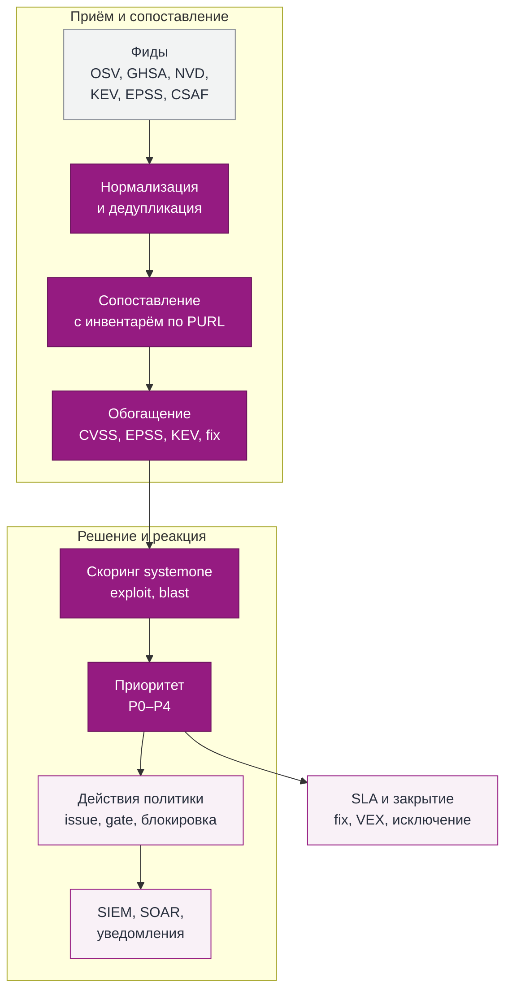

# 14. Безопасность, уязвимости и SIEM

Реестр пакетов стоит на пути каждой сборки, поэтому он одновременно главный актив цепочки поставки и лучшая точка контроля. Эта глава описывает защиту самого CRANE, работу с потоком уязвимостей, интеграцию с SIEM и SOAR, ролевую модель и журнал действий.

## 14.1 Почему поток уязвимостей это критическая функция

Число публикуемых CVE растёт год к году, и ИИ ускоряет этот рост с двух сторон: инструменты поиска уязвимостей находят их быстрее, а атакующие быстрее превращают публикацию в эксплойт. Новые advisory по зависимостям выходят ежедневно, и разбирать их вручную уже невозможно. Отдельный класс угроз создают сами LLM: они придумывают несуществующие имена пакетов, а атакующие регистрируют эти имена в публичных реестрах (slopsquatting).

Отсюда проектные требования:

-   **Скорость.** От публикации advisory в фиде до finding с адресатом проходит не больше 15 минут (профили M и L, раздел 4).
-   **Масштаб без ручного труда.** Тысячи advisory в сутки сопоставляются с инвентарём автоматически, без повторного сканирования байтов.
-   **Приоритет вместо списка.** Каждый finding получает приоритет P0–P4 с объяснением; люди разбирают сверху вниз, а не всё подряд.
-   **Замкнутый цикл.** Finding закрывается исправлением, VEX-заявлением или исключением с TTL; всё видно в SIEM и метриках.

## 14.2 Модель угроз

### STRIDE для самого CRANE

| Угроза | Пример | Контроль |
| --- | --- | --- |
| Spoofing | Публикация под чужим CI-проектом | Проверка подписи и claims ID token, trust policy по конкретным проектам и refs, provenance из claims, attestations из CI проверяются по подписи и издателю |
| Tampering | Подмена файла релиза | CAS по SHA-256, запрет перезаписи, выборочная проверка целостности, hash chain аудита |
| Repudiation | «Я этого не удалял» | Аудит всех действий с actor, request id, решением и правилом; WORM-якоря; экспорт в SIEM |
| Information disclosure | Утечка токена в логах CI, в контексте LLM | Префиксы токенов для secret scanning, редактирование логов, ACL до передачи в модель, токены никогда в URL |
| Denial of service | Zip-бомба, огромный upload, флуд | Лимиты размера, коэффициента распаковки, числа файлов, времени; GCRA; bulkheads |
| Elevation of privilege | Dependency confusion, SSRF через upstream | Резервирование namespaces, запрет fallback; allowlist хостов, запрет приватных адресов и redirect на них |

### Угрозы цепочки поставки

| Угроза | Как проявляется | Контроль в CRANE |
| --- | --- | --- |
| Typosquatting | `reqeusts` вместо `requests` | Предупреждение по расстоянию Дамерау–Левенштейна (11.5), блокировка по политике для proxy-репозиториев |
| Slopsquatting | Пакет с именем, которое придумала LLM, зарегистрирован атакующим | Пакет без истории (возраст, скачивания, maintainer) из публичного upstream попадает в quarantine; правило SIEM на первое обращение к такому имени |
| Dependency confusion | Публичный пакет с внутренним именем | Резервирование namespaces, внутреннее имя никогда не резолвится в upstream (10.3) |
| Захват maintainer-аккаунта | Вредоносная новая версия популярного пакета | Quarantine новых версий из upstream на настраиваемый срок (окно по времени публикации upstream, 10.2), пометка подозрительной публикации (11.5), фид вредоносных пакетов (14.4), проверка upstream attestations: пропала или стала невалидной при наличии у прошлых версий, сменился издатель → quarantine и событие SIEM (10.6.1) |
| Подмена на пути от upstream или в зеркале | Файл или metadata изменены по дороге | Проверка subject digest attestation против байтов, подпись Sigstore/PGP, TLS; CAS по SHA-256 |
| Вредоносный пакет | Известный malware в публичном реестре | Advisory `MAL-*` из фида даёт P0 и экстренную блокировку (14.8) |
| Брошенный пакет | Нет релизов годами, известные CVE без исправлений | Понижение в поиске, бейдж EOL, рекомендация замены |

## 14.3 Базовые меры

-   **Доступ.** Default deny; ролевая модель с разделением обязанностей (14.12); авторизация на каждом package- и management-endpoint; административные credentials отделены от package credentials; MFA и step-up для опасных операций по `acr`/`amr` и свежести `auth_time` (13).
-   **Анализ недоверенного содержимого.** Отдельный под или контейнер: distroless, non-root, read-only rootfs, seccomp, без сети кроме Trivy, лимиты CPU/RAM/времени, распаковка без symlink и с проверкой путей (path traversal).
-   **Сеть.** TLS 1.3, HSTS; весь исходящий трафик (upstream, фиды, webhooks, приёмники SIEM, импорт, модели AI) только через один HTTP-клиент с SSRF-guard; для webhooks и SIEM непубличные адреса запрещены по умолчанию, исключения задаёт allowlist экземпляра; NetworkPolicy в k8s.
-   **Отдача недоверенного содержимого.** Байты пакетов, metadata, evidence и README недоверенны. Протоколы и presigned-ссылки отдаются с отдельного origin пакетов (`CRANE_PACKAGES_URL`, 16.1). На всех таких ответах стоят `X-Content-Type-Options: nosniff`, `Content-Security-Policy: sandbox; default-src 'none'` и `Content-Disposition: attachment` (кроме JSON-документов протоколов); консоль работает со строгой CSP (15). Причина: файл `-docs.html` или `.svg` из Maven, открытый с origin консоли, прочитал бы `csrf_token` из `GET /api/v1/session` и действовал от имени AppSec; `SameSite=Strict` от этого не спасает.
-   **A2A-агент.** Права агента равны правам principal (Cedar, default deny); scopes `a2a:read` и `a2a:write` раздельны; запись только по плану, подтверждённому principal (одноразовый `confirmation_id`, привязка к хэшу плана, TTL 10 минут, step-up для исключений); операции с байтами, promotion, политики и роли через агента недоступны; сообщения вызывающего агента и содержимое пакетов недоверенны; все вызовы пишутся в аудит с каналом `a2a` и `task_id`.
-   **AI.** LLM не выдаёт доступ и не меняет состояние; README и metadata обрамляются как недоверенные данные; ответы содержат ссылки на источники. Оценки systemone только ужесточают решения и не опускают их ниже базовых правил. Ключи провайдеров моделей из Secret, не попадают в логи и аудит.
-   **Цепочка поставки самого CRANE.** cargo-deny и cargo-audit в CI, проверка лицензий зависимостей. С v0.5.0 (когда репозиторий становится публичным) релизы собираются в CI с provenance SLSA, подписью образов cosign и SBOM; advisories в CSAF и VEX для релиза выпускаются, когда это возможно. Это best effort без обязательств, см. [SECURITY.md](../../.github/SECURITY.md).
-   **Шифрование хранения (v0.5.0).** CRANE поддерживает TLS к PostgreSQL и серверное шифрование S3 через конфигурацию; шифрование томов и бэкапов — на стороне платформы; готовых профилей нет; `CRANE_REQUIRE_SECURE_CONFIG` проверяет конфигурацию при старте (16.8).
-   **Секреты.** Секрет робота показывается один раз; хранится HMAC; ключи шифрования и pepper из k8s Secret / External Secrets или файла с правами 0400.

## 14.4 Источники уязвимостей

CRANE не ведёт собственных исследований уязвимостей: он агрегирует открытые фиды, нормализует их и сопоставляет со своим инвентарём.

| Источник | Что даёт | Как часто | Роль в конвейере |
| --- | --- | --- | --- |
| OSV.dev | Advisory по всем четырём экосистемам в едином формате OSV, включая GitHub Advisory Database и вредоносные пакеты OpenSSF (`MAL-*`) | Инкрементально каждые 5–15 мин по времени изменения | Основной источник диапазонов версий |
| GitHub Advisory Database | Проверенные advisory для Maven, npm, PyPI, NuGet, Cargo (экосистема crates.io; RustSec приходит через OSV) | Через OSV или напрямую | Диапазоны, исправленные версии |
| NVD (API 2.0) | CVSS, CWE, CPE, ссылки | Окно по `lastModified`, с API-ключом | Обогащение, CVSS при отсутствии у экосистемы |
| CISA KEV | Уязвимости, эксплуатируемые на практике | Раз в сутки и по изменению | Повышение до P0 |
| FIRST EPSS | Вероятность эксплуатации в ближайшие 30 дней | Раз в сутки | Признак для приоритета и `exploit_relevance` |
| CSAF 2.0 и VEX поставщиков | Advisory и заявления о неприменимости | По публикации (provider metadata) | Обогащение и автоматическое закрытие |
| Trivy DB | База сканера для анализа артефактов | По выходу новой версии | Скан распакованных артефактов и SBOM |
| Собственные advisory организации | Внутренние уязвимости и запреты | Сразу при создании в UI или API | Тот же конвейер, что и для публичных |

**Нормализация.** Все источники приводятся к внутренней модели `advisory`: идентификатор, псевдонимы, экосистема и имя пакета, диапазоны в семантике формата, векторы серьёзности, исправленные версии, признак отзыва, время изменения. Дубликаты объединяются по графу псевдонимов (CVE ↔ GHSA ↔ OSV). Для диапазонов приоритет у источника экосистемы, затем GHSA, затем NVD. Отозванное advisory автоматически закрывает связанные findings с указанием причины.

## 14.5 Конвейер обработки



*Рис. 14.1. Конвейер уязвимостей: от фида до закрытия finding.*

1. **Синхронизация.** Задача `advisory.sync` забирает изменения каждого фида с момента последнего курсора. Курсор и время последнего успеха хранятся в PostgreSQL; отставание больше 30 минут даёт событие `feed.lagging`.
2. **Сопоставление.** `advisory.match` ищет по индексу (экосистема, имя) все версии из инвентаря: hosted-пакеты, proxy-кэш и рёбра зависимостей из SBOM. Диапазон проверяется компаратором версий формата. Стоимость пропорциональна числу затронутых имён, а не размеру инвентаря.
3. **Обогащение.** К finding добавляются CVSS, EPSS, KEV, CWE и ближайшая исправленная версия для каждой затронутой ветки.
4. **Скоринг.** `score.risk` запрашивает у systemone `exploit_relevance` и `blast_radius`; при недоступности модели приоритет считается только по правилам.
5. **Приоритет и действия.** Политика назначает приоритет (14.6) и действия: уведомить, создать issue, закрыть promotion, ограничить скачивание.
6. **Доставка.** События уходят в outbox: SIEM, SOAR, webhooks, почта. Issue создаётся один на пару (advisory, пакет) для команды-владельца.
7. **Закрытие.** Finding закрывается, когда исправленная версия получила release и потребители обновились по данным графа, когда принято VEX-заявление `not_affected` (по правилам 14.7; блокировку версии VEX не снимает), или по исключению с TTL. В v0.3.0 finding закрывается только выпадением версии из множества затронутых и отзывом advisory; VEX и исключения появятся в v1.1.0 как наложения поверх открытого finding, а не как его состояния (21.6).

Ежедневное обновление EPSS и KEV переоценивает все открытые findings одной пакетной задачей; изменение приоритета публикуется как `security.finding.priority_changed`. Анализ достижимости уязвимого кода (call graph) в первую версию не входит: архитектура оставляет для него место как для ещё одного признака скоринга.

## 14.6 Приоритизация и SLA

Приоритет считается как максимум из приоритета по правилам и приоритета по оценкам systemone: модель может только поднять приоритет.

```rust
fn priority(f: &Finding) -> Priority {
    let by_rules = rules::priority(f.cvss, f.epss, f.in_kev, f.is_malware, f.dep_scope, f.deployed);
    let by_scores = match scorer.score(&f.features()) {           // systemone; None при недоступности
        Some(s) => thresholds::priority(s.exploit_relevance, s.blast_radius),
        None => Priority::P4,
    };
    max(by_rules, by_scores)                                       // P0 выше P4
}
```

| Приоритет | Условия (стартовые, настраиваются) | Действия по умолчанию | SLA устранения |
| --- | --- | --- | --- |
| **P0 · экстренно** | В KEV; вредоносный пакет (`MAL-*`); `exploit_relevance` ≥ 0.9 при развёрнутых потребителях | Экстренный режим (14.8), вызов дежурного, SIEM critical | 24 ч |
| **P1 · критично** | CVSS ≥ 9.0; EPSS ≥ 0.3; `exploit_relevance` ≥ 0.7; runtime-зависимость развёрнутого приложения | Закрыть promotion затронутых версий, issue владельцу, SIEM high | 3 дня |
| **P2 · высокий** | CVSS 7.0–8.9; `blast_radius` ≥ 0.7 | Issue, ежедневный дайджест команде | 14 дней |
| **P3 · средний** | Остальные при наличии исправления | Дайджест | 30 дней |
| **P4 · низкий** | Нет исправления и низкие оценки; только dev- или test-зависимость | Backlog, пересмотр при изменении фида | без SLA |

Отсчёт SLA начинается с создания finding. За 25% времени до истечения владелец получает напоминание, при нарушении публикуется `security.sla.breached` и событие уходит в SIEM.

## 14.7 Шумоподавление и VEX

> VEX-заявление и исключение с TTL — наложения поверх finding (v1.1.0), а не переходы его состояния: finding остаётся `Open`, вывод «закрыт по VEX» вычисляется из наложения (21.6).

-   **Группировка.** Один finding на пару (advisory, версия пакета; если одна purl есть в двух proxy-репозиториях, группировка идёт по (advisory, purl)), одна задача на пару (advisory, пакет) для команды-владельца, а не по задаче на каждую версию и сборку.
-   **VEX.** Владелец или security фиксирует заявление о применимости в форматах OpenVEX, CycloneDX VEX или CSAF VEX: `not_affected` с обоснованием (например, `vulnerable_code_not_in_execute_path`), `affected`, `fixed`, `under_investigation`. Заявление действует на диапазон версий, пересматривается при изменении advisory и выдаётся потребителям вместе с SBOM. Правила:
    1.  VEX не меняет состояние версии и не снимает экстренную блокировку.
    2.  Для advisory вредоносного пакета (`MAL-*`, `is_malware`) VEX запрещён: «код не исполняется» к malware неприменимо (API: 422 `vex-not-applicable-malware`).
    3.  Maintainer и owner заявляют VEX только по своим пакетам и только для находок P2–P4 незаблокированных версий; находки P0 и P1 и заблокированных версий закрывает только AppSec.
    4.  Создание VEX всегда требует step-up (свежий MFA, раздел 13).
    5.  VEX по находке P0, P1 или по заблокированной версии — событие SIEM High (14.9).
-   **Дайджесты.** Немедленно уведомляются только P0 и P1; остальное собирается в ежедневный дайджест команды.
-   **Автозакрытие.** Finding закрывается без участия человека при выходе исправленной версии и обновлении потребителей или при отзыве advisory.

## 14.8 Экстренный режим

Срабатывает на P0: известная эксплуатация, вредоносный пакет, zero-day с публичным эксплойтом.

1. **Оценка воздействия.** CRANE строит список затронутых версий, потребителей и сборок, а также отчёт «что сломается при блокировке» (10.14).
2. **Решение о блокировке.** Для вредоносного пакета приём advisory сам создаёт экстренную блокировку (строку `emergency_block`). Для KEV и zero-day блокировку ставит дежурный AppSec одним действием (step-up MFA), без второго подтверждения: на P0 скорость реакции важнее; SecOps видит активные блокировки и получает событие critical. Поведение задаётся политикой.
3. **Применение.** Блокировка — правило по диапазону (`emergency_block`), а не перевод строк в `blocked`. Она действует на hosted и proxy, в том числе на версии, которые ещё никто не скачивал, на всех репликах не позже чем за 5 секунд; убирает версию из документов и запрещает скачивание, включая stale-кэш и прямые URL из lockfile (10.2). Клиенты получают ответ с диагностикой: advisory, правило, ближайшая исправленная версия.
4. **Оповещение.** Владельцы и потребители получают уведомления, в SIEM уходит событие critical, SOAR получает webhook `security.emergency_block.applied`.
5. **Break-glass.** Временное разрешение для конкретного проекта на срок до 24 часов с двумя approvals (security и владелец); каждое использование пишется в аудит. Действует только на пути скачивания артефакта (сборка с закреплённой версией) и не возвращает версию в документы.
6. **Снятие.** Блокировка снимается только явным действием `lift` дежурного AppSec со step-up и обоснованием. Выход исправленной версии, VEX и отзыв advisory её не снимают, а дают основание для пересмотра: при отзыве advisory AppSec получает задачу на пересмотр (событие), автоматического снятия нет, иначе подмена или ошибка фида снимала бы блокировку malware. Каждая блокировка имеет срок пересмотра.

## 14.9 Интеграция с SIEM

### Транспорты

| Транспорт | Когда выбирать | Особенности |
| --- | --- | --- |
| Syslog RFC 5424 поверх TLS (RFC 5425) | Классические SIEM и коллекторы | Одно событие на сообщение, структурированные данные в JSON-теле |
| HTTP JSON | SIEM с HTTP-приёмником, облачные SIEM | Пакеты до 500 событий или 1 с, повтор с экспоненциальной задержкой, опционально mTLS |
| OTLP logs | Если журналы уже идут через OpenTelemetry Collector | Те же поля в атрибутах записи |

Можно подключить несколько приёмников одновременно, у каждого свой фильтр по категориям и серьёзности.

### Схема событий

По умолчанию события формируются по открытой схеме OCSF (Open Cybersecurity Schema Framework), для старых SIEM доступен CEF (в нём экранируются `\`, `|`, `=` и переводы строк: имена пакетов, user agent и `status_detail` контролирует атакующий). Общие поля любого события: `event_id` (UUIDv7), время, actor (principal, тип: человек, робот, агент; `on_behalf_of` для A2A), IP и user agent, `request_id`, `trace_id`, ресурс (PURL, репозиторий), решение и идентификаторы правил, серьёзность, `hash` и `prev_hash` цепочки аудита, версия CRANE.

| Категория | Примеры событий | Класс OCSF | Серьёзность |
| --- | --- | --- | --- |
| Аутентификация | Вход, обмен ID token, неуспешная аутентификация, попытка использовать отозванный credential | Authentication (3002) | Info–Medium |
| Доступ и политики | Отказ доступа с правилом, обращение к зарезервированному имени через proxy, изменение политики Cedar или gate | API Activity (6003) | Low–High |
| Учётные записи роботов | Создание робота, выпуск и отзыв credential, изменение trust policy | Account Change (3001) | Medium |
| Уязвимости | Новый finding, смена приоритета, закрытие, VEX; с оценками systemone и факторами | Vulnerability Finding (2002) | По приоритету |
| Лицензии | Нарушение, review required, высокая оценка `license_virality` | Compliance Finding (2003) | Medium |
| Обнаружения | Подозрительная публикация, кандидат typosquatting или slopsquatting, разрыв цепочки аудита | Detection Finding (2004) | High |
| Экстренный режим | Блокировка, break-glass, снятие | Detection Finding (2004) | Critical |
| A2A | План предложен, подтверждён, исполнен, отклонён | API Activity (6003) | Info–Medium |
| Доступ к журналу | Просмотр (`audit.viewed`), раскрытие персональных данных, экспорт, нарушение разделения обязанностей (`sod.violation`) | API Activity (6003) | Medium–High |

### Гарантии доставки и целостность

-   **At-least-once.** События пишутся в outbox в той же транзакции, что и действие. Задача `siem.export` ведёт отдельный курсор для каждого приёмника; SIEM дедуплицирует по `event_id`. Порядок внутри потока сохраняется по идентификатору события.
-   **Недоступность SIEM.** Экспорт продолжается с курсора после восстановления; сам аудит хранится в PostgreSQL и не теряется. Отставание экспорта больше 5 минут даёт алерт.
-   **Целостность.** Каждое событие аудита несёт `hash` и `prev_hash`; раз в час уходит событие-якорь `audit.anchor` со ссылкой на объект WORM (10.13). Разрыв цепочки обнаруживается на стороне SIEM; команда `cctl audit verify` проверяет выгрузку из SIEM против якорей.
-   **Минимизация данных.** В события не попадают секреты и токены (только префикс), содержимое пакетов и тексты промптов. Набор полей идентификации пользователя настраивается под требования организации.

#### Шов v0.1.0

В v0.1.0 события аудита пишутся в журнал процесса двумя целями `tracing`: `crane::audit` (поля с именами путей OCSF 1.3) и `crane::access` (одна строка на каждый HTTP-запрос). Журналы идут в stdout JSON-строками; `flatten_event` выносит поля события на верхний уровень строки.

События `crane::audit`:

-   **Authentication (3002), только Failure:** предъявленный и отвергнутый токен. Запрос без токена события не создаёт: cargo всегда начинает с запроса без токена и повторяет его после ответа 401, это рукопожатие протокола, а не попытка входа (иначе правило «перебор токенов» срабатывало бы на каждой сборке).
-   **API Activity (6003):** публикация, yank и unyank, успех и отказ. Чтения не аудируются. С v0.4.0 успешные скачивания файлов записываются на 100% в отдельный поток скачиваний (14.13 «Аудит скачиваний», таблица в разделе 9).

3002 Success отложен до v0.4.0 по двум причинам: статический токен проверяется на каждом GET индекса, то есть успехов были бы сотни на одну сборку и ни одного настоящего входа; а в v0.4.0 каждое событие станет записью цепочки хэшей, и чтение начало бы писать в общую последовательную структуру. Кто выполнил чтение, видно по полю `actor` в `crane::access`, кто выполнил запись, по `actor.user.uid` в 6003.

В v0.4.0 аудит записи переезжает в транзакцию каталога (та же транзакция, что и действие), а приёмник остаётся для событий без транзакции: отказов и аутентификации. Сопоставление с OCSF переиспользует экспорт в SIEM (v1.1).

Поля `crane::audit` (необязательные поля отсутствуют в строке, если значения нет):

| Поле | Путь OCSF | Источник | Пример |
| --- | --- | --- | --- |
| класс, категория | `class_uid`, `category_uid` | действие: вход — 3002/3, остальное — 6003/6 | `6003`, `6` |
| действие | `activity_id`, `activity_name` | вход — 1 Logon; публикация — 1 Create; yank, unyank — 3 Update | `1`, `Create` |
| тип события | `type_uid` | `class_uid * 100 + activity_id` | `600301` |
| операция | `api.operation` (только 6003) | действие | `publish`, `yank`, `unyank` |
| исход | `status_id`, `status` | успех — 1 Success; отказ — 2 Failure | `2`, `Failure` |
| причина | `status_detail` (только отказ) | текст ошибки без цепочки причин | `версия уже существует` |
| серьёзность | `severity_id` | успех — 1; отказ — 2 | `2` |
| идентификатор события | `metadata.uid` | приёмник, UUIDv7 | `0192f0c4-…` |
| корреляция | `metadata.correlation_uid` | `request_id` запроса | `0192f0c4-…` |
| схема, продукт | `metadata.version`, `metadata.product.name`, `metadata.product.version` | константы, версия сборки | `1.3.0`, `CRANE`, `0.1.0` |
| время | `time` | приёмник, миллисекунды от эпохи | `1793102400123` |
| субъект (6003) | `actor.user.uid`, `actor.user.type_id`, `actor.user.type` | принципал: человек — 1 User; робот, workload, агент — 99 и имя вида | `crane`, `99`, `Robot` |
| субъект (3002) | `user.uid`, `user.type_id`, `user.type` | при отказе uid нет, тип 0 Unknown | `0`, `Unknown` |
| адрес клиента | `src_endpoint.ip` | контекст запроса (см. ниже) | `10.0.4.17` |
| user agent | `http_request.user_agent` | заголовок, не длиннее 256 символов | `cargo/1.90.0 (…)` |
| ресурс (6003) | `resources.uid`, `resources.type` | purl, `package` | `pkg:cargo/foo@1.0.0` |
| репозиторий | `unmapped.repository` | координата | `internal` |
| трасса | `unmapped.trace_id` | `traceparent` (W3C), только корректный | `4bf92f35…` |

Ключи плоские: `actor.user.uid` — имя поля, а не вложенный объект. Вложенный OCSF JSON собирает коллектор (например, Vector `unflatten` или трансформация OpenTelemetry Collector); `resources` в OCSF — массив, его тоже оборачивает коллектор.

Поля `crane::access`: `method`, `path` (без query), `status`, `duration_ms`, `request_id`, `client_ip`, `user_agent`, `actor` (id принципала при успешной аутентификации).

Адрес клиента и `X-Request-Id` берутся из заголовков только от доверенных прокси (`CRANE_TRUSTED_PROXIES`, по умолчанию пусто): `X-Forwarded-For` разбирается справа налево мимо своих прокси. Недоверенный клиент подсунуть свой идентификатор корреляции не может, если доверенный прокси перезаписывает или удаляет присланный `X-Request-Id` (раздел 16): эталонный Caddy удаляет присланный заголовок. Сервер сам выдаёт UUIDv7 и возвращает его в заголовке `X-Request-Id` и в теле ошибки.

Секреты не пишутся никогда (единственное исключение: bootstrap-токен первого запуска, один раз и в отдельную цель `crane::bootstrap`, 20.5): ни значение `Authorization`, ни его хэш или префикс, ни query запроса, ни тела пакетов.

### Готовые правила обнаружения

Вместе с продуктом поставляются правила в открытом формате Sigma: их переводят в язык запросов конкретной SIEM.

| Правило | Логика | Серьёзность |
| --- | --- | --- |
| Разведка dependency confusion | Больше N обращений к зарезервированным внутренним именам через proxy за 10 минут | High |
| Публикация из нового источника | Первая публикация в namespace от CI-проекта, который раньше в него не публиковал | Medium |
| Аномальное скачивание роботом | Объём скачиваний робота в 10 раз выше его базовой линии (по потоку скачиваний, 14.13) | Medium |
| Перебор токенов | Неуспешная аутентификация по одному префиксу с разных адресов | High |
| Исключение на KEV | Создано исключение для уязвимости из KEV | High |
| VEX по экстренной находке | VEX по находке P0 или P1 либо по заблокированной версии | High |
| Всплеск записи через A2A | Больше N подтверждённых write-действий агента за час от одного principal | Medium |
| Ослабление политики | Отключение gate CVE или лицензий вне окна изменений либо ослабление защиты репозитория (`mutable`, `dev_skip_quarantine`, `upstream_url`) | High |
| Разрыв цепочки аудита | `prev_hash` не совпадает с `hash` предыдущего события | Critical |
| Массовое раскрытие персональных данных | Больше N раскрытий в журнале за час одним сотрудником | Medium |
| Нарушение разделения обязанностей | Вход с несовместимыми ролями (`sod.violation`) | High |

## 14.10 SOAR и ответные действия

SOAR-платформа получает события через webhooks и может выполнять ответные действия через REST от имени робота `soar` с ограниченными scopes.

| Действие | Endpoint | Защита |
| --- | --- | --- |
| Заблокировать версию | `POST /api/v1/response/block-version` | Scope `response:block`, обязательный срок действия и ссылка на инцидент |
| Отозвать credential | `POST /api/v1/response/revoke-credential` | Применяется на всех репликах за 5 секунд (эпоха авторизации) |
| Поместить пакет в quarantine | `POST /api/v1/response/quarantine-package` | Новые версии пакета не выходят из quarantine до снятия |
| Создать исключение или VEX | `POST /api/v1/response/exception` | Требует approval человека; TTL обязателен |
| Отчёт о воздействии | `GET /api/v1/impact?advisory=…` | Только чтение |

Все действия идемпотентны по `Idempotency-Key`, пишутся в аудит с actor `soar` и полем `incident_ref` и попадают в SIEM, замыкая цикл «обнаружил → отреагировал → проверил».

Робот `soar` получает credential только обменом OIDC или по mTLS, не статическим секретом. Массовые ответные действия ограничены порогом (например, 20 версий или токенов за 10 минут), сверх порога действие эскалируется человеку. Отзыв credentials ролей `secops` и `appsec` выполняет только человек.

## 14.11 Метрики ИБ

| Метрика | Определение | Цель (M, L) |
| --- | --- | --- |
| Время обнаружения | Публикация advisory в фиде → создан finding | ≤ 15 мин |
| Отставание фида | Сейчас минус время последней успешной синхронизации | ≤ 30 мин |
| Время устранения | Finding → исправленная версия получила release и потребители обновились, или принят VEX | В пределах SLA приоритета |
| Нарушения SLA | Открытые findings сверх SLA | 0 для P0 |
| Покрытие | Доля версий со свежим SBOM (не старше 30 дней) и сканом на текущей базе | ≥ 98% |
| Доля закрытий через VEX | Индикатор шума и зрелости владельцев | Тренд |
| Переопределения оценок systemone | Доля решений, изменённых людьми вопреки оценке | Тренд, сигнал к калибровке |
| Отставание экспорта в SIEM | Последнее событие в outbox минус последнее доставленное | ≤ 5 мин |

Дашборды и правила алертов по этим метрикам поставляются вместе с Helm chart.

## 14.12 Ролевая модель и разделение обязанностей

Роли людей хранятся в CRANE в таблице `role_binding` (членство во времени, 14.15); решения Cedar считаются только по ней. Токен IdP лишь наблюдается: нормализатор claims (раздел 13) превращает группы и роли из токена в `GroupRef`, а отображает их в команды и роли только `group_mapping`. Роли экземпляра приходят, например, из client roles Keycloak клиента `crane` (`role:<имя>` без команды), роли в workspace — из групп (в профиле Keycloak рекомендуемое имя `/crane/<slug>/<роль>`, 14.15). Роли можно вести и локально, без IdP (14.15).

### Роли людей

| Роль | Уровень | Для кого | Главное, что может | Чего не может никогда |
| --- | --- | --- | --- | --- |
| `reader` | workspace | Потребители пакетов | Искать, читать карточки, устанавливать пакеты | Публиковать |
| `developer` | workspace | Разработчики команды | Всё, что `reader`; публиковать в dev- и snapshot-репозитории | Публиковать в release, менять настройки |
| `maintainer` | workspace | Владельцы библиотек | Публиковать в release-репозитории своих namespaces, deprecate, запрос approval, VEX по своим пакетам (P2–P4) | Выдавать исключения по безопасности |
| `owner` | workspace | Руководитель или техлид команды | Роли и роботы workspace, trust policies, репозитории (эксплуатационные настройки), retention и квоты своего workspace | Читать журнал действий, менять политики безопасности |
| `appsec` | экземпляр | Безопасность приложений | Политики уязвимостей и лицензий, исключения с TTL, approvals, приоритеты, экстренная блокировка и её снятие | Читать журнал действий целиком (видит только события своих решений) |
| `secops` | экземпляр | SOC, мониторинг ИБ | Экран «Журнал действий» с раскрытием персональных данных и экспортом, проверка целостности, приёмники SIEM и правила обнаружения, просмотр экстренных блокировок, подтверждение break-glass, отзыв любых токенов | Публиковать и удалять пакеты, менять хранилища и платформу, изменять или удалять записи журнала |
| `auditor` | экземпляр | Внутренний или внешний аудит | Журнал действий только на чтение с маскированными персональными данными, отчёты о соответствии, пакет для аудитора (маскированный, 14.14) | Раскрывать персональные данные, экспортировать журнал с раскрытыми данными, что-либо менять |
| `platform-admin` | экземпляр | DevOps и платформенная команда | Хранилища и классы хранения, upstream, интеграции, workspaces, квоты экземпляра, обновления | Читать и экспортировать журнал действий, менять политики безопасности и приёмники SIEM, выдавать исключения |

Любой пользователь, независимо от ролей, видит и отзывает свои токены и видит историю своих действий («Мои действия»).

### Машинные участники

| Участник | Откуда берётся | Права |
| --- | --- | --- |
| Робот | Создаёт `owner` workspace со step-up; секрет выпускается со step-up | Явные scopes, не шире прав workspace; обязательный срок |
| Нагрузка (CI, Kubernetes) | Обмен OIDC-токена по trust policy | Scopes из trust policy на время job |
| A2A-агент | Действует от имени principal | Не шире прав principal; запись только с подтверждением (раздел 13) |
| `soar` | Робот уровня экземпляра, создаёт `secops` | Только `response:*`; credential обменом OIDC или mTLS, без статического секрета (раздел 14.10) |

### Матрица прав

| Действие | reader | developer | maintainer | owner | appsec | secops | auditor | platform-admin |
| --- | --- | --- | --- | --- | --- | --- | --- | --- |
| Установка и поиск пакетов | ✓ | ✓ | ✓ | ✓ | ✓ | ✓ | — | ✓ |
| Публикация в dev и snapshot | — | ✓ | ✓ | ✓ | — | — | — | — |
| Публикация в release | — | — | ✓ | ✓ | — | — | — | — |
| Deprecate; VEX по своим пакетам (P2–P4, версия не заблокирована), MFA | — | — | ✓ | ✓ | ✓ | — | — | — |
| VEX по P0, P1 и заблокированным версиям, MFA | — | — | — | — | ✓ | — | — | — |
| Роботы и trust policies workspace, MFA (создание, выпуск секрета, изменение trust policy) | — | — | — | ✓ | — | — | — | — |
| Политики уязвимостей и лицензий, исключения | — | — | — | — | ✓ | — | — | — |
| Экстренная блокировка и её снятие | — | — | — | — | ✓ | — | — | — |
| Защитные настройки репозитория, MFA (hosted: `mutable`, `dev_skip_quarantine` — appsec; proxy: upstream — platform-admin) | — | — | — | — | ✓ | — | — | ✓ |
| Хранилища, upstream, интеграции | — | — | — | — | — | — | — | ✓ |
| Приёмники SIEM, правила обнаружения | — | — | — | — | — | ✓ | — | — |
| Журнал действий: просмотр | — | — | — | — | своё | ✓ | ✓ маск. | — |
| Журнал: раскрытие персональных данных | — | — | — | — | — | ✓ MFA | — | — |
| Журнал: экспорт | — | — | — | — | — | ✓ MFA | — | — |
| Пакет для аудитора | — | — | — | — | — | ✓ MFA | ✓ MFA маск. | — |
| Личный долгоживущий токен, MFA | ✓ | ✓ | ✓ | ✓ | ✓ | ✓ | ✓ | ✓ |
| Свои токены и «Мои действия» | ✓ | ✓ | ✓ | ✓ | ✓ | ✓ | ✓ | ✓ |

### Разделение обязанностей

-   **Администратор не контролирует журнал.** Роли `platform-admin` и `secops`, а также `platform-admin` и `auditor` несовместимы у одного человека. В режиме `strict` (по умолчанию) CRANE при входе с обеими ролями не активирует доступ к журналу и отправляет в SIEM событие `sod.violation`. Режим `warn` допускается только явной настройкой для профиля S, где всё обслуживает один человек; в UI тогда постоянный баннер.
-   **Журнал не изменяет никто.** Запись в `audit_event` идёт через роль базы данных без прав UPDATE и DELETE, цепочка хэшей и якоря WORM обнаруживают подмену (раздел 10.13). Удаление по истечении срока хранения выполняется только автоматически по политике и само попадает в журнал.
-   **Экспорт в SIEM нельзя тихо выключить.** Приёмники SIEM меняет только `secops`; любое изменение порождает событие, которое уходит в SIEM до применения изменения.
-   **Опасные действия требуют MFA.** Step-up — свежий MFA (`context.mfa`, раздел 13). Его требует действие, которое ослабляет защиту, выпускает долгоживущий секрет, раскрывает персональные данные или снимает блокировку. Категории: персональные данные и экспорт журнала; исключения, экстренная блокировка и её снятие, VEX; роботы, их секреты, личные долгоживущие токены и trust policies; защитные настройки репозитория, webhooks и приёмники SIEM; политики и gates; выпуск из quarantine и применение retention. Точный перечень — флаги `x-crane-step-up` в `docs/api`.

```cedar
// журнал действий: читают только secops и auditor
permit (principal, action == Action::"audit:read", resource is AuditLog)
when { principal.roles.containsAny(["secops", "auditor"]) };

// раскрытие персональных данных и экспорт: только secops, с MFA и обоснованием
permit (principal, action in [Action::"audit:reveal_pii", Action::"audit:export"], resource is AuditLog)
when { principal.roles.contains("secops") && context.mfa && context.reason != "" };

// пакет для аудитора: персональные данные в нём всегда маскированы
permit (principal, action == Action::"audit:auditor_bundle", resource is AuditLog)
when { principal.roles.containsAny(["secops", "auditor"]) && context.mfa };

// разделение обязанностей: администратор платформы журнал не видит
forbid (principal, action in Action::"audit", resource is AuditLog)
when { principal.roles.contains("platform-admin") && context.sod_mode == "strict" };
```

## 14.13 Журнал действий: доступ и требования

Журнал действий содержит персональные данные сотрудников и подрядчиков: логины, имена, IP-адреса, время действий. Поэтому CRANE с точки зрения закона обрабатывает персональные данные, а сам журнал является и средством защиты, и объектом защиты.

### Откуда требования

-   **152-ФЗ «О персональных данных»**, статья 19: оператор обязан принимать меры защиты персональных данных. Состав мер задают постановление Правительства РФ № 1119 (уровни защищённости) и **приказ ФСТЭК России № 21**; именно в нём регистрация событий безопасности (группа РСБ) и разграничение доступа (группы ИАФ и УПД).
-   **Если CRANE входит в государственную информационную систему** — приказ ФСТЭК № 17 с теми же группами мер; **если в значимый объект КИИ** (187-ФЗ) — приказ ФСТЭК № 239, группа мер «Аудит безопасности»; **в финансовых организациях** — ГОСТ Р 57580.1-2017, процесс регистрации событий защиты информации.
-   **152-ФЗ, статья 14**: работник вправе получить сведения об обработке своих персональных данных. Отсюда «Мои действия» для каждого пользователя.

Соответствие обеспечивает оператор (организация, развернувшая CRANE): он определяет уровень защищённости, перечень событий и сроки хранения в своих документах. CRANE даёт технические меры, перечисленные ниже. Сертификата ФСТЭК у продукта нет; если он нужен для конкретной системы, это отдельное решение (раздел 19).

### Приватность и удаление

Безопасность важнее приватности (решение владельца от 27.10.2026, раздел 19). Журнал хранит реальные идентификаторы (логин, IP и другие поля) внутри цепочки хэшей намеренно. Механизма стирания по субъекту и псевдонимизации «для удаления» нет по замыслу: целостность и атрибуция действий перед лицом атакующего важнее права субъекта на стирание. Данные уходят из журнала только по сроку хранения: целым периодом (истечение или архивация, «Хранение» ниже), но не по отдельному субъекту. То же относится к потоку скачиваний, он тоже содержит идентификаторы.

Удаление по GDPR (ст. 17) не поддерживается; развёртывания, на которые распространяется GDPR, оценивают это сами.

Маскирование в UI для читателей (устойчивый псевдоним, IP усечён до подсети /24, раскрытие с обоснованием и MFA) остаётся. Это мера разграничения доступа, а не приватность через стирание: сами данные в хранилище не меняются.

### Как CRANE закрывает меры приказа ФСТЭК № 21

| Мера | Что требует | Как реализовано |
| --- | --- | --- |
| ИАФ.1 | Идентификация и аутентификация пользователей | OIDC (Keycloak — профиль по умолчанию), MFA и step-up по `acr`/`amr` и свежести `auth_time` (раздел 13) |
| УПД.2 | Метод и правила разграничения доступа | Ролевая модель и политики Cedar, default deny (14.12) |
| УПД.4 | Разделение полномочий пользователей и администраторов | Администратор платформы не читает журнал; несовместимые роли |
| УПД.5 | Минимально необходимые права | Роли по workspace, scopes и сроки токенов, маскирование персональных данных для `auditor` |
| РСБ.1, РСБ.2 | Перечень событий, состав информации, сроки хранения | Каталог событий и общие поля (14.9); поток скачиваний со своим составом полей (с v0.4.0); срок хранения настраивается |
| РСБ.3 | Сбор, запись и хранение | Неизменяемый журнал в PostgreSQL, якоря WORM, экспорт в SIEM; поток скачиваний в партициях с часовым дайджестом в цепочке (с v0.4.0) |
| РСБ.4 | Реагирование на сбои регистрации | Запись аудита идёт в одной транзакции с действием: не записался аудит, не выполнилось действие; алерты на отставание outbox и экспорта |
| РСБ.5 | Просмотр, анализ и реагирование | Экран «Журнал действий» для `secops`, правила Sigma, SOAR (14.9, 14.10) |
| РСБ.6 | Метки времени и синхронизация времени | Время в UTC, синхронизация NTP на узлах, алерт на расхождение часов реплик |
| РСБ.7 | Защита информации о событиях | Цепочка хэшей, роль БД без UPDATE и DELETE, WORM, доступ только `secops` и `auditor`, аудит доступа к журналу; поток скачиваний: роль БД только с INSERT и часовой дайджест в цепочке; шифрование хранения и проверка конфигурации (14.3, 16.8) |

### Экран «Журнал действий»

-   **Поиск и фильтры.** Время, участник и его тип (человек, робот, нагрузка, агент), действие, ресурс (PURL, репозиторий), решение (разрешено, отказано) и правило, `request_id`, IP, канал (UI, CLI, API, A2A, CI, SOAR).
-   **Карточка события.** Все поля, соседние события того же запроса, связанная трасса, результат проверки цепочки хэшей для этой записи.
-   **Маскирование по умолчанию.** Логин заменён устойчивым псевдонимом, IP усечён до подсети /24. `secops` раскрывает данные кнопкой с обязательным обоснованием и MFA; каждое раскрытие становится событием `audit.pii_revealed` в журнале и SIEM.
-   **Экспорт.** CSV, JSON или OCSF только у `secops`, с обоснованием и ограниченным диапазоном; к файлу прикладываются хэш и ссылка на якорь цепочки; событие `audit.exported`.
-   **Аудит доступа к журналу.** Каждый поисковый запрос к журналу фиксируется событием `audit.viewed` (параметры запроса без результатов). Так видно, кто и что искал.
-   **Проверка целостности.** По кнопке и по расписанию: пересчёт цепочки от последнего якоря с отчётом.
-   **Хранение.** Онлайн 12 месяцев по умолчанию, далее архив в объектах WORM; срок задаёт оператор. Legal hold приостанавливает удаление для расследований.
-   **Минимизация.** В журнал не попадают секреты (только префикс токена), содержимое пакетов и тексты запросов к моделям.

### Аудит скачиваний

С v0.4.0 каждое успешное скачивание файла артефакта (не запросы metadata и индекса) даёт одну строку. Решение владельца: 100% скачиваний, а не выборка 10%. Поля строки: время, репозиторий (hosted или proxy), PURL и SHA-256 отданного файла (так видны и скачивания через proxy), участник (principal, обязателен: анонимных скачиваний нет, default deny), идентификатор credential (какой токен; никогда не секрет и не его хэш), команда атрибуции (`workspace_id`, копия `credential.workspace_id`; `NULL` — «не распределено»), `bytes` (сколько байт авторизовано к отдаче; факт завершения передачи клиентом неизвестен), `source` (`hosted`, `hit`, `stale`, `miss`, `coalesced`), IP клиента, `request_id`.

**Атрибуция при выпуске.** Команду, на которую списывается скачивание, фиксирует выпуск credential, а не само скачивание (решение 31 в 19): скачивание копирует значение без вычислений, суммы по командам аддитивны. Человеку в нескольких командах нужен токен на команду (`cctl login --team <slug>`, переключатель в SPA); без выбора скачивания идут в «не распределено». Атрибуция отражает момент выпуска: смена состава команд посреди сессии её не меняет до перевыпуска (14.15). Claims CI при обмене пишутся в `reason` события `credential.issued`, поэтому «скачивания pipeline P» находятся в два шага: `download_event.credential_id` → событие `credential.issued` (форензик).

Это отдельный высоконагруженный поток доступа, а не строка `audit_event` с цепочкой хэшей. Таблица `download_event` описана в разделе 9, подраздел «Поток скачиваний»; суточный агрегат `download_daily` — там же, «Суточный агрегат скачиваний».

-   **Хранение и права.** Партиции по `ts` по дням (range). Роль БД только с INSERT, без UPDATE и DELETE. Хэшей по строкам нет: цепочка на таком объёме стала бы общей точкой сериализации.
-   **Целостность.** Дайджест часа h считается в момент h+15 минут тем же часовым заданием, что пишет `audit.anchor` (10.13): SHA-256 по строкам закрытого часа (порядок по `ts`, `request_id`), результат уходит в цепочку хэшей событием `audit.download_digest` непосредственно перед якорем, поэтому сразу попадает в WORM. Дайджест несёт `audit.download_digest {hour, rows, dropped_known, sha256}`: `dropped_known` читается из `dlx:<час>`. Подмена потока обнаруживается по цепочке и якорям WORM.
-   **Покрытие.** Ответы сырых событий и экспорт несут `coverage { dropped_known, hours_without_digest[] }`: сумма известных потерь по диапазону и часы, для которых дайджеста нет. Данные берутся из событий дайджеста (24 в сутки; частичный индекс `audit_event (ts) WHERE action = 'audit.download_digest'` на партициях). Строки несброшенного буфера упавшей реплики не считает никто, поэтому признака «полно» нет. Агрегат и метрики `coverage` не отдают.
-   **Путь записи.** Каждая реплика API буферизует строки и сбрасывает их через COPY раз в 1 с. Буфер ограничен только временем: строки, не сброшенные за 10 минут (5 минут запаса до дайджеста на расхождение часов), теряются и считаются (`crane_download_audit_dropped_total` и событие SIEM). Реплика при отбрасывании `n` строк делает `INCRBY dlx:<час> n` в Valkey (TTL 48 ч, best effort). Сбой реплики теряет не больше несброшенного буфера. Политика при недоступной записи: `drop` (по умолчанию во всех профилях) или `reject` (скачивание получает 503, пока поток нельзя записать). `reject` — осознанный выбор оператора: он меняет доступность скачиваний при отказе первичного PostgreSQL (раздел 4) на полноту записи.
-   **Запрос.** «Кто скачал версию X между T1 и T2»: `GET /api/v1/audit/downloads?purl=…&from=…&to=…` и `cctl audit downloads`. В v0.4.0 доступ только у `secops` (API и `cctl audit downloads`); каждый запрос записывается в журнал событием `audit.viewed`. Маскированный доступ для `auditor` появляется в v1.1.0 вместе с маскированием журнала.
-   **Разрезы: агрегат и сырые события.** Суточный агрегат и сырые строки хранятся разные сроки (см. «Срок хранения»).

    | Разрез | Агрегат | Сырые события (окно) |
    | --- | --- | --- |
    | Команда, репозиторий, тип репозитория | да | да |
    | Пакет и версия (`purl`) | да | да |
    | `source` (в том числе `miss`: кто вызвал холодную загрузку) | да | да |
    | Вид принципала (человек, робот, workload) | да | да |
    | Личность (`actor`), токен, IP, CI-проект | нет | да |
    | Pipeline и job | нет | да, через `credential.issued` (окно журнала) |
    | Число уникальных людей и машин | нет | да |
    | `coverage` | нет | да |

-   **Отчёты по следу команды.** `GET /api/v1/usage/downloads` (`workspace`, `repository`, `purl`, `source`, `principal_kind`, `from`, `to`, `group_by`) отдаёт агрегат только в `hal+json`; owner видит только свою команду (Cedar по атрибуту ресурса). Файлы (CSV, NDJSON и другое) выдаёт единый механизм экспорта `POST /api/v1/audit/exports` с `stream: events | downloads | usage`: обоснование, хэш файла и якорь, step-up, событие `audit.exported`. Потоки `downloads` и `usage` доступны с v0.6.0, поток `events` (журнал) — с v1.1.0. Роли по операциям — OpenAPI. Метаданные (packument, индекс) в строки не пишутся и считаются метрикой по команде (16.6).
-   **Срок хранения.** Удаляются целые партиции, строчного DELETE нет. Онлайн по умолчанию 12 месяцев в профилях S и M и 90 дней в L; более старые партиции архивируются в объекты WORM со сжатием. Срок настраивается. Агрегат `download_daily` хранится 400 дней во всех профилях (`CRANE_USAGE_RETENTION_DAYS`). Оценка объёма для L — в разделе 9.

## 14.14 Пакет для аудитора

Пакет для аудитора даёт внутреннему или внешнему аудитору проверяемый набор материалов без прав на раскрытие персональных данных.

1.  **Отчёт о пересмотре доступа** (P1, v0.6.0). Кто какие роли имеет; роботы, токены и trust policies; последнее использование; не использовались N дней; конфликты разделения обязанностей. Строится периодически. Подпись проверяющего под отчётом становится событием журнала.
2.  **Экспорт пакета для роли `auditor`** (P2, v1.1.0, требует маскирования журнала). Отчёт о пересмотре доступа, маскированные выдержки из журнала и потока скачиваний за период, снимок конфигурации (политики, gates, приёмники SIEM). К пакету прикладываются хэш и ссылка на якорь цепочки. Формируется с MFA, событие `audit.exported`. Персональные данные остаются маскированными: экспорт с раскрытием остаётся только у `secops` (14.13).
3.  **Матрица распределения ответственности** (P2, v1.1.0). Машиночитаемая, формат OSCAL (component-definition), поставляется с каждым релизом: какие меры берёт на себя продукт, какие оператор. Охватывает меры приказа ФСТЭК № 21 из 14.13; при необходимости добавляются меры NIST SP 800-53 Rev. 5.

## 14.15 Команды и владение

**Команда ≡ workspace.** Отдельной сущности «команда» нет: workspace и есть команда («Команда (workspace)» в UI), единица владения (namespaces, пакеты без namespace, репозитории, роботы, trust policies, квоты) и членства. Иерархии нет (решение 30 в 19). В коде, API, метриках и Cedar пишется `workspace`. Cedar ссылается на uuid workspace, не на slug, поэтому переименование slug политики не меняет; slug не переиспользуется никогда. Таблицы: раздел 9, «Команды, принципалы и роли».

**Грамматика slug.** `^[a-z0-9][a-z0-9-]{1,62}$`: slug безопасен в URL и не переиспользуется. Соглашение Keycloak `/crane/<slug>/<роль>` — только рекомендация по именованию групп: UI предзаполняет `group_ref` при создании маппинга, путь не разбирается, права идут только через явный `group_mapping`. Расширить регулярное выражение можно позже, сузить нельзя (решение 43 в 19).

### Жизненный цикл

| Действие | Кто | Условия |
| --- | --- | --- |
| Создать | platform-admin | slug по грамматике, уникален за всё время |
| Изменить `display_name`, `description` | owner команды, platform-admin | slug не меняется |
| Архивировать, разархивировать | platform-admin, step-up | Архивация только если команда ничем не владеет: namespaces, пакеты без namespace, репозитории, активные роботы, trust policies, активные `access_grant` как владелец ресурса. Иначе `409` со списком |

Архивация закрывает открытые строки `role_binding` команды (источник `local` и `idp`; новые не открываются, пока команда в архиве), отключает роботов и отзывает их credentials. Жёсткого удаления нет: на команду ссылается история. Осиротевших пакетов не бывает: владелец есть всегда (CHECK `package_owner_once`), а команду с ресурсами архивировать нельзя.

Команда без owner (IdP убрал всех) допускается: она отмечается в отчёте о пересмотре доступа (14.14) и бейджем в UI, platform-admin действует за неё. Через API нельзя удалить последнего локального owner, если owner'ов из IdP нет (`409`).

### Принципалы, роли и источники

Принципал: `human` (человек, ключ `(iss, sub)`), `robot` (создаёт owner команды), `workload` (CI-проект или k8s ServiceAccount: один принципал на ключ `(iss, стабильный claim)`, для GitLab `project_id`, не путь). Workload создаётся при первом обмене токена платформы, его команда — команда trust policy. Если подошедшие правила trust policy принадлежат больше чем одной команде, обмен отклоняется (fail closed) с диагностикой. Роботы и workload-принципалы между командами не передаются: отключить и создать нового. Смена IdP создаёт новых людей (новый `iss`); склейка вне объёма (решение 38). Потребитель (`consumer`) вида «проект» в графе — это workload-принципал, третьего понятия «проект» нет.

Роли людей — только через `role_binding` (строка и операции: раздел 9). Источник строки — кто утверждает факт: `idp` (наблюдается из токена, каталога или push) или `local` (owner команды через API). Канал наблюдения (`via`: login, exchange, refresh, directory, scim, admin_event) пишется в `reason` событий `access.role_granted` / `access.role_revoked` (OCSF 3001) в той же транзакции, поэтому история защищена хэш-цепочкой. `valid_from` — момент, когда CRANE увидел факт, а не время изменения в IdP. Эффективная роль в команде = максимум по открытым строкам обоих источников (reader < developer < maintainer < owner). Cedar читает только `role_binding` (через кэш с эпохой), токен IdP только наблюдается. `GET /workspaces/{workspace}/members` отдаёт текущие (`valid_to = null`) строки той же схемы; прошлое — только `…/members/history` (owner, secops, auditor).

-   **Один путь прав из IdP.** Нормализованные группы и роли отображает только `group_mapping` (группа → команда и роль, либо роль экземпляра при `workspace_id NULL`). Команды создаются в CRANE; группа IdP команду не создаёт. Маппинги ведёт только platform-admin со step-up (решение 41).
-   **Локальное членство** (`source = local`): owner команды добавляет и убирает роли через API. Флаг экземпляра `access.local_membership: allow | deny` (по умолчанию `allow`; `deny` — организация запрещает права мимо IdP). Режимов idp, local и hybrid как настройки нет: команда с маппингом управляется IdP, локальные строки — добавка; без маппинга — только локально; «hybrid» = маппинг плюс локальные строки.
-   **Наблюдение.** Use case `observe(p, groups: &CompleteGroups, via)` вычисляет `resolve` и приводит открытые строки источника `idp` в соответствие (`RoleBindings::reconcile`, 10.16). Принимает только полный список групп: `Overage` и `Absent` до него не доходят, поэтому ничего не закрывается (13).
-   **Без каталога и push** роль, снятая в IdP, живёт до следующего входа или обновления токена (13, раздел 19).

### Владение и передача

-   `namespace.workspace_id NOT NULL` — владелец имени и всех пакетов внутри. `package.owner_workspace_id` заполнен только у пакетов без namespace (CHECK `package_owner_once`). Владелец пакета = `coalesce(namespace.workspace_id, package.owner_workspace_id)`. `repository.workspace_id NOT NULL`. Разным командам под одним scope дают разные, более узкие namespaces (`longest_match`, 10.3).
-   Namespace, пересекающийся (вложенный или покрывающий) с namespace другой команды, создаёт только platform-admin со step-up (в v0.2.0 — конфигурация сервера). Вложенные в пределах одной команды создаются свободно. Owner родительского namespace делегировать не может (решение 42).
-   **Передача владения** — одно действие `POST /ownership-transfers` {ресурс: namespace | пакет без namespace | репозиторий, `to` workspace, обоснование}. Выполняет тот, кто owner в обеих командах, или platform-admin; всегда step-up; применяется сразу (`200`). История — события журнала `ownership.transferred {from, to, resource}` и `package.claimed` (первая публикация имени). Таблицы передач и истории владельцев нет (решение 33). Роботы и trust policies принадлежат команде и не передаются.

### Межкомандный доступ

`access_grant`: команда-владелец ресурса даёт другой команде роль `reader`, `developer` или `maintainer` на свой namespace или репозиторий, с необязательным сроком. Создаёт owner команды-владельца ресурса (step-up), отзывает он же или platform-admin. По умолчанию приватные репозитории чужих команд не видны (`404`). Грант получают не все члены команды-получателя, а те, чья роль в ней не ниже роли гранта: грант `maintainer` — maintainer и owner, `reader` — все. Cedar: политика-шаблон, связанная со строкой `access_grant`:

```cedar
permit (principal in ?principal, action in <действия роли>, resource in ?resource);
// ?principal = Role::"<ws-грантополучателя>/<роль гранта>"; ?resource = Namespace::"<uuid>" или Repository::"<uuid>"
```

Два сценария. Команда A читает приватный репозиторий команды B: B даёт A `reader` на репозиторий. Платформенная команда даёт продуктовой публиковать в общий namespace: `maintainer` на namespace.

### Иерархия Cedar

Роли — иерархия сущностей: `Role::"<ws>/owner" in Role::"<ws>/maintainer" in Role::"<ws>/developer" in Role::"<ws>/reader" in Workspace::"<ws>"` (`<ws>` — uuid workspace). Принципалы: `Human/Robot/Workload in Role::"<ws>/<role>"` по открытым строкам `role_binding`. Ресурсы: `Package in Namespace` (или `Package in Workspace` без namespace), `Namespace in Workspace`, `Repository in Workspace`.

### Атрибуция скачиваний

Команду, на которую списывается действие, фиксирует выпуск credential: `credential.workspace_id` не меняется. Чистая функция домена `attribute` (10.16): для робота и workload это команда принципала (`requested` игнорируется); для человека `requested ∈ teams_now` даёт эту команду, иначе `NotAMember`; без выбора при единственной команде — она, при нескольких — `Unattributed`. Человек из нескольких команд выбирает явно: `cctl login --team <slug>` (и `cctl setup`), переключатель активной команды в SPA, поле `workspace` в `TokenCreate`. Нужны разные команды — разные токены. Использование в отчётах и разрезах: 14.13.

### Права на команды и след

Права и фазы операций — OpenAPI `docs/api/admin.openapi.yaml` (`x-crane-action`, `x-crane-step-up`, «Роли»). Правило одно: CSV и NDJSON выдаются только через `/audit/exports` (один механизм экспорта), `GET /usage/downloads` отдаёт только `hal+json`.
