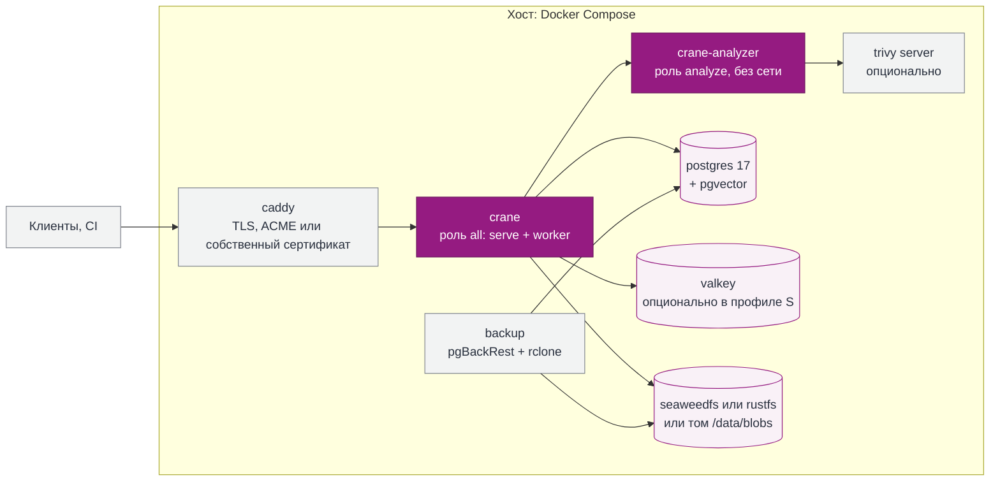
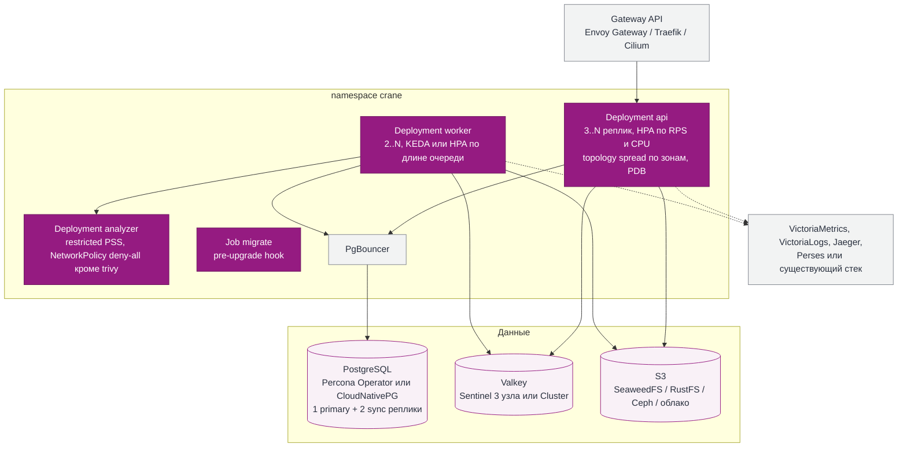
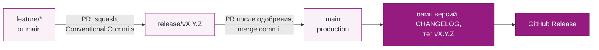

# 16. Развёртывание и наблюдаемость

Оба способа поддерживаются как равноправные. Используются один и тот же образ, одна и та же конфигурация (файл TOML и переменные окружения) и одни и те же миграции. Различаются только топология и число реплик.

## 16.1 Docker single node



*Рис. 16.1. Single node. Минимальный вариант: caddy, crane, postgres и локальный том.*

```yaml
services:
  crane:
    image: crane/crane:1.0.0     # образ публикуется проектом; адрес реестра задаётся при релизе
    command: ["all"]
    environment:
      CRANE_DATABASE_URL: postgres://crane@postgres/crane
      CRANE_CACHE: valkey://valkey:6379        # или "memory" для профиля S
      CRANE_BLOBS: s3://blobs?endpoint=http://seaweedfs:8333   # или file:///data/blobs
    read_only: true
    deploy: { resources: { limits: { cpus: "2", memory: 1g } } }
  analyzer:
    image: crane/crane:1.0.0
    command: ["analyze"]
    networks: [scan]                            # изолированная сеть только с trivy
    read_only: true
    security_opt: ["no-new-privileges:true"]
  postgres: { image: pgvector/pgvector:pg17, volumes: [pg:/var/lib/postgresql/data] }   # тег фиксируется в v0.2.0
  valkey:   { image: valkey/valkey:8, command: ["--save", "", "--appendonly", "no"] }
```

**Требования к PostgreSQL.** PostgreSQL 17+, pgvector ≥ 0.8 (итеративные сканы индекса HNSW, раздел 10.10), pg_trgm. Плавающие теги (`pgvector/pgvector:pg17` в `.env.dist`, на dogfood-стенде и в документации) заменяются точными версиями и digest в v0.2.0. С этого релиза `crane migrate` проверяет расширения `vector` и `pg_trgm` и при их отсутствии сразу завершается с понятным сообщением.

**Конфигурация (v0.1.0).** Источники: переменные окружения и необязательный файл TOML, путь к которому задаёт только `CRANE_CONFIG`. Приоритет: переменная окружения, затем файл, затем значение по умолчанию. Ключ файла — имя переменной без префикса `CRANE_` в нижнем регистре (`CRANE_HTTP_PORT` — `http_port`); значение — строка или целое число, а для любого ключа допустим ещё и массив строк (склеивается запятыми). Неизвестный ключ — ошибка запуска. Значения `memory` пишутся явно.

| Переменная | По умолчанию | Назначение |
| --- | --- | --- |
| `CRANE_CONFIG` | нет файла | путь к файлу TOML; только из окружения |
| `CRANE_DATABASE_URL` или `CRANE_DATABASE_URL_FILE` | одна из двух | каталог: `memory` (данные теряются при рестарте) или `postgres://…` (`postgresql://…`); файл читается без завершающего перевода строки |
| `CRANE_BLOBS` | обязательна | хранилище blob: `memory`, `file:///абсолютный/путь` или `s3://bucket[/prefix]?endpoint=…` |
| `CRANE_PUBLIC_URL` | обязательна | внешний адрес (`http://` или `https://`), попадает в `config.json` cargo |
| `CRANE_TOKEN` или `CRANE_TOKEN_FILE` | одна из двух | временный статический токен до v0.4.0; файл читается без завершающего перевода строки |
| `CRANE_TOKEN_PRINCIPAL` | `crane` | имя личности токена (тип «робот»): попадает в журнал аудита, `access`-журнал и ответ cargo `owners` |
| `CRANE_TRUSTED_PROXIES` | пусто | IP-адреса и CIDR (IPv4, IPv6) через запятую, чьим `X-Forwarded-For` и `X-Request-Id` верить; compose обязан указать сеть Caddy, иначе во всех событиях будет адрес прокси |
| `CRANE_HTTP_PORT` | `8080` | порт API |
| `CRANE_ADMIN_PORT` | `9464` | порт проб `/healthz/live` и `/healthz/ready` |
| `CRANE_CARGO_REPOS` | `internal` | hosted cargo-репозитории через запятую |
| `CRANE_CARGO_PROXY_REPOS` | пусто | proxy-репозитории crates.io через запятую (например `crates-io`): `/cargo/<имя>/`, индекс и архивы через кэш; имя не должно совпадать с hosted. Пустое значение выключает proxy |
| `CRANE_MAX_PUBLISH_BYTES` | `10485760` | предел тела публикации cargo в байтах |

`memory` нельзя смешивать с постоянным хранилищем: пара `CRANE_DATABASE_URL` и `CRANE_BLOBS` либо вся в памяти, либо вся постоянная. Иначе каталог в PostgreSQL после рестарта ссылался бы на потерянные blob, и сервер отказывается стартовать. Адрес базы с паролем в журналы и тексты ошибок не попадает. При недоступной БД `crane serve` падает на старте, `crane migrate` применяет миграции и идемпотентен.

`/healthz/ready` проверяет PostgreSQL и хранилище blob и укладывается в 1,5 с: на отказ или таймаут он отвечает 503, а `/healthz/live` хранилищ не трогает. Учётные данные в query `CRANE_BLOBS` запрещены (только `AWS_*`). Учётной записи S3 нужно право `s3:ListBucket`: без него отсутствующий ключ даёт 403 вместо 404, и готовность остаётся неуспешной.

`crane healthcheck` опрашивает `/healthz/ready` на `CRANE_ADMIN_PORT` и завершается с кодом 0 или 1 (для healthcheck в compose: в образе нет curl).

**Секреты и сети в compose.** Токен, пароль PostgreSQL и URL каталога (с паролем) лежат в файлах, пути к которым задают `CRANE_TOKEN_SECRET`, `POSTGRES_PASSWORD_SECRET` и `CRANE_DATABASE_URL_SECRET`; compose монтирует их в `/run/secrets`, а сервер читает через `CRANE_TOKEN_FILE` и `CRANE_DATABASE_URL_FILE`. Ни в переменных окружения, ни в compose-файле, ни в `.env` значений секретов нет. Сеть `edge` с фиксированной подсетью `CRANE_EDGE_SUBNET` соединяет только caddy и crane; та же подсеть передаётся как `CRANE_TRUSTED_PROXIES`, поэтому в аудите виден адрес клиента, а не Caddy. PostgreSQL в `edge` не входит, порт admin наружу не публикуется.

## 16.2 Kubernetes (Helm chart)



*Рис. 16.2. Kubernetes. Все stateful-компоненты могут быть внешними управляемыми сервисами организации.*

## 16.3 Размеры по профилям

| Компонент | S · single node | M · single node или k8s | L · k8s, 3 зоны |
| --- | --- | --- | --- |
| CRANE api | 1 контейнер: 1–2 vCPU, 0.5–1 ГБ | 2 × (2 vCPU, 1 ГБ) | 6–12 × (4 vCPU, 2–4 ГБ) |
| CRANE worker | 2 × (1 vCPU, 1 ГБ) | 4–8 × (2 vCPU, 2 ГБ) |
| Analyzer + Trivy | опционально, 1 vCPU, 2 ГБ | 2 × (2 vCPU, 4 ГБ) | 4–8 × (2 vCPU, 4 ГБ) |
| PostgreSQL | 1 vCPU, 1 ГБ | 4 vCPU, 16 ГБ + реплика | 16 vCPU, 64 ГБ × 3, NVMe |
| Valkey | не обязателен | 1 × 2 ГБ | 3 × (2 vCPU, 8 ГБ) |
| Хранилище blobs | локальный диск 50–200 ГБ | S3, 2–10 ТБ | S3 с EC, 100–500 ТБ |
| Итого вычислений | **2 vCPU / 4 ГБ** | **~16 vCPU / 48 ГБ** | **~120–180 vCPU / ~350 ГБ** |

*В профиле L основная доля CPU приходится на PostgreSQL, сканирование и хранилище; сами API-реплики на Rust занимают 24–48 vCPU. Для FastAPI этот слой составил бы 150–250 vCPU (раздел 3).*

## 16.4 Обновления и миграции

-   Миграции схемы по схеме expand / migrate / contract: новая версия приложения работает со старой и новой схемой, поэтому rolling update идёт без простоя.
-   Миграции запускаются отдельной ролью `migrate`: Helm pre-upgrade hook в k8s, одноразовый сервис в Compose. Advisory lock не даёт запустить две миграции сразу.
-   Поддерживается обновление через одну минорную версию; мажорные версии с документированным путём и проверкой в CI на снапшоте реальной схемы.

## 16.5 Резервное копирование и проверяемое восстановление

Если вам это нужно — CRANE это поддерживает, но готовых профилей мы не предоставляем: конфигурация каждого проекта и предприятия, как и их бюджет на инфраструктуру, сильно различаются.

CRANE хранит metadata в PostgreSQL и неизменяемые content-addressed blob, поэтому подходит любой согласованный бэкап PostgreSQL (pgBackRest с PITR, снимки томов, управляемые бэкапы облака) вместе с версионированием, репликацией или Object Lock бакета. Эти средства работают на стороне оператора и совместимы с CRANE; CRANE их не поставляет и не настраивает.

| Данные | Что подходит (на стороне оператора) | Проверка |
| --- | --- | --- |
| PostgreSQL | pgBackRest (MIT): полные и инкрементальные бэкапы + непрерывный WAL-архив в отдельный bucket; PITR. Подходят также снимки томов и управляемые бэкапы облака | Регулярное восстановление в изолированный экземпляр (рекомендация) |
| Blobs | Неизменяемы, поэтому достаточно репликации bucket или rclone (MIT) копии новых объектов; версионирование и Object Lock. Класс `proxy-cache` не бэкапится: он восстанавливается прогревом; `restricted` бэкапится отдельно в своём контуре | `crane restore verify`: каждый asset в БД имеет blob с верным SHA-256 |
| Конфигурация | Helm values / compose-файлы в Git; секреты в хранилище секретов организации | — |

Процедура восстановления (команда `crane restore verify` — план v0.5.0; процедура закрывает критерий приёмки «backup восстановлен в тестовом окружении с проверкой metadata и blobs»):

1.  Восстановить PostgreSQL из бэкапа в изолированный экземпляр (на нужный момент, если используется PITR).
2.  Подключить хранилище blob: исходный bucket, его реплику или версию.
3.  Выполнить `crane restore verify`: она сверяет восстановленную БД с хранилищем blob (каждый asset имеет blob с верным SHA-256) и формирует отчёт. Проверить отчёт: расхождения metadata и blob устраняются до переключения трафика.
4.  Переключить CRANE на восстановленные PostgreSQL и хранилище; кэш класса `proxy-cache` прогреть заново.

## 16.6 Наблюдаемость: что CRANE отдаёт наружу

CRANE отдаёт телеметрию только в открытых форматах: метрики Prometheus/OpenMetrics, трассы и журналы OTLP, журналы JSON в stdout. Привязки к конкретному стеку нет: подходят VictoriaMetrics, Prometheus, Jaeger, VictoriaLogs, любой OpenTelemetry Collector или существующий стек организации.

### Точки съёма

| Endpoint | Порт | Назначение | Доступ |
| --- | --- | --- | --- |
| `GET /metrics` | служебный (9464) | Метрики OpenMetrics с exemplars (`trace_id`) | Только из сети мониторинга; в Helm есть ServiceMonitor и PodMonitor |
| `GET /healthz/live` | служебный | Процесс жив и event loop не завис | Kubelet |
| `GET /healthz/ready` | служебный | Готов принимать трафик: PostgreSQL и хранилище доступны; Valkey и upstream на готовность не влияют | Kubelet, балансировщик |
| `GET /healthz/startup` | служебный | Миграции применены, кэши прогреты | Kubelet |
| `GET /api/v1/status` | основной | Версия, режим (normal, read-only, degraded), состояние компонентов и фидов, отставание экспорта в SIEM | Пользователи, CLI `cctl diag`, внешние статус-страницы |
| OTLP export | исходящий | Трассы, журналы и, по желанию, метрики в OpenTelemetry Collector (gRPC или HTTP) | Настраивается endpoint и заголовки |

### Каталог метрик

Все метрики имеют префикс `crane_`. Длительности в секундах, размеры в байтах.

| Группа | Метрики | Метки |
| --- | --- | --- |
| Протоколы и API | `http_requests_total`, `http_request_duration_seconds` (histogram), `http_inflight_requests`, `http_response_bytes_total` | `format`, `op`, `status_class` |
| Кэш и proxy | `cache_requests_total`, `singleflight_coalesced_total`, `upstream_requests_total`, `upstream_duration_seconds`, `upstream_up` | `layer` (l1, l2), `result` (hit, miss, stale), `upstream` |
| Публикация и хранилище | `publish_total`, `publish_bytes_total`, `blob_objects`, `blob_bytes`, `gc_reclaimed_bytes_total`, `integrity_failures_total`, `storage_move_bytes_total`, `quota_usage_ratio` | `format`, `result`, `store`, `class`, `workspace` (top N + `other`) |
| Доступ | `authz_decisions_total`, `auth_failures_total`, `authz_epoch_invalidations_total`, `credentials_expiring` | `decision`, `method`, `days` (7, 14, 30) |
| Очереди и события | `jobs_queued`, `job_oldest_age_seconds` (`now() - min(run_at)` среди видимых задач), `job_dead_total` (рост `job_dead`), `job_duration_seconds`, `outbox_lag_seconds` (только внешняя доставка), `webhook_deliveries_total` | `kind`, `outcome` |
| Уязвимости | `findings_open`, `findings_sla_breached`, `advisories_ingested_total`, `feed_lag_seconds`, `detection_time_seconds` (histogram: advisory → finding), `emergency_blocks_active`, `exceptions_expiring`, `vuln_db_age_seconds` | `priority`, `feed`, `scanner`, `days` |
| AI и скоринг | `ai_requests_total`, `ai_duration_seconds`, `ai_tokens_total`, `ai_fallback_total`, `score_value` (histogram), `score_overrides_total` | `role` (score, chat, embed, rerank), `provider`, `kind`, `direction` |
| A2A | `a2a_tasks_total`, `a2a_confirmations_total`, `a2a_task_duration_seconds` | `skill`, `state`, `outcome` |
| SIEM | `siem_events_total`, `siem_export_lag_seconds` | `sink`, `result` |
| Зависимости и рантайм | `db_pool_connections`, `db_query_duration_seconds`, `valkey_errors_total`, `s3_request_duration_seconds`, `tokio_busy_ratio`, `build_info` | `state`, `query_class`, `op`, `version`, `commit` |

**Бюджет кардинальности.** Имена пакетов, пользователи, IP и токены в метки не попадают. Метки по workspace ограничены top N с корзиной `other`. Цель не больше 5 000 рядов на реплику; превышение видно по самой метрике `crane_metric_series`.

### Журналы

-   **Формат.** JSON в stdout, одна строка на событие. Обязательные поля: `ts`, `level`, `msg`, `target`, `request_id`, `trace_id`, `span_id`; для запросов также `format`, `op`, `status`, `duration_ms`, `principal_kind` (человек, робот, агент), `workspace`, `rule_id` при отказе.
-   **Потоки.** Журнал приложения и access log разделены полем `stream`. Access log в stdout — операционный журнал: он пишется на 100% для ошибок и может прореживать успешные скачивания (доля настраивается, по умолчанию 10%), чтобы CI-трафик не топил журналы. Полная запись скачиваний — поток скачиваний (14.13 «Аудит скачиваний»): 100% с v0.4.0.
-   **Поля proxy.** В строке access log ответов proxy-репозиториев есть `cache` (`hit`, `miss`, `stale`, `stale-on-error`: откуда пришёл ответ), `upstream_failure` (`refused`, `unavailable`, `digest-mismatch`, `too-large`: почему upstream отказал) и `upstream_reason` (причина: для `refused` правило egress, для `digest-mismatch` ожидаемый и полученный sha256). Отказ egress и несовпадение суммы — события безопасности, поэтому они пишутся именно в этот журнал (14.9), клиенту же уходит только «upstream недоступен». Ответ несёт заголовок `Age` (секунды в кэше) и `Warning: 110` для устаревшего или `111` для ответа при сбое upstream; `Warning` отменён RFC 9111 и оставлен для старых клиентов, основной сигнал — `Age` и поле `cache`.
-   **Аудит не журнал.** Действия пользователей и решения доступа идут в неизменяемый аудит и в SIEM (раздел 14.9), а не в журнал приложения: у них другие гарантии доставки и хранения.
-   **Редактирование.** Секреты не реализуют вывод в журнал на уровне типов (`Secret<T>`); дополнительно включён фильтр известных форматов токенов и заголовков `Authorization`.

### Трассировка

-   **Протокол.** OTLP, распространение контекста по W3C Trace Context. Входящий `traceparent` от CI и внешних агентов принимается; к публичным upstream заголовки трассировки не отправляются.
-   **Spans.** `http.server` (операция протокола), `authz.decide`, `cache.lookup`, `upstream.fetch`, `blob.get` и `blob.put`, `db.query`, `job.run`, `ai.score`, `ai.complete`, `siem.deliver`, `a2a.task`.
-   **Сэмплирование.** Parent-based, 1% по умолчанию и 100% для ошибок и медленных запросов (через tail sampling в Collector). Exemplars связывают точки гистограмм с трассами.

### SLO и алерты

SLI считаются из метрик, а алерты строятся по скорости сжигания бюджета ошибок в двух окнах (multi-window burn rate): быстрое окно ловит острые аварии, медленное ловит тлеющие.

| Алерт | Условие | Серьёзность |
| --- | --- | --- |
| `CraneDownloadErrorBudgetBurn` | Бюджет доступности скачивания сжигается в 14.4 раза быстрее нормы за 1 ч и 5 мин | page |
| `CraneMetadataLatencyHigh` | p99 metadata при кэш-хите выше SLO (раздел 4) 15 минут | page |
| `CraneReadOnlyMode` | Сервис в режиме read-only больше 5 минут | page |
| `CraneUpstreamDown` | `upstream_up == 0` 10 минут | ticket |
| `CraneQueueBacklog` | Возраст старейшей задачи больше 10 минут | ticket |
| `CraneJobDeadGrowth` | Рост `job_dead` за 15 минут | ticket |
| `CraneOutboxLag` | Отставание outbox внешней доставки (webhooks, SIEM) больше 5 минут | page |
| `CraneFeedLagging` | Фид уязвимостей не синхронизировался 30 минут | page |
| `CraneP0WithoutAction` | P0 открыт больше 1 часа без блокировки или решения | page |
| `CraneVulnDbStale` | База сканера старше 24 часов | ticket |
| `CraneSiemExportLag` | Отставание экспорта в SIEM больше 5 минут | page |
| `CraneIntegrityFailure` | Любой blob с неверным SHA-256 | page |
| `CraneScoreDrift` | Распределение оценок systemone сместилось относительно базовой недели | ticket |

Правила поставляются как PrometheusRule в Helm chart и как отдельный YAML для других систем.

### Дашборды

В поставке дашборды Perses (Apache-2.0) и их JSON-версии для совместимых систем: «Обзор и SLO», «Протоколы», «Proxy и upstream», «Хранилище и GC», «Очереди и outbox», «Безопасность: findings, SLA, фиды», «AI, скоринг и A2A», «Экспорт в SIEM», «PostgreSQL и Valkey». Каждая панель ссылается на соответствующий раздел runbook.

## 16.7 Ветвление и выпуск версий



*Рис. 16.7. Ветвление и выпуск.*

- `main` — основная ветка (production). Feature-ветки создаются от `main`, сливаются в `release/vX.Y.Z` через PR со **squash**; заголовок PR следует Conventional Commits и проверяется commitlint.
- PR в `release/*` проходит `task check`, тесты затронутой части и ручные мутанты ревью (таблица в описании PR). Перед PR `release/*` → `main` владелец релиза локально запускает полный `task gate` по всему дифу релиза: юниты, e2e, мутационное тестирование (cargo-mutants, Stryker) и Playwright. Результат (`Gate: passed`, `Gate-SHA`) вставляется в описание релизного PR. В CI полный гейт не гоняется; на PR в `main` идут юнит-тесты backend и frontend, линтеры и проверки структуры.
- После одобрения владельцем открывается PR `release/vX.Y.Z` → `main` со слиянием **merge commit**: история коммитов нужна для CHANGELOG.
- После слияния workflow `release` от имени GitHub App (bypass защиты `main`) бампит версии в `Cargo.toml`, `package.json` и `Chart.yaml`, пересобирает `CHANGELOG.md` по Conventional Commits (окно сборки — между тегами), коммитит `chore(release): vX.Y.Z` и ставит тег `vX.Y.Z`.
- Тег запускает workflow `publish`: он создаёт GitHub Release с заметками из CHANGELOG. Первый коммит выпущен с тегом `v0.0.0`. Сборка образов в ghcr пока не входит в процесс.
- Если запись в `main` от бота недоступна, бамп и тег выполняются вручную тем же скриптом (`tools/bump-version.ts`) и командой `git-cliff`.
- **Dogfooding.** Внутренние крейты CRANE публикуются в собственный Cargo-реестр CRANE, как только он готов в рамках P0. Это первое применение продукта на себе и проверка sparse-протокола настоящим клиентом `cargo`: сборка CRANE берёт собственные крейты через `registry = "crane"`, а внешние зависимости идут через proxy crates.io.

## 16.8 Шифрование и проверка конфигурации

С v0.5.0. Если вам это нужно — CRANE это поддерживает, но готовых профилей мы не предоставляем: конфигурация каждого проекта и предприятия, как и их бюджет на инфраструктуру, сильно различаются.

### Что поддерживается

-   **PostgreSQL, канал.** TLS задаётся в URL каталога: `sslmode=verify-full`, `sslrootcert=<путь>`; для mTLS добавляются `sslcert` и `sslkey` (пути к файлам, ключ лежит в файле).
-   **PostgreSQL, диск.** LUKS/dm-crypt, шифрованные диски облака, шифрованный StorageClass в Kubernetes, сборки с TDE от третьих сторон (например, Percona pg_tde) — на стороне оператора и совместимы с CRANE.
-   **S3.** Серверное шифрование SSE-S3, SSE-KMS и DSSE-KMS задаётся несекретными параметрами `CRANE_BLOBS`: `aws_server_side_encryption` (`AES256`, `aws:kms`, `aws:kms:dsse`), `aws_sse_kms_key_id`, `aws_sse_bucket_key_enabled`; любой ключ вне списка несекретных параметров сервер отвергает при старте. Пример: `s3://blobs?aws_server_side_encryption=aws:kms&aws_sse_kms_key_id=<arn или id>&aws_sse_bucket_key_enabled=true`. SSE-C (`sse-c`) тоже поддерживается, но ключ `aws_sse_customer_key_base64` — секрет: его задают только через окружение `AWS_SSE_CUSTOMER_KEY_BASE64`, не в URL. Подходит и шифрование бакета по умолчанию на стороне хранилища.
-   **Бэкапы pgBackRest.** Шифрование репозитория (`repo1-cipher-type`) настраивается на стороне оператора.
-   **Valkey.** В конфигурации CRANE персистентности нет (только кэш), шифровать на диске нечего.
-   **Класс `restricted`.** Свой bucket и свой ключ KMS задаются параметрами хранилища этого класса (раздел 9).
-   **Секреты и pepper.** Как в 14.3.

### Проверка безопасной конфигурации

Параметр `CRANE_REQUIRE_SECURE_CONFIG` (по умолчанию `false`). При `true` `crane serve` отказывается стартовать, если:

-   публичный URL начинается с `http://`;
-   URL PostgreSQL без `sslmode=verify-full`;
-   endpoint S3 задан по `http://` или указан `aws_allow_http=true`;
-   режим разделения обязанностей `warn` (14.12).

Без `true` те же находки дают предупреждения и событие `config.insecure`. Шифрование на диске CRANE не проверяет: это зона оператора.

### Чек-лист для оператора

Если нужно усиление, проверьте:

-   TLS везде;
-   `sslmode=verify-full` для PostgreSQL;
-   серверное шифрование S3 (SSE-KMS) через параметры `CRANE_BLOBS` или шифрование бакета по умолчанию;
-   шифрованные тома и бэкапы;
-   разделение обязанностей `strict`;
-   заданы доверенные прокси (`CRANE_TRUSTED_PROXIES`);
-   порт admin не опубликован наружу;
-   `CRANE_REQUIRE_SECURE_CONFIG=true`.
