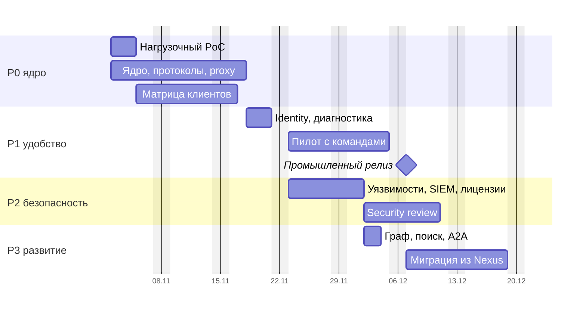

# 18. План работ, команда, бюджет

Разработку ведёт оператор-архитектор с параллельно работающими AI-агентами. Поэтому трудоёмкость считается в **агент-часах** (час работы одного агента), а участие людей отдельно в часах. Оценка выведена из замера реального проекта, сделанного тем же способом, и пересчитывается скриптом `tools/estimate-agent-hours.py` при уточнении входных данных.

## Эталон: как получена норма

Эталоном служит сервис-витрина справочных данных: Python (FastAPI, gRPC, Kafka-консьюмеры, кэш Valkey, PostgreSQL с pgvector, лексико-семантический поиск и RAG), A2A-агент, административная SPA на React, Helm, CI, наблюдаемость. Он написан с нуля за 4,5 календарных дня одним оператором с агентами.

| Показатель | Замер | Как получен |
| --- | --- | --- |
| Код продукта | 71,5 тыс. строк | Непустые строки backend, агента и SPA; без lock-файлов, сгенерированного кода и импортированных спецификаций |
| Тесты | 93,0 тыс. строк | Те же правила подсчёта; на строку кода 1,3 строки тестов |
| Развёртывание, CI, документация | 25,8 и 38,2 тыс. строк | Helm, CI, правила алертов; авторская документация |
| Активное время агентов | 40–47 ч | По 1 384 коммитам: сессии с разрывом не больше 30–45 минут |
| Параллельность | 3,8 агента в среднем, до 15 | Число одновременно активных веток в 30-минутном окне (132 ветки) |
| Трудоёмкость | **≈ 165 агент-ч** | 43,5 ч × 3,8 |
| Внимание оператора | ≈ 20 ч | Оценка оператора |

Отсюда норма полного цикла: **2,3 агент-часа на тысячу строк кода продукта**, включая тесты, документацию, CI и развёртывание. На один агент-час приходится около 0,12 часа внимания оператора.

## Пересчёт на CRANE

Объём CRANE оценён по модулям (разделы 7 и 8). Для каждого модуля задан коэффициент сложности относительно эталона и коэффициент языка: Rust агентам даётся медленнее Python из-за строгой типизации и циклов компиляции (базово ×1,6, диапазон ×1,3–2,0).

| Модуль | Этап | Тыс. строк | Сложность | Агент-ч |
| --- | --- | --- | --- | --- |
| Ядро: домен, порты, use cases, HTTP, очередь, outbox, миграции | P0 | 12 Rust | 1,0 | 44 |
| Протоколы npm, PyPI, Maven, NuGet, Cargo (sparse) | P0 | 24 Rust | 1,6 | 142 |
| CAS, атомарная публикация, GC, retention, целостность | P0 | 6 Rust | 1,3 | 29 |
| Proxy: TTL, SWR, singleflight, SSRF guard | P0 | 5 Rust | 1,4 | 26 |
| Доступ: OIDC, токены, обмен, Cedar, роли, разделение обязанностей, эпохи | P0 | 7 Rust | 1,3 | 34 |
| Наблюдаемость: метрики, трассы, health, алерты | P0 | 3 Rust | 0,8 | 9 |
| SPA: каркас, каталог, карточка, администрирование | P0 | 14 TS | 1,0 | 32 |
| CLI, настройка пакетных менеджеров, NuGet и Cargo credential provider | P0, P1 | 5 Rust | 0,9 | 17 |
| GitLab identity, диагностика, CI templates, импорт из Nexus | P1 | 6 Rust | 1,0–1,3 | 24 |
| Классы хранения, размещение, онлайн-перенос | P1 | 2 Rust | 1,3 | 10 |
| SPA: рабочие столы ролей | P1 | 7 TS | 1,0 | 16 |
| Evidence, SBOM, Trivy, песочница анализа | P2 | 7 Rust | 1,3 | 34 |
| Attestations: Sigstore, in-toto/SLSA, проверка upstream | P2 | 3 Rust | 1,4 | 16 |
| Лицензии: SPDX, политика, вирусность | P2 | 4 Rust | 1,2 | 18 |
| Promotion, approvals, исключения | P2 | 4 Rust | 1,0 | 15 |
| Уязвимости: фиды, сопоставление, P0–P4, VEX, экстренный режим | P2 | 9 Rust | 1,4 | 47 |
| Скоринг systemone | P2 | 2 Rust | 1,0 | 7 |
| События безопасности: OCSF, SIEM, Sigma, SOAR | P2 | 5 Rust | 1,1 | 20 |
| Журнал действий: маскирование, раскрытие, экспорт, аудит доступа | P2 | 2 Rust | 1,0 | 7 |
| SPA: рабочие столы AppSec и SecOps, журнал действий | P2 | 11 TS | 1,0 | 25 |
| Граф потребителей и impact | P3 | 4 Rust | 1,2 | 18 |
| Поиск и LLM: FTS, pgvector, RAG, rerank | P3 | 4 Rust | 1,0 | 15 |
| A2A-агент | P3 | 3 Rust | 0,8 | 9 |
| SPA: AI-поиск, ассистенты, граф | P3 | 6 TS | 1,0 | 14 |
| **Итого код** | | **117 Rust + 38 TS** | | **627** |

Работы, которые не пропорциональны объёму кода, добавлены отдельно: матрица реальных клиентов (44 агент-ч), нагрузочный стенд и оптимизация горячего пути (25), интеграция с реальными Keycloak, GitLab, Trivy и S3 на стенде (30), исправление замечаний security review (30), подключение SIEM и SOAR пилотной организации (15). Всего **144 агент-ч**.

## Этапы и трудоёмкость

| Этап | Состав | Агент-ч: оптимистично · базово · пессимистично | Разработка, раб. дней (базово) | Оператор, ч (базово) |
| --- | --- | --- | --- | --- |
| **P0 · ядро** | Пять форматов hosted и proxy, CAS, атомарная публикация, namespaces, Keycloak, токены для людей, роботов и CI, роли, Cedar, базовый UI, аудит, наблюдаемость, backup/restore, Compose и Helm, матрица клиентов, нагрузочный PoC | 306 · **395** · 590 | 12,3 | 72 |
| **P1 · удобство** | GitLab и другие OIDC-платформы, CI templates, provenance, карточка пакета, диагностика отказов, классы хранения, импорт из Nexus, рабочие столы ролей | 71 · **87** · 123 | 2,7 | 16 |
| **P2 · безопасность** | Trivy, SBOM, attestations (проверка upstream, приём из CI), фиды уязвимостей, P0–P4, VEX, экстренный режим, скоринг systemone, лицензии и вирусность, quarantine и promotion, исключения, события OCSF в SIEM, SOAR, журнал действий для SecOps | 183 · **234** · 347 | 7,3 | 42 |
| **P3 · развитие** | Граф потребителей, impact analysis, поиск и ассистенты на LLM, A2A-агент, migration assistant | 43 · **55** · 84 | 2 | 10 |
| **Итого** | | **603 · 771 · 1 143** | **24** | **140** |

Дни разработки посчитаны для 4 параллельных агентов по 8 часов в рабочий день: 32 агент-часа в день. Эталон шёл быстрее (около 38 агент-часов в день), но с ночными сессиями. Сценарии различаются коэффициентом Rust (×1,3, ×1,6, ×2,0) и общей сложностью (×0,9, ×1,0, ×1,25).

## Дорожная карта

Часть сроков не сокращается агентами: нагрузочный тест на целевом железе, security review, пилот с командами и миграция из Nexus идут по календарю. Они поставлены параллельно разработке следующего этапа.

*Рис. 18.1. Базовый сценарий при старте 2 ноября 2026: промышленный релиз (P0 + P1 после пилота) через ~5 недель, полный объём P0–P3 с миграцией через ~7 недель.*

| Сценарий | Промышленный релиз | Полный объём P0–P3 |
| --- | --- | --- |
| Оптимистичный | ~4 недели | ~6 недель |
| **Базовый** | **~5 недель** | **~7 недель** |
| Пессимистичный | ~7 недель | ~10 недель |

## Команда

| Роль | Участие (базово) | Зона ответственности |
| --- | --- | --- |
| Оператор-архитектор | ~140 ч (109–208) | Постановка задач агентам, ревью, архитектурные решения, приёмка |
| AI-агенты | ~770 агент-ч, 4 параллельно | Код, тесты, документация, CI, развёртывание |
| Security reviewer | ~40 ч | Модель угроз, ревью критичных модулей, пентест, правила SIEM |
| SRE / DevOps | ~30 ч | Стенды, нагрузочный PoC, HA PostgreSQL, бэкапы, наблюдаемость |
| Юрист или комплаенс | ~8 ч | Лицензионная политика организации |
| Пилотные команды | 2–3 команды | Обратная связь, первые миграции |

Множитель внимания оператора взят в 1,5 раза выше эталона: Rust, протоколы с жёсткой совместимостью и функции безопасности требуют более плотного ревью.

Вне итога и графика остаётся опциональная подпись продвинутых версий самим CRANE (частный Sigstore: Fulcio и Rekor со своим TUF-корнем). Её цена и причины отложить описаны в «Вне графика» ROADMAP.

## Бюджет

Бюджет складывается из агент-часов (умножьте на стоимость агент-часа по тарифу используемой модели), часов людей и инфраструктуры.

| Профиль | Вычисления | Хранилище | Лицензии ПО |
| --- | --- | --- | --- |
| S | 1 ВМ 2 vCPU / 4 ГБ | 50–200 ГБ диска | 0 |
| M | ~16 vCPU / 48 ГБ | 2–10 ТБ S3 | 0 |
| L | ~120–180 vCPU / ~350 ГБ | 100–500 ТБ S3 с EC | 0 |

> **Для ЛПР.** Разработка занимает недели, а не месяцы: ~770 агент-часов и ~140 часов оператора в базовом сценарии. Дольше всего идут этапы, которые агенты не ускоряют: пилот, security review и миграция команд. Выбор Rust добавляет около 200 агент-часов (≈ 6 рабочих дней при 4 агентах) и экономит в профиле L порядка 100–200 vCPU и 50–100 ГБ RAM постоянно. Главный риск оценки в переносе нормы с эталона на другой язык и домен; он закрывается замером скорости на первой неделе P0 и пересчётом.
