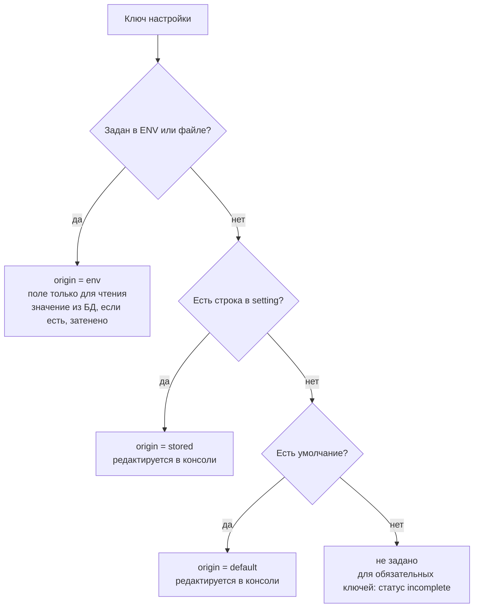
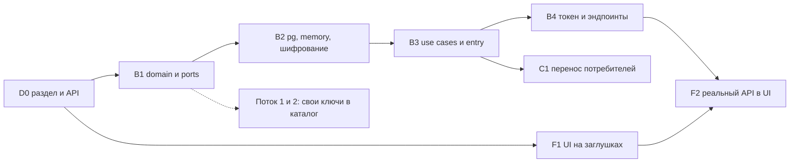

# 20. Настройки и онбординг первого запуска

Раздел вытянут вперёд из плана: настройки платформы и мастер первого запуска нужны v0.3.0 (три новых формата и интеграция Trivy добавляют настройки, которые нельзя только зашивать в окружение) и дальше растут вместе с доступом (v0.4.0). Он проектирует три вещи, которых нет в разделах 9, 13 и 16: единую модель настроек с источниками, мастер, который проводит оператора от пустой установки до работающего экземпляра, и защиту этого мастера от захвата. Статус: проект, реализация идёт потоками v0.3.0 (20.7).

## 20.1 Модель настроек: inherited и effective

Настройка — именованное типизированное значение уровня экземпляра (`storage.blobs`, `identity.oidc.issuer`, `proxy.max_artifact_bytes`). У настройки два возможных источника значения:

| Источник | В UI | Где живёт | Кто меняет |
| --- | --- | --- | --- |
| **inherited** | «Из окружения» | ENV, `*_FILE`, файл `CRANE_CONFIG`; читается при старте процесса | оператор развёртывания (Compose, Helm, Secret) |
| **effective** | «Задано в консоли» | таблица `setting` в PostgreSQL | администратор через консоль или мастер |

В разговоре «effective» часто звучит как «итоговое значение»; здесь это слово закреплено за значением в БД. Итог вычисляется отдельно и в API называется `value` с полем `origin`.

**Правило приоритета: ENV > БД > умолчание.** Если настройка задана в окружении, значение из БД не используется; значение из окружения нельзя изменить из консоли.



*Рис. 20.1. Вычисление итогового значения настройки.*

### Как это видит оператор

- В списке и карточке настройки: бейдж источника (`env`, `stored`, `default`) и замок у `env`. Поле `env` не редактируется; подсказка называет переменную (`CRANE_BLOBS`) и что нужно изменить, чтобы управлять значением из консоли: убрать её из окружения.
- **Затенение.** Если в БД есть значение, а окружение его перекрывает, консоль показывает его серым «сохранено, но не действует» с датой и автором. Затенение возникает, когда оператор добавил переменную после того, как администратор уже сохранил значение. При старте это даёт предупреждение `settings.shadowed` в журнал ИБ (20.3).
- **Секреты** в ответе API и в UI не появляются никогда: только `secret_state: set | unset` и время последнего изменения.
- У каждой настройки есть признак применения: `live` (подхватывается без перезапуска в течение 5 секунд) или `restart` (консоль пишет «вступит в силу после перезапуска», и в `/status` появляется баннер `restart_required`).

### Что происходит, когда ENV исчезает

Данные не удаляются и не копируются:

- Скалярная настройка: начинает действовать значение из БД, если оно есть; иначе умолчание. Последнее значение из окружения **не** запоминается, потому что окружение может нести секрет, а запись секрета в БД без решения администратора недопустима. Чтобы пережить уход переменной, значение «принимают» явно: операция `adoption` копирует несекретное inherited-значение в БД (по умолчанию в мастере предлагается один раз на итоговом шаге).
- Сущность (репозиторий, namespace, класс хранилища), объявленная в окружении: её строка остаётся и получает `origin = db`, с событием `settings.inherit_released`. Пакеты, ссылающиеся на репозиторий, не пострадали бы от обратного, поэтому ничего не удаляется.
- Если обязательный ключ после этого остаётся без значения, экземпляр работает дальше, но `/status` показывает `settings: incomplete` с перечнем ключей. Мастер заново не открывается (20.5); недостающее вносится на экране «Настройки платформы».

### Какие настройки в базу не попадают

Эти ключи нужны, чтобы вообще получить доступ к БД или защитить её содержимое, поэтому они только inherited (в каталоге помечены `bootstrap`):

| Ключ | Переменная | Почему только ENV |
| --- | --- | --- |
| `database.url` | `CRANE_DATABASE_URL`, `_FILE` | без неё нет БД, где хранить остальное |
| `settings.key` | `CRANE_SETTINGS_KEY_FILE` | ключ шифрования секретов в БД (20.2) |
| `http.port`, `admin.port` | `CRANE_HTTP_PORT`, `CRANE_ADMIN_PORT` | слушатели поднимаются до чтения настроек |
| `net.trusted_proxies` | `CRANE_TRUSTED_PROXIES` | от него зависит, какому `X-Forwarded-For` верить в журнале ИБ; менять из консоли небезопасно |
| `security.require_secure_config` | `CRANE_REQUIRE_SECURE_CONFIG` | защитная настройка, которую не должен ослаблять тот, кто получил консоль |
| `bootstrap.token` | `CRANE_BOOTSTRAP_TOKEN`, `_FILE` | первичный секрет (20.5) |

### Сущности: репозитории, namespaces, хранилища

Репозитории (`CRANE_CARGO_REPOS`, `CRANE_NPM_PROXY_REPOS` и так далее), namespaces (`CRANE_NAMESPACES`) и классы хранилищ (раздел 9) уже являются таблицами, а не скалярами. Модель та же, но источник записан в колонке `origin text NOT NULL DEFAULT 'db' CHECK (origin IN ('env', 'db'))`. При старте перечисленное в окружении записывается с `origin = env` (upsert), такие строки в консоли заблокированы. Имя, которое есть и в окружении, и в консоли, принадлежит окружению; консольная строка с тем же именем невозможна (уникальность `(format, name)` уже есть).

## 20.2 Домен, порты и хранение

Слои как в `AGENTS.md`: `entry → adapters → app → ports → domain`; serde только в `formats` и `entry`, в `domain`, `ports`, `app` его нет.

### domain (чистая логика, без IO)

- `SettingKey`: проверенное имя `группа.подгруппа.имя`, нижний регистр, не длиннее 96 символов.
- `SettingValue`: `Bool`, `Int(i64)`, `Text(String)`, `Duration`, `List(Vec<String>)`, `Secret(Secret)`. Адреса и размеры — `Text`/`Int` с проверкой в определении.
- `Secret`: обёртка без `Debug` и `Display`, без `Clone` за пределами крейта; значение выдаёт единственный метод `expose()`, его зовут только шифрование и клиент, которому оно нужно. Тест редакции остаётся (AGENTS.md).
- `SettingDefinition` (статическая таблица в коде, не данные): ключ, тип, `secret`, `bootstrap`, `apply: Live | Restart`, `required_by: &[Feature]`, функция проверки `fn(&SettingValue) -> Result<(), SettingError>`, умолчание.
- `Origin { Env, Stored, Default }` и чистая функция `resolve(&SettingDefinition, Option<&SettingValue>, Option<&Stored>) -> Resolved`. `Resolved` для секрета содержит не значение, а `SecretState`. `Resolved::ensure_writable()` возвращает `SettingError::Locked { env_var }`, если источник `Env`.
- `OnboardingState`: `NotStarted → InProgress { step, done } → Completed { at, by }`; недопустимые переходы возвращают ошибку (как `VersionState::ensure`, раздел 9).
- `BootstrapPolicy`: константы лимитов (20.5).

Определения собирает каталог в крейте `app` (каждый поток добавляет свои ключи рядом с кодом, которому они нужны; общей «простыни» нет). Реестр определений и функция `resolve` — первая поставка (20.7): без неё потоки не могут объявлять свои настройки.

### ports

```rust
pub trait SettingsStore: Send + Sync {
    async fn list(&self) -> Result<Vec<Stored>, StoreError>;
    async fn get(&self, key: &SettingKey) -> Result<Option<Stored>, StoreError>;
    /// Запись с проверкой версии (CAS); аудит пишется в той же транзакции, когда журнал её поддерживает.
    async fn put(&self, key: &SettingKey, value: &StoredValue, expected: Option<Version>, by: &AuditCtx) -> Result<Stored, StoreError>;
    async fn delete(&self, key: &SettingKey, expected: Version, by: &AuditCtx) -> Result<(), StoreError>;
}
pub trait SecretBox: Send + Sync {
    fn seal(&self, plaintext: &Secret, aad: &[u8]) -> Result<Sealed, SecretBoxError>;
    fn open(&self, sealed: &Sealed, aad: &[u8]) -> Result<Secret, SecretBoxError>;
}
pub trait OnboardingStore: Send + Sync {
    async fn state(&self) -> Result<OnboardingState, StoreError>;
    async fn save_step(&self, step: StepId, by: &AuditCtx) -> Result<OnboardingState, StoreError>;
    async fn complete(&self, by: &AuditCtx) -> Result<(), StoreError>; // атомарно сжигает bootstrap-токен
}
pub trait BootstrapTokens: Send + Sync {
    async fn issue_if_absent(&self, hash: TokenHash) -> Result<bool, StoreError>; // true: выпустила эта реплика
    async fn verify(&self, presented: &Secret, client: ClientIp) -> Result<Verified, BootstrapError>;
    async fn rotate(&self, hash: TokenHash) -> Result<(), StoreError>;
}
pub trait Probe: Send + Sync { // по одному на шаг: StorageProbe, UpstreamProbe, IdentityProbe
    async fn run(&self, candidate: &Candidate) -> ProbeReport;
}
```

`AuditCtx` — актор, `request_id`, адрес клиента, `traceparent` (то же, что получают другие порты записи по правилу «журналирование ИБ сразу»). Реализации: `crane-pg` (`SettingsStore`, `OnboardingStore`, `BootstrapTokens`), `crane-memory` (те же с контрактными тестами в `ports/contract`), шифрование в отдельном адаптере, пробы в адаптерах хранилища (`objstore`), `upstream` и OIDC.

### Хранение и миграции

Миграция `0004_settings.sql` (`crane-pg`; следующие номера резервируются в 20.7):

```sql
CREATE TABLE setting (
  key         text PRIMARY KEY,
  kind        text   NOT NULL,                       -- bool | int | text | duration | list | secret
  value_text  text,                                  -- для несекретных; список хранится строкой с разделителем \n
  value_sealed bytea,                                -- nonce || шифртекст || тег; для секретов
  key_id      text,                                  -- какой ключ шифрования использован (ротация)
  version     bigint NOT NULL DEFAULT 1,
  updated_at  timestamptz NOT NULL DEFAULT now(),
  updated_by  text   NOT NULL,                       -- id актора из AuditCtx
  CONSTRAINT setting_value_xor CHECK ((kind = 'secret') = (value_sealed IS NOT NULL AND value_text IS NULL))
);

CREATE TABLE onboarding (
  singleton   boolean PRIMARY KEY DEFAULT true CHECK (singleton),
  state       text   NOT NULL CHECK (state IN ('not_started', 'in_progress', 'completed')),
  step        text,
  done_steps  text[] NOT NULL DEFAULT '{}',
  completed_at timestamptz,
  completed_by text
);

CREATE TABLE bootstrap_token (
  singleton   boolean PRIMARY KEY DEFAULT true CHECK (singleton),
  token_hash  bytea  NOT NULL CHECK (octet_length(token_hash) = 32),
  issued_at   timestamptz NOT NULL DEFAULT now(),
  expires_at  timestamptz NOT NULL,
  failed      integer NOT NULL DEFAULT 0,
  burned_at   timestamptz
);

ALTER TABLE repository ADD COLUMN origin text NOT NULL DEFAULT 'db' CHECK (origin IN ('env', 'db'));
ALTER TABLE namespace  ADD COLUMN origin text NOT NULL DEFAULT 'db' CHECK (origin IN ('env', 'db'));
```

Все изменения — expand: старые версии кода колонок не читают. Откат миграции не предусмотрен, как для остальных (16.4).

### Шифрование секретов

- Алгоритм AEAD (AES-256-GCM, 96-битный случайный nonce); ключ — 32 байта из файла `CRANE_SETTINGS_KEY_FILE` (права 0400, как pepper в 14.3). Новая зависимость обосновывается в PR реализации (лицензия permissive, `cargo deny`).
- AAD = `ключ настройки || версия`: шифртекст нельзя подменить строкой другой настройки или более старой версией.
- `key_id` хранится рядом; для ротации ключа CLI `crane settings rekey` перешифровывает строки (после v0.4.0, не в первой поставке). До неё допускается один активный ключ.
- Нет ключа — секреты в БД хранить нельзя: мастер показывает секретные поля неактивными и объясняет, что задать (`*_FILE`-переменную секрета или `CRANE_SETTINGS_KEY_FILE`). Это осознанная мера: защита секретов важнее удобства.
- Секреты, пришедшие через ENV/Secret, в БД не копируются и не шифруются; в консоли они `origin = env`, `secret_state = set`.

### Применение изменений

Реплики опрашивают `setting` раз в 5 секунд по `max(updated_at, version)` и применяют ключи `live` атомарно (подмена снимка конфигурации за `ArcSwap`-подобным указателем). Ключи `restart` только отмечаются как ожидающие. LISTEN/NOTIFY не берётся в первой поставке: он добавил бы зависимость от постоянного соединения; опроса с запасом хватает.

### Режим «не настроен»

Если при старте нет обязательного хранилища блобов, процесс не падает, а поднимает только админ-слушатель (мастер, `/status`, `/readiness` с `not_configured`) и отвечает на протоколы пакетов `503` с problem `not-configured` и `Retry-After`. После шага «Хранилище» экземпляр переходит в рабочий режим перезапуском процесса (`apply = restart`, мастер просит перезапустить и ждёт готовности). Если все обязательные ключи пришли из окружения, этот режим не включается и мастер не нужен.

## 20.3 Аудит

Каждое изменение настроек и шаг мастера — событие журнала ИБ с контекстом `AuditCtx` (актор, `request_id`, `src_endpoint.ip`, `traceparent`). Сейчас события идут в цель `crane::audit` по шву v0.1.0 (14.9), с v0.4.0 — записью цепочки хэшей в транзакции изменения.

| Событие | OCSF | Исход | Что в полях |
| --- | --- | --- | --- |
| `settings.changed` | 6003 Update | Success | ключ, версия, `origin`, `secret: true/false`; для несекретных `unmapped.old_value` и `new_value` (до 256 символов); для секретов значений нет |
| `settings.rejected_locked` | 6003 Update | Failure | ключ, имя переменной, из-за которой запись запрещена |
| `settings.shadowed` | 6003 Other | Success, серьёзность 2 | ключ, версия затенённого значения; пишется при старте |
| `settings.inherit_released` | 6003 Update | Success | сущность, имя |
| `onboarding.started` | 6003 Create | Success | — |
| `onboarding.step_completed` | 6003 Update | Success | шаг, результат проб (только идентификаторы проверок и статусы) |
| `onboarding.completed` | 6003 Update | Success | актор, способ входа (`bootstrap_token` или `static_token`) |
| `onboarding.skipped_preconfigured` | 6003 Update | Success | актор `env`: все обязательные ключи пришли из окружения |
| `onboarding.token_failed` | 3002 Logon | Failure | адрес клиента, счётчик; предъявленное значение не пишется |
| `onboarding.token_rotated` | 6003 Update | Success | актор (CLI-оператор) |

Токены и значения секретов не пишутся ни в одно поле; единственное исключение вывода токена — 20.5.

## 20.4 Мастер первого запуска

Мастер — последовательность шагов с сохранением после каждого. Шаг состоит из **валидации** (локальной, без сети, по схеме определений) и **проверки связи** (`probe`, по сети, с отчётом). Переход вперёд разрешён при отсутствии `fail`; `warn` пропускает с подтверждением. Состояние хранится в `onboarding`, поэтому мастер возобновляется после закрытия вкладки, перезапуска и смены реплики.

| № | Шаг | Что вносится | Проверка связи | Условие показа |
| --- | --- | --- | --- | --- |
| 1 | Среда | публичный URL, URL origin пакетов (`CRANE_PACKAGES_URL`, 14.3) | БД доступна, версия миграций, разные хосты, TLS | всегда |
| 2 | Хранилище | backend (`file` или `s3`), параметры, шифрование S3 | запись, чтение, удаление объекта `.crane-probe/<uuid>`; для S3 — наличие SSE-заголовка; уборка пробы | всегда |
| 3 | Upstream | реестры для proxy: готовые (crates.io, npm, PyPI, Maven Central, NuGet.org) или свой адрес, allowlist | запрос корня через клиент с SSRF-guard; статус, TLS | всегда |
| 4 | Namespaces | шаблоны (`@acme/*`), reserved, режим dependency confusion (10.3) | пересечение с прокси-репозиториями из шага 3 | всегда |
| 5 | Оргструктура | первая команда (`workspace`) и её slug | уникальность slug | только при включённых командах (v0.4.0, 14.15); до этого шаг `unavailable` |
| 6 | Идентичность | OIDC: issuer, audience, клиенты, отображение claims, группа администраторов | discovery и JWKS через SSRF-guard; сопоставление claims на тестовом примере | всегда; применение настроек — с v0.4.0 (доступ), до этого они только сохраняются |
| 7 | Остальное | перечень обязательных ключей, оставшихся пустыми (SIEM, Trivy, ключи AI и так далее) | зависит от ключа | только при пустых обязательных ключах |
| 8 | Итог | сводка «inherited / effective»; предложение принять inherited-значения (`adoption`); «Завершить» | — | всегда |

Правила шагов:

- **Inherited-поля показываются, но заблокированы.** Если шаг целиком inherited (хранилище задано окружением), он помечается «Выполнено окружением» и пропускается автоматически. Проверка связи всё равно запускается и показывает отчёт.
- **Администратор.** Шаг 6 не выдаёт права «первому, кто пришёл»: роль `platform-admin` получает группа IdP из `group_mapping` или явно указанный `sub`. До v0.4.0 управление идёт статическим токеном (20.5).
- **Проба — не запись.** `POST …/probe` ничего не сохраняет и не создаёт; `PUT …/steps/{step}` сохраняет и повторяет валидацию. Перед записью чужого адреса проба идёт через единый HTTP-клиент с SSRF-guard (14.3); для непубличных адресов, нужных внутренним Artifactory или Nexus, оператор заранее задаёт allowlist (шаг 3 показывает, какие адреса запрещены и почему).
- **Идемпотентность.** Все POST требуют `Idempotency-Key`; повторное сохранение шага тем же телом даёт тот же ответ.
- **Завершение** атомарно: состояние `completed`, сожжённый токен, событие `onboarding.completed`. Дальше те же настройки правятся на экране «Настройки платформы» (E16); мастер недоступен (20.5).

## 20.5 Защита первого запуска

Мастер открыт без вошедшего пользователя, и тот, кто первым им воспользуется, задаёт OIDC и хранилище. Поэтому доступ к нему защищён отдельным секретом.

### Bootstrap-токен

- Формат `crb_<43 символа base64url>` (256 бит энтропии), префикс по аналогии с `crp_`, `crr_`, `crci_` (13). Хранится только SHA-256 в `bootstrap_token`; сравнение с постоянным временем.
- **Откуда берётся.** (1) Оператор задал `CRANE_BOOTSTRAP_TOKEN` или `CRANE_BOOTSTRAP_TOKEN_FILE` (рекомендуется для Compose и Helm: секрет генерирует развёртывание). (2) Если не задан, при первом старте с `onboarding.state != completed` процесс выпускает его сам: `INSERT … ON CONFLICT DO NOTHING` определяет единственную реплику-победителя.
- **Печать в лог.** Выпустивший процесс один раз пишет строку цели `crane::bootstrap` в stdout: `bootstrap token: crb_… (valid until <время>)`. Это единственное осознанное исключение из правила «секреты не пишутся никогда» (14.9); поэтому: токен позволяет только пройти мастер (никаких прав на пакеты, API или токены), живёт 24 часа, сгорает при завершении, цель `crane::bootstrap` не входит в потоки аудита и SIEM и маскируется в `crane::access`. Альтернатива без логов — переменная окружения из (1).
- Потерянный токен: `crane onboarding token --rotate` на хосте с доступом к БД печатает новый и аннулирует старый (событие `onboarding.token_rotated`).

### Вход и сессия мастера

`POST /onboarding/session {token}` проверяет токен и ставит cookie `__Host-crane_onboarding` (`HttpOnly`, `Secure`, `SameSite=Strict`, TTL 2 часа скользящий). Токен после этого не пересылается; дальше действуют CSRF-токен и проверка Origin, как у остальных мутаций. Если экземпляр открыт по `http://` не с loopback, мастер отказывается принимать токен (кроме явно отключённой `CRANE_REQUIRE_SECURE_CONFIG=false`, и тогда показывает предупреждение).

### Лимиты перебора

- 5 неудачных попыток с одного адреса за 15 минут: блокировка этого адреса на 15 минут (GCRA), ответ `429` с `Retry-After`.
- 100 неудачных попыток по всем адресам: токен аннулируется до ручного `--rotate`.
- Каждая неудача — событие `onboarding.token_failed` (3002 Failure); правило SIEM «перебор токенов» (14.9) его подхватывает.

### Закрытие навсегда

После `completed` эндпоинты мастера отвечают `410 onboarding-completed`, `GET /onboarding` возвращает только `{state: completed}`, токен сожжён. Открыть мастер повторно по HTTP нельзя. Break-glass — только на хосте: `crane onboarding reset --confirm` (требует доступ к БД, событие в журнале) выпускает новый токен и переводит состояние в `in_progress`; настройки, сделанные ранее, остаются.

### Совместимость со статическим токеном v0.1.0

- Установка, у которой все обязательные ключи пришли из окружения (то есть любая рабочая v0.1.0–v0.2.0), при первом старте помечается `completed` без мастера (`onboarding.skipped_preconfigured`). Миграция существующих развёртываний ничего не требует от оператора.
- Статический токен (`CRANE_TOKEN`) остаётся рабочим на протоколах и в Admin API так же, как раньше. Если он задан, мастер принимает его вместо bootstrap-токена (`Authorization: Bearer`), и токен для лога не выпускается; завершение мастера статический токен не сжигает.
- В v0.4.0 статический токен удаляется (ROADMAP); тогда доступ к настройкам определяют роли (14.12), а bootstrap-токен остаётся единственным способом открыть первый запуск.

## 20.6 API и экраны

Контракт — в [admin.openapi.yaml](../api/admin.openapi.yaml), теги `onboarding` и `settings`. Операции помечены `x-crane-since: v0.3.0` (значение добавлено в допустимые для линтера и описано в шапке спеки).

| Операция | Назначение | Доступ | Аудит |
| --- | --- | --- | --- |
| `GET /onboarding` | состояние: публично `{state}`; по сессии мастера — шаги, недостающие ключи | публично / сессия мастера | нет |
| `POST /onboarding/session` | обмен bootstrap-токена на сессию мастера | токен | `onboarding.token_failed` |
| `PUT /onboarding/steps/{step}` | валидировать и сохранить шаг | сессия мастера | `onboarding.step_completed` |
| `POST /onboarding/steps/{step}/probe` | проверка связи без сохранения | сессия мастера | нет |
| `POST /onboarding/completion` | завершить мастер | сессия мастера | `onboarding.completed` |
| `GET /settings`, `GET /settings/{key}` | итоговые значения с источниками | `settings:read` | нет |
| `PUT /settings/{key}` | записать значение (`If-Match` с версией) | `settings:write` | `settings.changed` |
| `DELETE /settings/{key}` | убрать значение из БД | `settings:write` | `settings.changed` |
| `POST /settings/{key}/adoption` | принять inherited-значение в БД | `settings:write` | `settings.changed` |

Ошибки: `409 setting-locked` (ключ задан окружением), `412` (устарел `If-Match`), `422 setting-invalid`, `401 bootstrap-token-invalid`, `429` (лимит перебора), `410 onboarding-completed`.

Типы для web генерирует `orval` из той же спеки (`pnpm --filter web run gen:api`), поэтому UI-поток пишет заглушки против этих типов, а не против выдуманных.

Экраны (описание — [docs/ui/screens.md](../ui/screens.md), строки A0 и E16): **A0 «Первый запуск»**: полноэкранный мастер (шаги 1–8, прогресс, отчёты проб, «Выполнено окружением»); **E16 «Настройки платформы»**: список по группам с бейджами источника, замком, затенением, баннером `restart_required`. Реализация UI идёт сначала на заглушках с пометкой `FIXME(settings-api)` (20.7).

## 20.7 План реализации и порядок потоков

Работы делятся на слои так, чтобы потоки v0.3.0 не ждали друг друга дольше одного небольшого PR.

| Этап | Что | Слой, крейты | Размер | Блокирует |
| --- | --- | --- | --- | --- |
| D0 | Этот раздел и контракт API | `docs/` | S | старт потоков 2 и 3 |
| B1 | `SettingKey`, `SettingValue`, `Secret`, `SettingDefinition`, `resolve`, `OnboardingState`, порты `SettingsStore`/`OnboardingStore`/`BootstrapTokens`/`SecretBox`/`Probe` | `domain`, `ports` | S | все остальные этапы; потребители уже могут объявлять ключи |
| B2 | Миграция `0004`, `crane-pg`, `crane-memory`, шифрование, контрактные тесты | `adapters/persistence/*` | M | B3 |
| B3 | Use cases, наложение ENV (inherited), определение «предконфигурирован», режим «не настроен», опрос, аудит-шов | `app`, `entry/server` | M | B4; перенос потребителей |
| B4 | Bootstrap-токен, эндпоинты, сессия мастера, пробы хранилища, upstream, OIDC | `entry/http`, адаптеры | M | замена заглушек UI |
| F1 | Мастер A0 и экран E16 на заглушках по типам OpenAPI, истории Storybook на все состояния | `web` | M | не блокирует бэкенд |
| F2 | Замена заглушек реальным API | `web` | S | после B4 |
| C1 | Перенос потребителей (`repos`, `namespaces`, хранилище, upstream) на каталог определений | `entry/server/config` | M | после B3 |

Резервирование номеров миграций, чтобы три потока не столкнулись: `0004` — настройки и онбординг (B2); `0005–0009` — поток 1 (PyPI, Maven, NuGet); `0010–0014` — поток 2 (Trivy, SecOps); дальше по очереди. Номер занимается в строке этой таблицы до начала работы; при конфликте при ребейзе перенумеровывается более поздний PR.



*Рис. 20.2. Порядок и зависимости. Пунктир: потребители объявляют ключи, как только готов B1.*

**Правила потоков.**

- Потоки 2 и 3 начинают работу после влития D0. Поток 1 (форматы) не зависит от настроек: его репозитории остаются в окружении (`CRANE_*_REPOS`) до C1.
- Заглушки UI помечаются `FIXME(settings-api): <операция>`; команда `task fixme:report` (добавляется вместе с F1) перечисляет их по PR, чтобы заглушка не стала тихим долгом. Критерий закрытия F2: ни одного `FIXME(settings-api)`.
- Зоны конфликтов: `entry/server/src/config/**` и `run/proxy.rs` (C1 и поток 1), `docs/api/common.yaml` (добавлять только новые блоки в конце раздела, не переупорядочивать), `.cargo/mutants.toml` и `Cargo.lock` (ребейз перед PR), таблица миграций выше.
- Изоляция тестовых ресурсов: у каждого потока свой Compose-проект и порты PG/Valkey (переменные `.env` на worktree), мутации по `--test-package`, не больше одного мутационного прогона на поток (иначе общий Valkey даёт ложные падения).
- Тесты. Модель и приоритет — таблицы AAA в `domain`; контракт `SettingsStore` в `ports/contract`; сценарий «первый запуск» в стенде `tools/dogfood` (пустая БД → токен из лога → шаги → завершение → закрыт мастер). Playwright подключается в v0.4.0 (ROADMAP), поэтому UI покрывают Storybook (`play`), a11y и vitest.

Пересчёт объёма вех (что убирается из v0.4.0–v0.6.0 и сколько добавляется в v0.3.0) делает отдельный PR в `ROADMAP.md` с `tools/estimate-agent-hours.py`; этот раздел его вход, не замена.

## 20.8 Риски и открытые вопросы

| Риск | Мера |
| --- | --- |
| Проба заставляет сервер ходить по адресу, который ввёл не доверенный пользователь (SSRF) | единый клиент с SSRF-guard, allowlist для непубличных адресов, таймаут 5 с, в ответе только статусы проверок |
| Bootstrap-токен в логе утекает через сбор логов | таймер 24 часа, права только на мастер, исключение из потоков аудита и SIEM, предпочтительный путь через `CRANE_BOOTSTRAP_TOKEN_FILE` |
| Потеря `CRANE_SETTINGS_KEY_FILE` делает секреты в БД нечитаемыми | ключ в Secret с резервной копией; секреты можно перезаписать; предупреждение в мастере при выборе хранения секретов в БД |
| ENV затеняет значение из консоли, и администратор не понимает почему | бейдж и замок, серое «не действует», событие `settings.shadowed`, баннер в `/status` |
| Гонка двух администраторов или реплик | CAS по `version`, `If-Match` (412), опрос с идемпотентным применением |
| Режим «не настроен» усложняет запуск | граница узкая: только админ-слушатель и 503 для протоколов; покрыт сценарием стенда |
| Заглушки UI расходятся с реальным API | типы из одной спеки (`orval`), реестр `FIXME`, критерий закрытия F2 |
| Контракт-тест `utoipa` против этого документа (шапка спеки) | эти эндпоинты входят в сверку сразу, `x-crane-since: v0.3.0` |
| Три потока на общих файлах и миграциях | таблица резервирования, правила в 20.7, ребейз перед PR |

**Что вне этого раздела.** Ротация ключа шифрования (`rekey`), LISTEN/NOTIFY вместо опроса, экспорт настроек в GitOps-манифест и политика «настройки как код» — после v0.3.0. **Обязательства по документации**: после слияния плана нужно обновить оценку (`tools/estimate-agent-hours.py`, разделы 1 и 18), как требует `AGENTS.md`, и один раз уточнить правило «секреты не пишутся никогда» в 14.9 (исключение уже вписано одной строкой этим PR).
