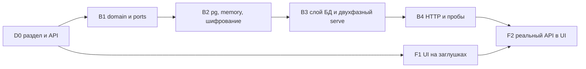

# 20. Настройки и онбординг первого запуска

Раздел вытянут вперёд из плана: настройки платформы и мастер первого запуска нужны v0.3.0 (три новых формата и интеграция Trivy добавляют настройки, которые неудобно держать только в окружении) и дальше растут вместе с доступом (v0.4.0). Он описывает три вещи, которых нет в разделах 9, 13 и 16: БД как ещё один источник конфигурации, мастер, который проводит оператора от пустой установки до работающего экземпляра, и защиту этого мастера от захвата. Статус: проект, реализация идёт потоками v0.3.0 (20.7).

Главная мысль: новой модели значений не появляется. Конфигурация уже разбирается из слоёв «окружение поверх файла» (`config::source::layered`), и все правила разбора (типы, взаимоисключения, запрет секретов в URL) написаны над этими слоями. Настройки консоли — третий слой под ними.

## 20.1 Модель настроек: inherited и effective

Настройка — это существующий ключ конфигурации: файловый ключ (`blobs`, `public_url`, `cargo_proxy_repos`), из которого переменная окружения выводится как `CRANE_` + верхний регистр (`CRANE_BLOBS`), как это уже делает `source::file::variable`. Один словарь имён на окружение, файл, БД и API.

| Источник | В UI | Где живёт | Кто меняет |
| --- | --- | --- | --- |
| **inherited** | «Из окружения» | ENV, `*_FILE`, файл `CRANE_CONFIG`; читается при старте процесса | оператор развёртывания (Compose, Helm, Secret) |
| **effective** | «Задано в консоли» | таблица `setting` в PostgreSQL | администратор через консоль или мастер |

В разговоре «effective» часто значит «итоговое значение»; здесь слово закреплено за значением в БД. Итог в API называется `value` с полем `origin` (`env`, `stored`, `default`).

**Правило приоритета: ENV > файл > БД > умолчание.** Значение в БД хранится строкой той же формы, что у окружения и файла. Загрузчик добавляет третий слой, разбор секций не меняется:

```rust
// entry/server/config/source
pub(crate) fn layered<E, R>(env: E, read_file: &R, stored: HashMap<String, String>)
    -> Result<impl Fn(&str) -> Option<String>, ConfigError>
// move |name| env(name).or_else(|| file.get(name).cloned()).or_else(|| stored.get(name).cloned())
```

Источник вычисляется вопросом «какой слой ответил». Значение из inherited-слоя из консоли изменить нельзя.

### Форма значения

У каждой настройки есть вид (`kind`, закрытый набор) — подсказка виджета UI, а не тип хранения. Значение и в API, и в БД — строка в форме окружения:

| `kind` | Кодирование строки |
| --- | --- |
| `text`, `url` | как есть |
| `number` | десятичное целое; необязательная единица `unit`: `bytes` или `seconds` |
| `bool` | `true` или `false` |
| `list` | элементы через запятую без пробелов; элементы запятых не содержат (как склеивает `file::entry`) |
| `secret` | в ответах значения нет никогда, только `secret_state: set | unset` |

### Как это видит оператор

- В списке и карточке настройки: бейдж источника (`env`, `stored`, `default`) и замок у `env`. Поле `env` не редактируется; подсказка называет переменную и говорит, что её нужно убрать из окружения, чтобы управлять значением из консоли. Запись поверх окружения — `409 setting-locked` с именем переменной.
- **Затенение.** Если в БД есть значение, а окружение его перекрывает, консоль показывает его серым «сохранено, но не действует» с датой и автором. Состояние производное (строка в БД есть, ключ inherited): оно не хранится, а на старте даёт `warn` в обычный лог процесса, не событие журнала ИБ.
- **Применение.** В v0.3.0 любое изменение вступает в силу при перезапуске: все потребители строятся один раз в `run::assemble`. `/status` показывает баннер `restart_required`, если снимок настроек, с которым процесс стартовал, отличается от текущего в БД. Снимок — хэш отсортированного списка пар (`key`, `version`): он замечает и удаление одного ключа со вставкой другого, которое пропустили бы `max(version)` и число строк. Опроса таблицы нет.

### Что происходит, когда ENV исчезает

Ничего не копируется и не удаляется: начинает отвечать следующий слой (БД, затем умолчание). Значение из окружения в БД не запоминается, потому что оно может быть секретом. Чтобы пережить уход переменной, администратор заранее записывает значение в консоли обычным `PUT /settings/{key}` (кнопка «сохранить текущее» в UI делает тот же PUT с несекретным значением).

Если после этого конфигурация не разбирается, процесс не стартует с понятной `ConfigError`, как в v0.2: без хранилища блобов или статического токена экземпляр работать не может. Обход для оператора — задать ключ в окружении.

### Валидация и обязательность

- **Запись** проверяется прогоном той же секции разбора над наложением «env > файл > БД + кандидат». Межключевые правила (`MixedStorage`, `S3KeyWithMemory`, взаимоисключение `X` и `X_FILE`) работают для консоли автоматически. Отказ — `422 setting-invalid` с расширением `errors: [{key, detail}]`.
- **Обязательный ключ** — тот, без которого секция возвращает `ConfigError::Missing`. Отдельного списка обязательных нет.
- **Правило для новых ключей v0.3.0:** либо есть умолчание, либо ключ обязателен только при включении своей фичи (обычный код секции). Иначе рабочая v0.2 после обновления не разберётся и уйдёт в мастер.
- **Неизвестные ключи** в БД (ключ удалён в новой версии) при загрузке пропускаются с `warn`.
- **Невалидное сохранённое значение** после завершения мастера валит старт с `ConfigError`, где назван ключ; обход — тот же ключ в окружении.

### Какие настройки в базу не попадают

Эти ключи нужны, чтобы получить доступ к БД или защитить её содержимое, поэтому они только inherited (в определении `console: false`):

| Ключ | Переменная | Почему только ENV |
| --- | --- | --- |
| `database_url` | `CRANE_DATABASE_URL`, `_FILE` | без неё нет БД со слоем настроек; поэтому `Database` разбирается отдельно и только по env |
| `settings_key` | `CRANE_SETTINGS_KEY_FILE` | ключ шифрования секретов в БД (20.2) |
| `http_port`, `admin_port` | `CRANE_HTTP_PORT`, `CRANE_ADMIN_PORT` | слушатели поднимаются до чтения слоя БД |
| `trusted_proxies` | `CRANE_TRUSTED_PROXIES` | от него зависит, какому `X-Forwarded-For` верить в журнале ИБ и в лимите перебора |
| `require_secure_config` | `CRANE_REQUIRE_SECURE_CONFIG` | защитная настройка, которую не должен ослаблять тот, кто получил консоль |
| `bootstrap_token` | `CRANE_BOOTSTRAP_TOKEN`, `_FILE` | первичный секрет (20.5) |

### Статический токен — секретная настройка

`CRANE_TOKEN` (решение 58, раздел 19, PR #73) — обычная секретная настройка: задаётся окружением (`CRANE_TOKEN`, `_FILE`) или хранится в БД зашифрованным. До v0.4.0 это единственная защита протоколов и Admin API, поэтому он обязателен: без него разбор возвращает `Missing`, мастер требует его на шаге «Остальное», а протоколы отвечают `503 not-configured`; анонимного доступа нет. Bootstrap-токен — только вход в мастер и только пока статического токена нет (20.5).

Секрет в БД требует ключа шифрования. Поэтому на чистой установке, где нет ни `CRANE_TOKEN` в окружении, ни `CRANE_SETTINGS_KEY_FILE`, шаг «Остальное» записать токен не может: он показывает «задайте `CRANE_TOKEN_FILE` или `CRANE_SETTINGS_KEY_FILE` и перезапустите», `token` остаётся в `missing` `GET /onboarding`, а завершение недоступно. Это осознанно: незашифрованный токен в БД хуже, чем лишний перезапуск.

### Сущности: репозитории и namespaces

Списки `CRANE_*_REPOS` и `CRANE_NAMESPACES` — обычные настройки вида `list` и идут тем же слоем; на старте `ensure_repository` и `reserve` создают недостающее, как сейчас (`ON CONFLICT DO NOTHING`). Источник сущности для UI вычисляется, а не хранится: имя есть в inherited-списке — `env`, иначе `stored`. Поэтому нет вопроса «кому принадлежит строка», когда у реплик при rolling update разные окружения.

### Режим `CRANE_DATABASE_URL=memory`

Настройки и состояние мастера живут в памяти и пропадают при перезапуске. Такая установка всегда предконфигурирована (окружение задаёт всё нужное), а молча теряемые правки хуже отказа. Поэтому в этом режиме запись настроек отклоняется: `409 settings-not-persistent`; чтение работает (все значения `env` или `default`).

## 20.2 Домен, порты и хранение

Слои как в `AGENTS.md`: `entry → adapters → app → ports → domain`; serde только в `formats`, `entry` и `crates/wire/*`.

### domain (`crates/core/domain/src/settings/`, только данные)

- `Secret`: существующий `config::source::Secret` (без `Debug` и `Display`, значение только через `expose()`) переносится в domain. Один тип секрета на проект, тест редакции один.
- `SettingDef { key, env_var, group, kind: Kind, unit: Option<Unit>, console: bool }`, `Kind { Text, Number, Bool, List, Url, Secret }`, `Unit { Bytes, Seconds }`. `group` — секция конфигурации, она же группа UI и шаг мастера.
- `Origin { Env, Stored, Default }`.
- `StoredValue { Plain(String), Secret(Secret) }`, `Version(NonZeroU64)`, `Stored { value, version, updated_at, updated_by }`.
- `Onboarding { Pending { token: TokenHash, expires_at }, Completed { at, by } }` и `TokenHash([u8; 32])` с чистой функцией `matches(&self, presented: &Secret) -> bool` (SHA-256 и сравнение в постоянное время; `sha2` и `subtle` уже в дереве).
- `ProbeReport { checks }`, `ProbeCheck { id, status, detail }`, `ProbeStatus { Pass, Warn, Fail, Skipped }`.
- Новые варианты `AuditAction` (20.3), только в конец enum.

Определения ключей — не domain: таблица `SETTINGS` лежит рядом с `VARS` каждой секции в `entry/server/config`. Новый формат потока 1 получает консоль даром: строка в `REPO_VARS` даёт env, файл и консоль.

```rust
// рядом с VARS секции storage
pub(super) const SETTINGS: [SettingDef; 2] = [
    SettingDef { key: "database_url", env_var: DATABASE_URL, group: "storage", kind: Kind::Secret, unit: None, console: false },
    SettingDef { key: "blobs", env_var: BLOBS, group: "storage", kind: Kind::Url, unit: None, console: true },
];
```

### ports (`crates/core/ports/src/settings/`)

```rust
pub trait SettingsStore: Send + Sync {
    async fn list(&self) -> Result<Vec<(String, Stored)>, StoreError>;
    /// Запись с проверкой версии (CAS): None — строки не было.
    async fn put(&self, key: &str, value: &StoredValue, expected: Option<Version>, by: &Principal) -> Result<Version, StoreError>;
    async fn delete(&self, key: &str, expected: Version, by: &Principal) -> Result<(), StoreError>;
}   // StoreError: Conflict (412), SecretsUnavailable (422), NotPersistent (409), Unavailable

pub trait OnboardingStore: Send + Sync {
    async fn get(&self) -> Result<Option<Onboarding>, StoreError>;
    /// Первый старт: вставляет `initial`, если строки нет; возвращает то, что лежит в БД.
    async fn begin(&self, initial: Onboarding) -> Result<Onboarding, StoreError>;
    /// Новый токен вместо истёкшего или потерянного (старт, роль `onboarding-token`).
    async fn rotate(&self, token: TokenHash, expires_at: SystemTime) -> Result<(), OnboardingError>;
    /// Только из Pending; Completed → OnboardingError::Completed (410).
    async fn complete(&self, by: &Principal) -> Result<(), OnboardingError>;
}

/// Инверсия: app пишет и аудирует, entry знает, что валидно.
pub trait SettingsSchema: Send + Sync {
    fn definitions(&self) -> &'static [SettingDef];
    /// Переменная окружения или файл, задавшие ключ на старте; Some — ключ заблокирован.
    fn inherited(&self, key: &str) -> Option<&'static str>;
    /// Прогон секции `def.group` над наложением env > файл > stored.
    fn check(&self, def: &SettingDef, stored: &dyn Fn(&str) -> Option<String>) -> Result<(), Invalid>;
}
```

Порты хранения получают только `by: &Principal` для колонки `updated_by`; событие журнала пишет use case через существующий `AuditSink` (20.3). Реализации: `crane-pg` и `crane-memory` с контрактными сценариями `contract/settings` и `contract/onboarding` (CAS, «Completed необратим», «begin идемпотентен»); `SettingsSchema` — одна реализация в `entry/server`.

### Хранение и миграции

Миграция `0004_settings.sql` (`crane-pg`; номера следующих зарезервированы в 20.7):

```sql
CREATE TABLE setting (
  key          text PRIMARY KEY CHECK (key ~ '^[a-z][a-z0-9_]*$' AND length(key) <= 96),
  value_text   text,                -- несекретное: строка той же формы, что у ENV и файла
  value_sealed bytea,               -- секрет: nonce || шифртекст || тег
  key_id       text,                -- каким ключом зашифровано (ротация)
  version      bigint NOT NULL CHECK (version >= 1),
  updated_at   timestamptz NOT NULL, -- время ставит адаптер из Clock, не БД
  updated_by   text NOT NULL,
  CONSTRAINT setting_value_xor CHECK ((value_text IS NULL) <> (value_sealed IS NULL)),
  CONSTRAINT setting_sealed_key CHECK ((value_sealed IS NULL) = (key_id IS NULL))
);

CREATE TABLE onboarding (
  singleton        boolean PRIMARY KEY DEFAULT true CHECK (singleton),
  token_hash       bytea CHECK (octet_length(token_hash) = 32),
  token_expires_at timestamptz,
  completed_at     timestamptz,
  completed_by     text,
  CONSTRAINT onboarding_state CHECK (
       (completed_at IS NULL AND token_hash IS NOT NULL AND token_expires_at IS NOT NULL AND completed_by IS NULL)
    OR (completed_at IS NOT NULL AND token_hash IS NULL AND token_expires_at IS NULL AND completed_by IS NOT NULL))
);
```

Состояний два, и «завершён, но с токеном» непредставимо. Завершение — один `UPDATE … SET completed_at, completed_by, token_hash = NULL, token_expires_at = NULL WHERE completed_at IS NULL`. Прогресс шагов не хранится (20.4). Все изменения — expand; откат миграции не предусмотрен (16.4).

### Шифрование секретов

- Шифрование — деталь pg-адаптера: `PgSettings::new(pool, key: Option<SettingsKey>)`. Порт работает с открытым `Secret`, memory-адаптер не шифрует, контрактные тесты про шифр не знают.
- AES-256-GCM через `aws_lc_rs::aead::RandomizedNonceKey` (сам генерирует 96-битный nonce). `aws-lc-rs` уже криптопровайдер проекта (sqlx и object_store собраны с `tls-rustls-aws-lc-rs`), новой зависимости нет.
- Файл ключа — base64 от 32 байт (`openssl rand -base64 32`), права 0400, читается тем же `source::secret` с обрезкой перевода строки (сырые байты эту обрезку ломают).
- AAD = имя настройки, версия строки и `key_id`: шифртекст нельзя переставить в строку другой настройки, а оставшийся от старой версии не откроется. **Не покрыто:** откат строки целиком (старые шифртекст и версия вместе) тем, у кого есть запись в БД; это угроза уровня доступа к БД.
- Без ключа `put` секрета — `StoreError::SecretsUnavailable` (`422 secrets-unavailable`): мастер показывает секретные поля неактивными и объясняет, что задать (`*_FILE`-переменную секрета или `CRANE_SETTINGS_KEY_FILE`).
- Секреты из окружения в БД не копируются и не шифруются.
- Ротация ключа (`rekey`) — после v0.3.0; до неё один активный ключ.

### Двухфазный `serve`

«Не настроен» — не режим работающего экземпляра, а первая фаза `serve` в том же процессе:

Фазу задаёт состояние `onboarding`, а результат разбора только разрешает завершение:

| Строка `onboarding` | Разбор | Что делает старт |
| --- | --- | --- |
| нет | Ok | `begin(Completed { by: crane:system })`, событие `OnboardingSkippedPreconfigured`, рабочий режим |
| нет | Err | `begin(Pending)` с новым токеном, мастер |
| `Pending` | любой | мастер; `completion` разрешён только при Ok, иначе `422` со списком `missing` |
| `Completed` | Ok | рабочий режим |
| `Completed` | Err | fail fast с `ConfigError`, как в v0.2 |

```rust
async fn serve_async(boot: Boot) -> Result<(), RunError> {
    let store = connect(&boot.database).await?;        // Database разбирается только из env
    loop {
        let layers = Layers::load(&boot.env, &store).await?;
        let parsed = Settings::from_layers(&layers);
        let state = match store.onboarding().await? {
            Some(state) => state,
            None => store.begin(first_state(&parsed, &boot)).await?, // Completed при Ok, иначе Pending
        };
        match (state, parsed) {
            (Onboarding::Pending { .. }, _) => serve_wizard(&boot, &store).await?, // возвращается на complete
            (Onboarding::Completed { .. }, Ok(settings)) => return serve_ready(settings, &store).await,
            (Onboarding::Completed { .. }, Err(error)) => return Err(error.into()),
        }
    }
}
```

- Пока `onboarding` в `Pending`, процесс обслуживает SPA и API мастера на **публичном** слушателе при любом результате разбора, а протоколы пакетов отвечают `503 not-configured` с `Retry-After`. Так break-glass `onboarding-reset` на работающем экземпляре действительно открывает мастер, а перезапуск посреди мастера после добавления переменных окружения не превращает незавершённую установку в рабочую с живым токеном. Admin-порт остаётся только для проб `healthz` (16.1).
- На `complete` фаза гасится существующим graceful shutdown, слои перечитываются, процесс входит в обычный `routers()` без перезапуска.
- Другие реплики в первой фазе раз в несколько секунд читают одну строку `onboarding`; опрос только здесь.
- Проба хранилища строит кандидатный `ObjectBlobStore::from_url` и ничего не перезапускает.
- Первой фазы нет, только когда строки `onboarding` ещё нет, а разбор проходит (предконфигурированная установка).

## 20.3 Аудит

Каждое изменение настроек и значимый шаг мастера — событие журнала ИБ. Контекст — существующий `domain::access::Caller` (`Principal` + `RequestContext`: `request_id`, `trace_id`, `client_ip`, `user_agent`); отдельный тип не вводится. Событие пишет use case через `AuditSink`, как `Registry::reserve`; транзакционность с журналом — забота unit of work v0.4.0 (`ports/audit`). Фоновые действия (первый старт, перевыпуск токена) пишет системный принципал `crane:system` (вид Robot) в `domain::access`, согласованный с потоком SecOps. Записи мастера под bootstrap-токеном пишет именованный принципал `crane:bootstrap` (вид Robot) рядом с ним: он попадает в `updated_by` и в актора события; под статическим токеном актор — принципал статического токена (`CRANE_TOKEN_PRINCIPAL`). Сопоставление с OCSF — в `adapters/external/siem`.

| `AuditAction` | OCSF | Исход | Поля |
| --- | --- | --- | --- |
| `SettingChanged { key, version, secret }` | 6003 Update | Success | для несекретных старое и новое значение в `unmapped` (до 256 символов); для секретов значений нет |
| `SettingRejectedLocked { key, env_var }` | 6003 Update | Failure | имя переменной, из-за которой запись запрещена |
| `OnboardingStarted` | 6003 Create | Success | актор `crane:system` |
| `OnboardingCompleted { via }` | 6003 Update | Success | `via`: `bootstrap_token` или `static_token` |
| `OnboardingSkippedPreconfigured` | 6003 Update | Success | актор `crane:system` |
| `OnboardingTokenRejected` | 3002 Logon | Failure | адрес клиента; предъявленное значение не пишется |
| `OnboardingTokenRotated` | 6003 Update | Success | актор: оператор роли `onboarding-token` или `crane:system` |

Варианты добавляются в конец `AuditAction` (поток 2 тоже добавляет свои). Затенение (20.1) — не событие журнала, а `warn` на старте и признак в API. Токены и значения секретов не пишутся ни в одно поле; единственное исключение вывода токена — 20.5.

## 20.4 Мастер первого запуска

Мастер — последовательность шагов. Шаг = секция конфигурации, она же группа экрана настроек, поэтому таксономия одна. Каждый шаг — **валидация** (прогон секции над наложением с кандидатом, без сети) и **проверка связи** (проба по сети с отчётом). Вперёд можно при отсутствии `fail`; `warn` пропускает с подтверждением.

**Прогресс не хранится, а вычисляется.** Статус шага: `done` — разбор его секции над текущими слоями проходит; `done_by_env` — к тому же все его ключи inherited; `unavailable` — возможность ещё не включена (v0.4.0); иначе `todo`. Прогресс не может разойтись с данными (шаг «выполнен», а значение потом удалили), и мастер возобновляется после закрытия вкладки, перезапуска и смены реплики без отдельного состояния.

| № | Шаг | Секция | Что вносится | Проверка связи | Показ |
| --- | --- | --- | --- | --- | --- |
| 1 | Среда | network | публичный URL, URL origin пакетов (`CRANE_PACKAGES_URL`, 14.3) | БД и версия миграций, разные хосты, TLS | всегда |
| 2 | Хранилище | storage | backend (`file` или `s3`), параметры, шифрование S3 | запись, чтение, удаление `.crane-probe/<uuid>`; для S3 — SSE-заголовок | всегда |
| 3 | Upstream | proxy, repos | proxy-репозитории (crates.io, npm, PyPI, Maven Central, NuGet.org или свой адрес) | запрос корня через клиент с SSRF-guard; статус, TLS | всегда |
| 4 | Namespaces | namespaces | шаблоны (`@acme/*`), reserved (10.3) | пересечение с proxy-репозиториями шага 3 | всегда |
| 5 | Оргструктура | workspaces | первая команда и её slug | — | `unavailable` до v0.4.0 (14.15) |
| 6 | Идентичность | identity | OIDC: issuer, audience, клиенты, claims, группа администраторов | discovery и JWKS (`skipped` до v0.4.0) | `unavailable` до v0.4.0 |
| 7 | Остальное | token и прочие | статический токен `CRANE_TOKEN` (секрет, обязателен) и другие ключи, разбор которых ещё возвращает `Missing` (Trivy и так далее) | зависит от ключа | при наличии таких ключей |
| 8 | Итог | — | сводка inherited / effective; «Завершить» | — | всегда |

Правила шагов:

- **Inherited-поля показываются, но заблокированы.** Шаг, целиком заданный окружением, — `done_by_env`; проба всё равно запускается и показывает отчёт.
- **Шаги v0.4.0 заглушены на бэкенде:** сохранение отвечает статусом `unavailable`, проба OIDC — `skipped` (`FIXME(v0.4.0): …` в коде); в UI для них заглушек нет. Администратора первым входом мастер не назначает: роль `platform-admin` в v0.4.0 приходит из `group_mapping`, до этого управление идёт статическим токеном.
- **Пробы — функции адаптеров, а не трейт.** `ObjectBlobStore::probe` после `from_url(candidate)`, upstream — существующий клиент с SSRF-guard (14.3). Для непубличных адресов внутренних Artifactory или Nexus оператор заранее задаёт allowlist; шаг 3 показывает, какие адреса запрещены и почему. Проба ничего не сохраняет.
- **Ошибки шага** — `422 setting-invalid` с `errors: [{key, detail}]` по ключам шага.
- **Идемпотентность.** POST требуют `Idempotency-Key`; повторное сохранение шага тем же телом даёт тот же ответ.
- **Завершение** возможно, когда разбор всей конфигурации проходит; иначе `422` со списком `missing`. Оно атомарно: `Completed`, токен стёрт, событие `OnboardingCompleted`, фаза мастера гасится (20.2). Дальше те же настройки правятся на экране «Настройки платформы» (E16).

## 20.5 Защита первого запуска

Мастер открыт без вошедшего пользователя, и тот, кто первым им воспользуется, задаёт хранилище и upstream. Поэтому вход в него защищён отдельным секретом.

### Bootstrap-токен

- Формат `crb_<43 символа base64url>` (256 бит энтропии), префикс по аналогии с `crp_`, `crr_`, `crci_` (13). В БД только SHA-256 в строке `onboarding`; проверка — `TokenHash::matches` в постоянное время.
- **Откуда берётся.** (1) Оператор задал `CRANE_BOOTSTRAP_TOKEN` или `CRANE_BOOTSTRAP_TOKEN_FILE` — рекомендуемый путь для Compose и Helm, секрет генерирует развёртывание. (2) Иначе на первом старте процесс выпускает его сам: `begin` (`INSERT … ON CONFLICT DO NOTHING`) определяет единственную реплику-победителя. (3) Если на первом старте задан `CRANE_TOKEN`, bootstrap-токен не выпускается и не печатается: вход в мастер только по статическому токену (в строке `onboarding` хранится хэш, который не соответствует ни одному выданному токену).
- **Печать в лог.** Выпустивший процесс один раз пишет в отдельную цель `crane::bootstrap`: `bootstrap token: crb_… (valid until <время>)`. Это единственное осознанное исключение из правила «секреты не пишутся никогда» (14.9). Оправдание: токен открывает только мастер (никаких прав на пакеты, API или токены), живёт 24 часа, сгорает при завершении; цель `crane::bootstrap` не входит в потоки аудита и SIEM.
- **Истёкший токен** перевыпускается на старте, пока состояние `Pending` и статический токен не задан, и снова печатается. Пока токен не истёк, перезапуск его не печатает.
- **Потерянный токен:** роль бинарника `crane onboarding-token` (рядом с `migrate`) печатает новый и аннулирует старый (`OnboardingTokenRotated`).

### Вход без сессии

Каждый запрос мастера несёт `Authorization: Bearer <crb_… | статический CRANE_TOKEN>`; bootstrap-токен принимается, только пока статический не задан, после записи статического токена мастер продолжается под ним. Сервер сначала проверяет префикс `crb_` по строке `onboarding`, иначе — существующий `StaticToken` из `crane_http::auth`. Сессии, cookie и CSRF нет: запрос с Bearer-заголовком межсайтово не подделывается. SPA проверяет введённый токен вызовом `GET /onboarding` с заголовком (20.6).

**Переход между токенами.** Как только статический токен задан (записан на шаге «Остальное» или пришёл из окружения), bootstrap-токен больше не принимается. Ответ сохранения шага, записавшего `token`, несёт `next_credential: static_token`, и SPA дальше шлёт статический токен, который оператор только что ввёл. Фаза мастера проверяет статический токен по текущему слою БД при каждом запросе, а не по снимку на старте фазы, поэтому переход не требует перезапуска.

**Компромисс, записанный явно:** SPA держит токен в памяти вкладки (не в `localStorage`), поэтому он виден JS этой вкладки. Это принято: токен живёт не дольше 24 часов, даёт права только на мастер, при закрытии вкладки нужен повторный ввод, а CSP SPA обязательна (раздел 15). Альтернатива (cookie-сессия) при нескольких репликах требует общего хранилища сессий, которого в дизайне нет, и всё равно будет заменена OIDC BFF в v0.4.0.

Если схема `CRANE_PUBLIC_URL` — `http`, а хост не loopback, мастер токены не принимает (кроме явно выключенной `CRANE_REQUIRE_SECURE_CONFIG`, тогда с предупреждением). Решение принимается по конфигурации, а не по заголовкам запроса.

### Лимит перебора

GCRA по адресу клиента на слое HTTP (адрес с учётом `CRANE_TRUSTED_PROXIES`): 5 неудач за 15 минут блокируют адрес на 15 минут, ответ `429` с `Retry-After`. Каждая неудача — `OnboardingTokenRejected` (3002 Failure), её подхватывает правило SIEM «перебор токенов» (14.9). Глобальной блокировки токена нет: при 256 битах энтропии она не защищает от подбора, а только даёт неаутентифицированному атакующему рычаг для отказа в обслуживании.

### Закрытие навсегда

После `Completed` эндпоинты мастера отвечают `410 onboarding-completed`, `GET /onboarding` — только `{state: completed}`. Повторно по HTTP мастер не открывается. Break-glass — только с хоста: роль `crane onboarding-reset --confirm` (нужен доступ к БД, событие в журнале) возвращает `Pending` с новым токеном; сделанные настройки остаются.

### Совместимость с v0.1.0–v0.2.0

- **«Предконфигурирован»** = при первом старте строки `onboarding` нет, а разбор конфигурации над слоями проходит. Это ровно условие, при котором стартовала v0.2, поэтому обновление существующей установки ничего не требует: `begin(Completed { by: crane:system })` и событие `OnboardingSkippedPreconfigured`.
- **Статический токен** (`CRANE_TOKEN`) работает на протоколах и в Admin API как раньше. Мастер принимает его вместо bootstrap-токена; завершение мастера его не сжигает. На чистой установке его нет: мастер требует задать его (20.1), и до этого протоколы отвечают `503`.
- В v0.4.0 статический токен удаляется (ROADMAP); тогда доступ к настройкам определяют роли (14.12), а bootstrap-токен остаётся единственным входом в первый запуск.

## 20.6 API и экраны

Контракт — в [admin.openapi.yaml](../api/admin.openapi.yaml), теги `onboarding` и `settings`, операции с `x-crane-since: v0.3.0`.

| Операция | Назначение | Доступ | Аудит |
| --- | --- | --- | --- |
| `GET /onboarding` | состояние; проверка введённого токена | публично / Bearer мастера | `OnboardingTokenRejected` при неверном токене |
| `PUT /onboarding/steps/{step}` | валидировать и сохранить ключи шага | Bearer мастера | `SettingChanged` по каждому ключу |
| `POST /onboarding/steps/{step}/probe` | проверка связи без сохранения | Bearer мастера | нет |
| `POST /onboarding/completion` | завершить мастер | Bearer мастера | `OnboardingCompleted` |
| `GET /settings`, `GET /settings/{key}` | итоговые значения с источниками | `settings:read` | нет |
| `PUT /settings/{key}` | записать значение (`If-Match` с версией) | `settings:write` | `SettingChanged` |
| `DELETE /settings/{key}` | убрать значение из БД | `settings:write` | `SettingChanged` |

«Bearer мастера» — схема `bearer` с bootstrap- или статическим токеном (20.5). `GET /onboarding` отвечает так:

- без заголовка — `{state}`;
- с верным токеном — `state`, `current_step`, `steps[{id, status}]` и `missing` (ключи, разбор которых возвращает `Missing`);
- с неверным токеном — `401 bootstrap-token-invalid`, при превышении лимита — `429` с `Retry-After` на этом же вызове;
- при `state = completed` — `{state: completed}`; остальные операции мастера отвечают `410`.

Ошибки: `409 setting-locked`, `409 settings-not-persistent` (режим memory), `412` (устарел `If-Match`), `422 setting-invalid` с `errors: [{key, detail}]` (на `PUT /settings/{key}` — один элемент, на шаге мастера — по ключам шага), `422 secrets-unavailable`, `401 bootstrap-token-invalid`, `429` (лимит перебора), `410 onboarding-completed`, `503 not-configured` (протоколы в первой фазе).

Типы для web генерирует `orval` из той же спеки (`pnpm --filter web run gen:api`), поэтому UI-поток пишет заглушки против этих типов, а не против выдуманных.

Экраны (описание — [docs/ui/screens.md](../ui/screens.md), строки A0 и E16): **A0 «Первый запуск»** — полноэкранный мастер (ввод токена, шаги 1–8, отчёты проб, «Выполнено окружением»); **E16 «Настройки платформы»** — список по группам с бейджами источника, замком, затенением и баннером `restart_required`.

## 20.7 План реализации и порядок потоков

| Этап | Что | Слой, крейты | Размер | Блокирует |
| --- | --- | --- | --- | --- |
| D0 | Этот раздел и контракт API | `docs/` | S | старт потоков 2 и 3 |
| B1 | domain: перенос `Secret`, `SettingDef`, `Kind`, `Unit`, `Origin`, `StoredValue`, `Version`, `Stored`, `Onboarding`, `TokenHash`, `ProbeReport`, варианты `AuditAction`; ports: `SettingsStore`, `OnboardingStore`, `SettingsSchema`, контрактные сценарии | `domain`, `ports` | S | B2, B3 |
| B2 | Миграция `0004` (`setting`, `onboarding`), `crane-pg` с шифрованием, `crane-memory` | `adapters/persistence/*` | M | B3 |
| B3 | Третий слой `layered`, отдельный разбор `Database`, `SettingsSchema`, двухфазный `serve`, use cases с аудитом | `app`, `entry/server` | M | B4 |
| B4 | HTTP мастера и настроек, лимит по IP, пробы хранилища и upstream | `entry/http`, адаптеры | M | замена заглушек UI |
| F1 | Мастер A0 и экран E16 на заглушках по типам OpenAPI, истории Storybook на все состояния | `web` | M | не блокирует бэкенд |
| F2 | Замена заглушек реальным API | `web` | S | после B4 |

Этапа переноса потребителей нет: они уже читают ключи через `var`.

Резервирование номеров миграций, чтобы потоки не столкнулись: `0004` — настройки и онбординг (B2); `0005–0009` — поток 1 (PyPI, Maven, NuGet); `0010–0014` — поток 2 (Trivy, SecOps); дальше по очереди. При конфликте на ребейзе перенумеровывается более поздний PR.



*Рис. 20.1. Порядок этапов. Потоки 1 и 2 от них не зависят.*

**Правила потоков.**

- Потоки 2 и 3 начинают работу после влития D0. Потоки 1 и 2 объявляют ключи как сегодня: `VARS` и строка `SETTINGS` в своей секции, от B1 они не зависят.
- **Заглушки** помечаются `FIXME(vX.Y.Z): <operationId> <пояснение>` в `web/src/shared/api`, в Rust — `FIXME(vX.Y.Z): <текст>`; версия не меньше `x-crane-since` операции и не выпущена. Команда `task fixme:report` (добавляется вместе с F1) перечисляет их по версиям. Критерий F2: ни одного `FIXME(v0.3.0)` на операциях тегов `onboarding` и `settings`.
- **Зоны конфликтов:** `entry/server/src/config/**` (поток 1 добавляет `REPO_VARS`, B3 — слой), `docs/api/common.yaml` (новые блоки — в конец раздела, без переупорядочивания), `AuditAction` (только в конец), `.cargo/mutants.toml` и `Cargo.lock` (ребейз перед PR), таблица миграций выше.
- **Изоляция тестовых ресурсов:** у каждого потока свой Compose-проект и порты PG и Valkey (`.env` на worktree), мутации по `--test-package`, не больше одного мутационного прогона на поток.
- **Тесты.** Наложение слоёв и вычисление источника — таблицы AAA; контракт `SettingsStore` и `OnboardingStore` — в `ports/contract`; сценарий «первый запуск» — на стенде `tools/dogfood` (пустая БД → токен из лога → шаги → завершение → мастер закрыт). Playwright подключается в v0.4.0, поэтому UI покрывают Storybook (`play`), a11y и vitest.

Пересчёт объёма вех делает отдельный PR в `ROADMAP.md` с `tools/estimate-agent-hours.py`; этот раздел — его вход.

## 20.8 Риски и открытые вопросы

| Риск | Мера |
| --- | --- |
| Проба заставляет сервер ходить по адресу, который ввёл недоверенный пользователь (SSRF) | единый клиент с SSRF-guard, allowlist для непубличных адресов, таймаут 5 с, в ответе только статусы проверок |
| Bootstrap-токен в логе утекает через сбор логов | 24 часа, права только на мастер, цель вне аудита и SIEM, предпочтительный путь через `CRANE_BOOTSTRAP_TOKEN_FILE` |
| Токен мастера виден JS вкладки | память вкладки, не `localStorage`; CSP SPA; срок и права токена (20.5) |
| Потеря `CRANE_SETTINGS_KEY_FILE` делает секреты в БД нечитаемыми | ключ в Secret с резервной копией; секреты можно перезаписать |
| Откат строки `setting` целиком (шифртекст и версия вместе) тем, у кого есть запись в БД | не покрыто: угроза уровня доступа к БД (20.2); отдельный откат шифртекста ловит версия в AAD |
| ENV затеняет значение из консоли, и администратор не понимает почему | бейдж и замок, серое «не действует», `warn` на старте |
| Новый обязательный ключ отправляет обновлённую v0.2 в мастер | правило новых ключей v0.3.0 (20.1) |
| Невалидное сохранённое значение не даёт стартовать | ошибка называет ключ; обход — ключ в окружении |
| Гонка двух администраторов | CAS по `version`, `If-Match` (412) |
| Заглушки UI расходятся с реальным API | типы из одной спеки (`orval`), реестр `FIXME`, критерий F2 |
| Потоки на общих файлах и миграциях | таблица резервирования и правила 20.7, ребейз перед PR |

**Решения владельца** (раздел 19, решения 57–59, PR #73).

1. **Статический токен — секретная настройка.** `CRANE_TOKEN` задаётся через env или хранится в БД зашифрованным; мастер требует его как недостающий. Bootstrap-токен — вход в мастер, только пока статического нет. Без токена реестр не открывается: протоколы отвечают `503`, анонимного доступа нет.
2. **Применение перезапуском.** В v0.3.0 изменения настроек вступают в силу после перезапуска, с баннером `restart_required`; мастер — первая фаза `serve` в том же процессе. Живое применение переносится на будущую веху.
3. **Публичный слушатель на первой фазе.** Пока установка не завершена, мастер работает на публичном слушателе, admin-порт только для проб (16.1). Лимит неудач — по адресу клиента, глобальной блокировки нет; после завершения — `410`.

**Вне этого раздела:** ротация ключа шифрования (`rekey`); живое применение настроек — будущая веха (когда понадобится — снимок всей таблицы и `tokio::sync::watch` вокруг того же загрузчика слоёв); экспорт настроек в GitOps-манифест. **Обязательства по документации:** после слияния плана обновить оценку (`tools/estimate-agent-hours.py`, разделы 1 и 18), как требует `AGENTS.md`.
