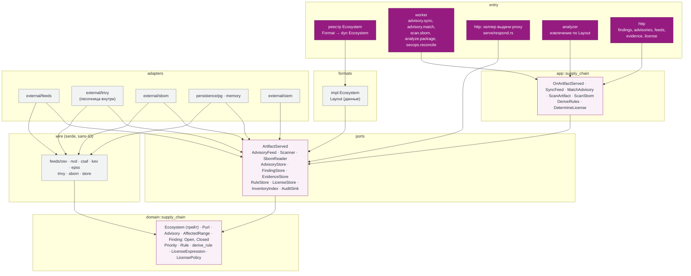

# 21. SecOps-слой: как цепочка поставки встроена в абстракции CRANE

Статус: проект для согласования. Раздел 14 говорит, **что** делает безопасность цепочки поставки (фиды, findings, VEX, экстренный режим); раздел 8 — как устроены слои. Здесь связано одно с другим: из каких крейтов и портов собирается SecOps-слой и почему он не знает ни форматов пакетов, ни upstream, ни клиентов.

**Радиус v0.3.0** (решение по ROADMAP #69, поток 2):

-   **A.** Модель `advisory` и `finding`, фиды (OSV, GHSA, NVD, KEV, EPSS, CSAF, собственные), сопоставление по PURL, приоритеты P0–P4.
-   **B.** Evidence, SBOM (CycloneDX), Trivy за портом сканера, песочница анализа артефактов.
-   **Выдача.** Индекс deny-правил в `served()`; правила выводятся из advisory `MAL-*` и из результата скана по политике; окно карантина новых upstream-версий (ROADMAP v0.3.0, п. 7) — реализация, не точка расширения.
-   **D.** Лицензии: заявленная лицензия, разбор SPDX-выражения, политика организации (21.8).

Только точки расширения (v1.1.0): VEX и исключения с TTL (наложения поверх finding), SLA, ручной экстренный режим (`lift`, break-glass), promotion и gates, вирусность лицензий. Вне радиуса: проверка upstream attestations (10.6.1), приём in-toto/SLSA из CI, ИИ-оценка `risk_score`; для них слой оставляет место: новые виды evidence и новые входы приоритета без изменения схемы и портов.

## 21.1 Принципы агностичности

1.  **Словарь слоя совпадает со словарём каталога.** SecOps оперирует `Format`, `PackageName`, `Version`, `Purl` и `Sha256`. Строк вроде `"npm"` или имён файлов клиента в `domain`, `ports` и `app` слоя нет.
2.  **Специфика экосистемы живёт за трейтом `Ecosystem`.** Трейт объявлен в `domain` (`registry/ecosystem.rs`), реализации — в `formats/<fmt>`, реестр `Format → Arc<dyn Ecosystem>` собирает `entry` и передаёт в `app` и `crane-pg`. Методы и порядок поставки (21.15): `format`, `parse_name`, `parse_version` — F1 be1 (ADR потока форматов, раздел 8 правится его PR); `purl`, `resolve` и `layout` — первый PR слайса A (be2) вместе с потребителем и реализациями для Cargo и npm; для PyPI, Maven и NuGet эти методы реализует поток форматов у себя. `domain` хранит результат разбора: `Version { canonical, order: OrderKey(Vec<u8>), written, prerelease }`, равенство и хеш по `canonical`, `Ord` по `(order, canonical)`.
3.  **Один словарь экосистем — реестр `Ecosystem`.** Адаптеры фидов и Trivy отдают `Purl` и сырые строки версий и диапазонов; разбор версий выполняет `app` в одном месте через реестр.
4.  **Выдача решается одним правилом.** `served()` (10.2) остаётся единственным правилом видимости для hosted и proxy; SecOps влияет на него только через deny-правила (21.7).
5.  **Новый формат, фид или сканер — реализация порта и строка конфигурации.** Ядро SecOps не меняется; это проверяется тестом (21.12).
6.  **Нет данных не значит безопасно.** Компонент без сопоставления (тип PURL вне реестра, непарсящаяся версия, фид недоступен) помечается «не покрыт», а не «чист» (10.7).

С клиентами пакетных менеджеров слой связан двумя существующими швами: на входе `served()` получает правила, на выходе отказ приходит как `Diagnosed` (причина, advisory, ближайшая исправленная версия), который формат превращает в ответ клиенту через `render_error` (08). SecOps не строит HTTP-ответы и не фильтрует документы.

## 21.2 Идентификатор ресурса: PURL

-   **`domain::supply_chain::Purl` — тип по спецификации package-url:** `type`, `namespace`, `name`, `version`, `qualifiers`; разбор и печать по спецификации (кодирование `@`, `+` и прочего). О `Format` он не знает.
-   **Экосистемная часть — в `Ecosystem`:** `purl(&PackageName, Option<&Version>) -> Purl` строит идентификатор (Maven `namespace/name` из `group:artifact`, нормализация PyPI по PEP 503, регистр NuGet); `resolve(&Purl) -> Option<(PackageName, Option<Version>)>` разбирает обратно. Сигнатуры согласуются с be1.
-   **Чужая экосистема** — это отсутствие `type` в реестре `Ecosystem` (`pkg:golang`, `pkg:deb` из SBOM приложения), а не отдельный вариант типа. Такой компонент остаётся в графе «не покрытым» и в сопоставление не идёт; `advisory.ecosystem` остаётся `pkg_format`.
-   **Идентичность версии каталога не меняется:** `(repository, name_norm, version canonical)`. Колонка `package_version.purl` производная, пишется из `Ecosystem::purl`; это таблица каталога, колонка согласуется с be1, миграция — по правилам expand/migrate/contract. Квалификаторы (`type`, `classifier`, `repository_url`) в ключ finding не входят.
-   **SIEM.** Приватная функция `purl()` в `adapters/external/siem/src/ocsf.rs` для Maven и PyPI дала бы неверный идентификатор; она заменяется готовым `Purl`, который событие получает из use case.

## 21.3 Где живёт специфика экосистемы

| Что зависит от экосистемы | Где живёт | Как SecOps его использует |
| --- | --- | --- |
| Грамматика имени | `Ecosystem::parse_name` | Имя advisory нормализуется при приёме; отвергнутое имя считается в `advisory_name_rejected_total` |
| Порядок версий | `Ecosystem::parse_version` → `Version.order` | Диапазоны сравниваются **только** `Version::precedence()` (по `order`), не `Ord`: у Maven `1` и `1.0` равны по порядку, но различны канонически |
| PURL туда и обратно | `Ecosystem::purl`, `Ecosystem::resolve` | 21.2 |
| Диапазон advisory | `domain::supply_chain::AffectedRange` над `Version` | Обе границы диапазона (`introduced`, `fixed`, `last_affected`) разбирает `Ecosystem` формата advisory; не разобралось — «не сопоставлено» и `advisory_range_unmatched_total`. Отдельная «схема версий» в `Version` не нужна; `GIT` без коммитов в инвентаре не сопоставляется |
| Словари фидов (`PyPI`, `crates.io`, …) и вывод Trivy | слой `wire` (21.5) | Переводятся в `Purl` и сырые строки; второго словаря нет |
| Время публикации в upstream | `formats` (`upstream_published_at`, 10.2) | Вход окна карантина в `served()` |
| Раскладка архива | `Ecosystem::layout(&self, file_name: &str) -> Option<Layout>`: `formats` отдаёт **данные** `Layout`: вид контейнера (tar.gz, zip), срезаемый префикс (npm `package/`), что раскрывать вложенным (jar в jar) | Безопасное извлечение (zip-slip, symlink, лимиты размера, числа файлов, глубины) пишется один раз в `entry/analyzer` (21.5); IO-порта распаковки нет. `None` (незнакомое имя файла) — артефакт «не покрыт», метрика `scan_layout_unknown_total`, скана наугад нет |
| Заявленная лицензия | Поле данных публикации, которые `formats` уже разбирают (21.8) | Сырое выражение; разбор SPDX общий |
| Тело ошибки для клиента | `formats` (`render_error(&Diagnosed)`) | SecOps отдаёт `Diagnosed` |

**Зависимость от потока форматов.** Реализации `Ecosystem` и `Layout` для PyPI, Maven и NuGet приносит поток форматов v0.3.0: они нужны каталогу для самих форматов. SecOps их не дублирует; сопоставление для этих форматов закрывается не раньше соответствующей реализации (матрица 21.12).

**Страж архитектуры.** В модулях `supply_chain` (`domain`, `ports`, `app`) `Format::` запрещён без белого списка; формат выбирает реестр `Ecosystem`, который собирает `entry`. Правило добавляется в `tools/lint-structure`.

## 21.4 Evidence и finding привязаны к содержимому

-   **Субъект evidence — digest.** `evidence.subject_sha256` и есть ключ; колонки `version_id` нет (схема в 09 поправлена этим разделом, таблица ещё не создана). Версии, к которым относится evidence, находятся соединением `asset → blob`. Один blob в hosted и в proxy, в двух репозиториях или двух версиях даёт одно evidence.
-   **Скан — функция содержимого:** идемпотентен по `(sha256, scanner_id, db_version)`; документ отчёта лежит в CAS один раз. Между форматами пересечений нет по построению: разные байты — разный digest.
-   **Finding — пара `(advisory, purl компонента)`.** Где компонент встречен, говорит отношение `component_occurrence(purl, sha256, repository NULL, source)`, где `source` — `proxy_artifact` (артефакт proxy до v0.5.0, 21.6), `sbom_component` или `scan_component` (компонент внутри артефакта или SBOM). Для hosted-версий отдельной строки не нужно: связь purl ↔ blob уже даёт `asset`. Одна уязвимая библиотека в десяти пакетах — один finding и десять мест; группировка 14.7 следует из ключа.
-   **Evidence не переписывается.** Новая база Trivy даёт новую строку с новым `facts.db_version`; читатели берут последнюю. База старше `security_scanner_db_max_age` — причина пересканирования (10.7).
-   **Скан SBOM и скан артефакта сходятся в одну модель:** отчёт `https://in-toto.io/attestation/vulns/v0.2` (`trust = crane`, `kind = none`, `verify_result = unsigned`) и findings с источником `scanner` или `feed`; приоритет считается одной функцией.
-   **SBOM пакета и SBOM приложения различаются.** SBOM, приложенный к hosted-версии, — evidence её blob; SBOM сборки описывает потребителя (`consumer`, 09). Деплой-evidence — P3.
-   **Таблица `evidence`** вытягивается из v0.6.0 в v0.3.0 в форме из 09.

## 21.5 Крейты, порты и направление зависимостей

Bounded context «цепочка поставки» — модуль `supply_chain` в `domain`, `ports` и `app` (08). Добавляется слой **`wire`** (решение 49 в разделе 19; правило в `AGENTS.md` и `lint-structure` — отдельный PR лида SecOps): крейты `crates/wire/feeds/{osv,nvd,csaf,kev,epss}` и `crates/wire/{trivy,sbom,store}` — sans-IO описания внешних документов, serde в них разрешён, зависят только от `domain`. `adapters/external/*` и `crane-pg` зависят от `wire`; jsonb-документы (`advisory.ranges`, `advisory.sources`, `evidence.facts`) описываются в `wire/store`.



*Рис. 21.1. Слои SecOps. Стрелки — зависимости. `app` знает только порты; форматы подключаются реестром `Ecosystem`, который собирает `entry`; адаптеры друг друга не знают; `wire` знает только `domain`.*

| Слой | Что добавляется в v0.3.0 |
| --- | --- |
| `domain` | Трейт `Ecosystem` в `registry/ecosystem.rs` (общий с каталогом); в `supply_chain` — `Purl`, `Advisory`, `AffectedRange`, `Finding` (21.6), `Priority` и чистые правила приоритета (14.6), `Rule` (формат, имя, диапазон или точная версия, `origin`), `derive_rule`, `LicenseExpression`, `LicensePolicy`. Без IO и serde |
| `ports` | `ArtifactServed` (синхронный наблюдатель выдачи proxy, 21.6), `AdvisoryFeed`, `Scanner`, `SbomReader`, `AdvisoryStore`, `FindingStore`, `EvidenceStore`, `RuleStore`, `LicenseStore`, `InventoryIndex` (версии по `(format, name_norm)`), `AuditSink`. Методы крупные и атомарные, как у `Catalog`: `FindingStore::reconcile(advisory, совпадения)` в одной транзакции |
| `app::supply_chain` | Реализация `ArtifactServed` (дедупликация, upsert occurrence, постановка скана), `SyncFeed`, `MatchAdvisory`, `ScanArtifact`, `ScanSbom`, `DeriveRules`, `DetermineLicense`; разбор версий и диапазонов через реестр `Ecosystem` — только здесь. Тесты на in-memory адаптерах |
| `wire/*` | `crates/wire/feeds/{osv,nvd,csaf,kev,epss}` (KEV — JSON, EPSS — CSV: по решению 49 их разбор тоже не может жить в `adapters/external/feeds`; группа `feeds` уточняет состав из решения 49) и `crates/wire/{trivy,sbom,store}` (jsonb-колонки) с serde |
| `adapters/external/feeds`, `trivy`, `sbom` | `AdvisoryFeed` (по подкаталогу на фид), `Scanner`, `SbomReader`; отдают `Purl` и сырые строки |
| `adapters/persistence/pg`, `memory` | Хранилища за портами; контракт-тесты в `ports/src/contract/supply_chain/` |
| `entry/worker`, `entry/http`, `entry/analyzer` | Обработчики задач, маршруты из 21.11, вызов `ArtifactServed`, сборка реестра `Ecosystem`; `analyzer` — единственное место безопасного извлечения |

**Сканер и извлечение.** Безопасное извлечение пишется один раз и не зависит от сканера: оно живёт в `entry/analyzer`, роли-песочнице из 08 (distroless, non-root, read-only rootfs, без сети кроме сервера сканера, лимиты, 14.3). Analyzer получает blob и `Layout`, извлекает дерево и вызывает `Scanner::scan(ScanTarget)`, где `ScanTarget::Tree(&ExtractedTree)` или `ScanTarget::Sbom(...)`. Тип `ExtractedTree` объявлен в `ports`, и компилятор межкрейтово не запрещает его создать; поэтому это правило ревью: конструктор `ExtractedTree::from_extraction` вызывается только в `entry/analyzer` (проверяется поиском по коду при ревью). Адаптер сканера читает дерево только на чтение и не выходит за его корень. Отдельный крейт извлечения отвергнут: ему пришлось бы жить в `adapters`, а адаптеры сканеров не могут зависеть ни друг от друга, ни от него. Адаптер сканера — антикоррупционный слой: замена Trivy на Grype — новый адаптер и строка настройки, извлечение не копируется. Trivy работает в режиме client/server. Сбой сканера даёт evidence `unverifiable` и «ошибку анализа» (10.6), а не «чисто»; circuit breaker и отдельный пул — как у upstream.

Тесты извлечения (условие приёмки): выход за корень через `../`; абсолютные пути; symlink и hardlink за корень; zip-бомба (лимиты распакованного объёма и коэффициента сжатия); лимит числа файлов; лимит глубины вложенности (jar в jar); дублирующиеся записи архива; имена с нулевым байтом и обратными слешами.

## 21.6 Конвейер, автомат finding и миграции

-   **Курсор.** `feed_cursor(feed_id, cursor, last_success_at, last_error)`; `advisory.sync` пишет advisory и сдвигает курсор в одной транзакции: сбой даёт повтор, а не потерю.
-   **Приём advisory идемпотентен:** `AdvisoryStore::upsert` принимает строку, только если её `modified_at` новее сохранённой; источники сливаются по графу псевдонимов с приоритетом 14.4.
-   **`advisory.match` идемпотентен по `(advisory_id, modified_at)`:** обработчик вычисляет множество затронутых компонентов и вызывает `FindingStore::reconcile`, который приводит findings и occurrence к этому множеству.
-   **Автомат finding в v0.3.0:** `Open | Closed(NoLongerAffected | Withdrawn)`. `NoLongerAffected` — компонент выпал из множества затронутых (уточнён диапазон, исчезли все occurrence); `Withdrawn` — advisory отозвано. Состояния «исправлено» нет: уязвимая версия не становится исправленной, исправленная версия — другой компонент, к которому finding не относится. VEX и исключения с TTL (v1.1.0) — **наложения** поверх открытого finding, а не его состояния (14.5, 14.7).
-   **Отказ фида.** Свой circuit breaker и пул на фид. Недоступный фид оставляет данные без изменений; после 30 минут без успеха — `feed.lagging` (14.5). Закрывает findings только положительный сигнал, никогда — отсутствие данных. Отзыв advisory не снимает правило выдачи (решение 25).
-   **Начальная загрузка** OSV — пакетная выгрузка, затем инкременты; NVD — окно `lastModified` и ключ API.
-   **Инвентарь proxy (решение 61 в разделе 19 с уточнением от 28.10.2026).** Сегодня proxy-версии строк `package_version`, `asset` и `blob` не создают (это v0.5.0, п. 9), а движок proxy (`ProxyEngine::artifact`) не знает формата, имени и версии: их знает маршрут формата.
    1.  **Наблюдатель выдачи.** Порт `ArtifactServed { repository, format, name, version, sha256, result }` в `ports`: синхронный, без `Result`, не может уронить или затормозить выдачу. Его вызывает общий хелпер выдачи proxy в `entry/http/src/serve/` (`respond.rs`, `Served → Response`) после каждого успешного артефакта (`Hit`, `Miss`, `Coalesced`); строка вызова — по одной в каждом маршруте `entry/http/src/formats/<формат>/proxy/routes.rs`. Движок proxy и его сигнатура не меняются. Поставка — после переезда маршрутов в F3 be1 (21.15).
    2.  **Реализация в `app::supply_chain`:** дедупликация в процессе ограниченным moka-кэшем по `(repository, sha256)`, upsert occurrence `proxy_artifact` по `(purl, sha256, repository)`, постановка скана по `(sha256, scanner_id, db_version)`. Ошибка — запись в журнал и метрика `secops_observer_failures_total`; ответ клиенту отдаётся как обычно.
    3.  **At-least-once для используемых артефактов** даёт повтор события на каждой выдаче. Задача `secops.reconcile` (раз в час) нужна только для пересканирования: occurrence без evidence текущей базы ставится в очередь с ключом `(sha256, scanner_id, db_version)`. Сверка «blob без occurrence» недостижима (у blob нет координаты) и не делается; остаточный риск — в 21.13.
    4.  **Слияние с каталогом в v0.5.0 — замена, не ссылка.** Когда proxy-commit начнёт создавать строки `package_version` и `asset`, связь purl ↔ blob для proxy будет храниться в `asset`, как у hosted. Миграция v0.5.0 переносит строки `source = proxy_artifact` в материализованные строки каталога (через тот же хвост `publish`, 10.2) и удаляет их; `component_occurrence` сужается до компонентов внутри артефактов и SBOM. Внешний ключ на `package_version` оставил бы два описания одного факта (строка occurrence и строка asset), которые пришлось бы согласовывать; замена оставляет один источник истины.
-   **Миграции 0010–0014** (резерв 20.7: `0004` — настройки, `0005–0009` — форматы): `0010` advisory и `feed_cursor`; `0011` finding и `component_occurrence`; `0012` evidence; `0013` правила выдачи (`emergency_block` из 09 с колонкой `origin`); `0014` лицензии (`license_decision`, `license_policy`, колонка `package_version.declared_license` для `NewVersion.declared_license: Option<String>` — PR be2 после F2 be1). Миграции потоков коммутативны: не ссылаются на таблицы друг друга, внешние ключи — только на существующие таблицы каталога. Применение миграции с меньшим номером, чем уже применённая, проверено по `sqlx-core` 0.9.0 (`migrate/migrator.rs:262-285`): неприменённая применяется, ошибку дают только расхождение контрольной суммы и `VersionMissing`.

## 21.7 Выдача: факт → правило

Одна функция переводит факт безопасности в правило выдачи:

```rust
// domain::supply_chain
pub fn derive_rule(fact: &SecurityFact, policy: &SecurityPolicy) -> Option<Rule>;
pub enum SecurityFact { Advisory(&Advisory), Scan(&ScannedComponent) }   // в v1.1.0 — ручная блокировка
pub struct Rule { pub format: Format, pub name: PackageName, pub scope: RuleScope, pub origin: RuleOrigin }
pub enum RuleOrigin { MalwareAdvisory(AdvisoryId), ScanPolicy { scanner: ScannerId, db: DbVersion } }
```

-   `MAL-*` даёт правило по диапазону (14.8) для всех репозиториев.
-   **Правило из скана ставится на координаты артефакта, а не компонента.** Скан идёт по blob; если результат подпадает под `security_deny_from_scan`, правило создаётся на каждую координату `(repository, format, name, version)` с этим `sha256`: для hosted — из `asset`, для proxy — из occurrence `proxy_artifact`. Blob в нескольких репозиториях даёт по правилу на каждую координату; координата, появившаяся позже, получает правило при следующем событии выдачи или пересканировании (ключ правила — координата и `origin`, повтор идемпотентен). Сам компонент внутри артефакта отдельным правилом из скана не блокируется: если его advisory — `MAL-*`, правило по диапазону уже создано из фида (дедупликация по `advisory_id`); иначе правило на чужую координату по вендоренной копии было бы ложным.
- лицензионная политика — тоже предикат здесь, когда её решение `deny` должно влиять на выдачу (по умолчанию нет, решение 6 в разделе 19).
-   Worker пишет правило в `emergency_block` (`RuleStore`), индекс перестраивается по событию в канале `inv` и страховочно по таймеру; вступление в силу на всех репликах — не дольше 5 с (10.2).
-   **`served()` не меняется:** in-memory индекс правил, состояние строки версии и окно карантина; без IO, findings и evidence на запрос не выбираются никогда.
-   **Карантин.** Новая proxy-версия младше `proxy_quarantine_age` не отдаётся; отсутствующее время публикации решает `proxy_quarantine_unknown_age` (`quarantine` или `release`). Досрочный выпуск — promotion, v1.1.0.
-   **Снятие.** Правило из `MAL-*` автоматически не снимается (решение 25); `lift` со step-up — v1.1.0. Минимальный `lift` в v0.3.0 не вытягивается (решение 62 в разделе 19): правило из скана снимается только сменой политики `security_deny_from_scan` оператором, это событие журнала ИБ. Ложное срабатывание до исключений v1.1.0 — `DEBT.md`, п. 23.
-   **Promote** — `evaluate` из 10.6, v1.1.0, этим разделом не меняется. Cedar отвечает «кто может», правило — «отдаётся ли версия»; атрибуты правил не копируются в политики Cedar. Инварианты 14.7 и 14.8 — правила домена, а не политики.

## 21.8 Лицензии (D)

| Шаг | Где | Что |
| --- | --- | --- |
| Заявленная лицензия | Метаданные hosted-публикации, которые `formats` уже разбирают: поле `declared_license: Option<String>` в `NewVersion` (npm `license`, PyPI `License-Expression` по PEP 639, Cargo `license`, NuGet `license`, Maven `<licenses>` POM). Нового метода `Ecosystem` нет | Основной источник для hosted. Proxy-версии строк каталога до v0.5.0 не имеют (21.6), поэтому их лицензия в v0.3.0 — из SBOM и отчёта Trivy; заявленная лицензия proxy появится со строками каталога v0.5.0 |
| Второй и третий источник | SBOM версии (CycloneDX `licenses`) и отчёт Trivy | Конфликт источников помечается, все показываются |
| Разбор SPDX-выражения | Чистая функция `domain::supply_chain::LicenseExpression::parse` | `AND`, `OR`, `WITH`, `LicenseRef-*`; формат-слепой |
| Политика | `LicensePolicy` по 10.8 | `allow`, `review`, `deny` по категориям организации; `AND` — худшее, `OR` — лучшее, `Unknown` и `LicenseRef-*` — всегда `review`. Решение хранится в `license_decision`, отдаётся `getVersionLicense`; на выдачу влияет только через `derive_rule` |
| Вне v0.3.0 | Распознавание текста файла (askalono), вирусность, gate `license` в promotion | v1.1.0 |

## 21.9 Настройки

Отдельного каталога определений нет: БД — третий слой существующего `config::source::layered` (ENV > файл > БД > умолчание). Ключи SecOps объявляются секцией в `entry/server/config` так же, как сегодняшние `VARS`: переменная окружения, ключ файла и строка в таблице `SETTINGS` секции `{var, secret, widget}`. Условная обязательность — код разбора секции (если `security_scanner_enabled`, то `security_scanner_trivy_url` обязателен). Правило: новый ключ либо имеет умолчание, либо обязателен только при включённой фиче, иначе установки v0.2 при обновлении уйдут в мастер. Ключи — как файловые (`^[a-z][a-z0-9_]*$`), переменная — `CRANE_<КЛЮЧ>` в верхнем регистре.

| Ключ | ENV | Умолчание |
| --- | --- | --- |
| `security_feeds_enabled` | `CRANE_SECURITY_FEEDS_ENABLED` | `false` |
| `security_feeds_osv_url` (по ключу на фид: `security_feeds_<id>_url`) | `CRANE_SECURITY_FEEDS_OSV_URL` | URL публичного фида |
| `security_feeds_sync_interval` | `CRANE_SECURITY_FEEDS_SYNC_INTERVAL` | 15 мин (14.4) |
| `security_scanner_enabled` | `CRANE_SECURITY_SCANNER_ENABLED` | `false` |
| `security_scanner_trivy_url` | `CRANE_SECURITY_SCANNER_TRIVY_URL` | нет; обязателен при включённом сканере |
| `security_scanner_trivy_token` (секрет) | `CRANE_SECURITY_SCANNER_TRIVY_TOKEN`, `_FILE` | нет |
| `security_scanner_timeout` | `CRANE_SECURITY_SCANNER_TIMEOUT` | 5 мин |
| `security_scanner_db_max_age` | `CRANE_SECURITY_SCANNER_DB_MAX_AGE` | 24 ч |
| `security_deny_from_scan` (`off`, `malware`) | `CRANE_SECURITY_DENY_FROM_SCAN` | `malware`; на установках v0.2 после обновления ничего не включает: сканер выключен (`security_scanner_enabled = false`) |
| `proxy_quarantine_age` | `CRANE_PROXY_QUARANTINE_AGE` | 24 ч |
| `proxy_quarantine_unknown_age` (`quarantine`, `release`) | `CRANE_PROXY_QUARANTINE_UNKNOWN_AGE` | `release` |

-   **Секрет** токена Trivy хранится в БД только при заданном `CRANE_SETTINGS_KEY_FILE`; иначе — только из ENV.
-   **Умолчание окна — 24 часа, а не 0.** Карантин защищает от захвата аккаунта maintainer: вредоносная версия популярного пакета обычно живёт в реестре часы, пока её не снимут или пока она не попадёт в фиды `MAL-*`. Сутки покрывают этот промежуток с запасом и совпадают с практикой самих клиентов (например, `minimumReleaseAge` в pnpm); больше суток заметно задерживало бы исправления безопасности. Срок — допущение, а не замер: оператор меняет его одной настройкой.
-   **Влияние на обновление с v0.2.** После обновления новые upstream-версии моложе 24 часов перестают отдаваться: `latest` разрешается в предыдущую версию, lockfile с только что вышедшей версией получает отказ с диагностикой (причина и время окончания окна) до её созревания. Версии без времени публикации не исчезают, потому что `proxy_quarantine_unknown_age = release`. Изменение пишется в заметки выпуска.
-   **Окно карантина — настройка экземпляра.** Защитная настройка уровня репозитория требует прав уровня репозитория (14.12), а они приходят с Cedar в v0.4.0; тогда добавляется переопределение в `config` репозитория, ключ экземпляра остаётся умолчанием. Переопределение без прав на него было бы обходом защиты.
-   **SLA не объявляется**: SLA — v1.1.0. Ослабление защиты (отключение фида, уменьшение окна, `security_deny_from_scan = off`) — событие журнала ИБ.

## 21.10 Журнал ИБ и метрики

-   **Без нового контекста аудита.** Use case получает `domain::access::Caller` и пишет через `AuditSink`; варианты SecOps добавляются в конец `domain::audit::AuditAction` (создание и снятие правила, закрытие finding, лицензионное решение, изменение настроек `security_*` и `proxy_quarantine_*`). Сопоставление с классами OCSF — в `adapters/external/siem` исчерпывающим `match`.
-   **Фоновые задачи** действуют от системного принципала `crane:system` (вид `Robot`); его объявляет первый влитый PR из потоков 2 и 3.
-   **События** названы в 13 и 14.9 (`security.finding.*`, `feed.lagging`, …); внешняя доставка — outbox и `SiemSink`.
-   **Метрики** (16.6): `findings_open`, `advisories_ingested_total`, `feed_lag_seconds`, `detection_time_seconds`; добавляются `advisory_range_unmatched_total`, `advisory_name_rejected_total`, `scan_unverifiable_total`, `coverage_foreign_components`, `deny_rules_active`. Из меток формата — только `ecosystem`, где она нужна оператору.

## 21.11 Публичный контракт и заглушки интерфейса

Контракт уже описан в `docs/api/admin.openapi.yaml`; новых операций и дублей нет. Этот PR переносит на `x-crane-since: v0.3.0`: `listFindings`, `getFindingsSummary`, `getFinding`, `listVersionFindings`, `listFeeds`, `listAdvisories`, `getAdvisory`, `listVersionEvidence`, `getEvidenceContent`, `getVersionLicense`. Поля, наполняемые только в v1.1.0, стали nullable: в `FindingRow` и `Finding` — `deployed`, `workspace`, `issue`, `sla`, `scores` (и `_embedded.crane:scores`); в `FindingsSummary` — `emergency_blocks`. Формы ответов не пересматриваются.

Поток UI пишет заглушки **от контракта**: типы — сгенерированные из OpenAPI, фикстуры — `examples` спецификации; те же `examples` проверяет контракт-тест сериализации на стороне Rust. Заглушка помечается `FIXME(v0.3.0)` (версия равна `x-crane-since`) и попадает в `task fixme:report`.

## 21.12 Проверка агностичности

| Слайс | Cargo | npm | PyPI | Maven | NuGet |
| --- | --- | --- | --- | --- | --- |
| A. Совпадение диапазона advisory | `Ecosystem` есть | `Ecosystem` есть | после `Ecosystem` PyPI | после `Ecosystem` Maven | после `Ecosystem` NuGet |
| A. PURL (`purl` ↔ `resolve`) | да | да | да | да | да |
| B. Скан SBOM | формат-слепой | формат-слепой | формат-слепой | формат-слепой | формат-слепой |
| B. Скан артефакта (`Layout`) | `.crate` | `.tgz`, префикс `package/` | wheel, sdist | `.jar`, вложенные jar | `.nupkg` |
| Выдача: правило, карантин | формат-слепой | формат-слепой | формат-слепой | формат-слепой | формат-слепой |
| D. Заявленная лицензия | `license` | `license` | PEP 639 | POM `<licenses>` | `license` |
| D. SPDX и политика | формат-слепой | формат-слепой | формат-слепой | формат-слепой | формат-слепой |
| Отказ клиенту (`render_error`) | есть | есть | в формате PyPI | в формате Maven | в формате NuGet |

«Формат-слепой»: в коде слайса нет ветвления по `Format`, он проверяется один раз.

1.  **Параметризованный сценарий по `Format::ALL`** на in-memory адаптерах: advisory с диапазоном, компонент внутри и вне, ожидаемые findings и occurrence, `Closed(NoLongerAffected)` при уточнении диапазона, `Closed(Withdrawn)` при отзыве, правило из `MAL-*` скрывает версию в `served()`. Формат без `Ecosystem` роняет сценарий.
2.  **Корпуса порядка версий:** `precedence()` каждой реализации `Ecosystem` на публичных векторах (semver.org, `packaging` для PEP 440, `ComparableVersion` Maven, спецификация NuGet) и примерах диапазонов OSV.
3.  **Контракт-тесты портов** в `ports/src/contract/supply_chain/` и `Ecosystem` для каждой реализации; привязка адаптера — одна строка без разметки AAA.
4.  **`wire` и адаптеры на записанных документах** OSV, KEV, EPSS, NVD, GHSA, CSAF, Trivy; без сети. Безопасное извлечение песочницы — на враждебных архивах (zip-slip, symlink, бомбы).
5.  **Мутации на дифе каждого PR** (`cargo mutants --in-diff … --test-package`); критичный путь: сопоставление диапазонов, `derive_rule`, `served()`, разбор SPDX и политика.
6.  **Сквозной сценарий на стенде:** Trivy-скан создаёт evidence и правило, версия исчезает из документа и отдаётся клиенту диагностикой — на Cargo и npm, затем на остальных форматах.

## 21.13 Риски и что сознательно не делается

| Риск | Последствие | Мера |
| --- | --- | --- |
| `Ecosystem` и `Layout` для PyPI, Maven, NuGet запаздывают | Сопоставление и скан для трёх форматов позже | Зависимость от потока форматов; Cargo и npm закрываются первыми |
| Сложные диапазоны OSV | Ложные пропуски | `advisory_range_unmatched_total`, «не покрыто» в UI |
| Сотни тысяч правил из `MAL-*` | Память индекса | Индекс по `(format, name)`, префиксное дерево (09), нагрузочная проверка после v1 |
| Фид отдаёт неверные данные | Ложная блокировка или закрытие | Закрывает только положительный сигнал, правило из `MAL-*` снимает человек |
| Правило из скана нельзя снять до v1.1.0 | Ложное срабатывание держит версию | Снимается сменой политики оператором (решение 62); сканер выключен по умолчанию, умолчание `malware`; `DEBT.md`, п. 23 |
| Окно карантина 24 ч по умолчанию | После обновления свежие upstream-версии не отдаются до суток | Диагностика клиенту, `unknown_age = release`, заметки выпуска, настройка оператора |
| Proxy-артефакт скачали один раз, событие `ArtifactServed` потерялось, повторных скачиваний нет | Артефакт не просканирован | Закрывается строками каталога v0.5.0, п. 9 (`DEBT.md`, п. 22). Смягчение: `MAL-*` и deny по advisory работают в `served()` по координате и диапазону без occurrence и скана, поэтому самый опасный класс от этого пути не зависит |
| Дрейф заглушек UI от API | Переписывание UI | Контракт-первый подход, общие `examples` |
| Недоступность Trivy | Нет свежих сканов | `unverifiable`, метрика отставания базы |

**Не делается в v0.3.0:** VEX и исключения, SLA, ручной экстренный режим и break-glass, promotion и gates, вирусность и распознавание лицензий по тексту, анализ достижимости, проверка upstream attestations, ИИ-оценка риска, сопоставление по CPE (NVD только обогащает), ветвление по формату внутри SecOps.

## 21.14 Решения владельца

Вопросы этого раздела решены: решение 62 в разделе 19. Состав v0.3.0 — по решению 55 (A, B, механизм deny в `served()` с окном карантина, лицензии SPDX — D); окно карантина — настройка экземпляра с ненулевым умолчанием (21.9), переопределение по репозиторию — с Cedar в v0.4.0; минимальный `lift` не вытягивается (21.7).

## 21.15 Порядок поставки

| Шаг | Кто | Что |
| --- | --- | --- |
| F1 | be1 (поток форматов) | Трейт `Ecosystem` в `domain/registry/ecosystem.rs` с `format`, `parse_name`, `parse_version`; `Version` с `OrderKey`; реестр в `entry`. Без `purl` |
| A1 | be2 (SecOps), после F1 | `Purl` по purl-spec, методы `purl`, `resolve`, `layout` в `Ecosystem` с реализациями для Cargo и npm; первые потребители: замена `ocsf.rs::purl`, ключ finding; системный принципал `crane:system`, если его ещё не объявил поток 3 |
| F2 | be1 | `NewVersion` для новых форматов |
| F3 | be1 | Маршруты переезжают в `entry/http/src/formats/<формат>/`; хелпер выдачи остаётся в `entry/http/src/serve/` |
| B-proxy | be2, после F3 | Порт `ArtifactServed`, вызов из хелпера выдачи и строки в маршрутах, реализация в `app::supply_chain`, `secops.reconcile` |
| A2… | be2, после F2 | `NewVersion.declared_license` и колонка (миграция 0014), остальные PR слайсов A, B, D и выдачи |
| F4… | be1 | `purl`, `resolve`, `layout` для PyPI, Maven, NuGet — вместе с самими форматами |
